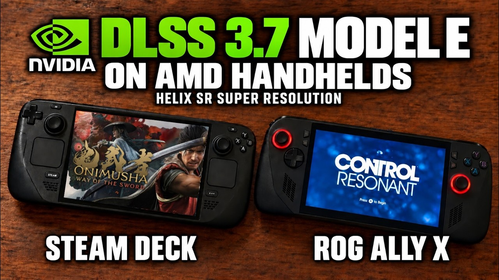

A community mod allows AMD GPU laptops to run NVIDIA's image reconstruction. It is called **HelixSR** and, in early independent measurements, scaling to 1080p costs around **7 milliseconds per frame**, compared to the **11 ms** consumed by FSR 4 under the same conditions. The figure matters because the AMD laptop park — Steam Deck, ROG Ally X, and company — still lacks official access to FSR 4.

## What HelixSR does

HelixSR is presented as a direct substitute for FSR 3.1 in games with **Direct3D 12**. The idea is to trick the game: it thinks it is calling AMD's scaler, but what it receives is DLSS image reconstruction. To achieve this, it runs NVIDIA's neural network as DirectX 12 compute shaders, so it does not need an NVIDIA driver, nor CUDA, nor ROCm. On Linux it works through Proton and vkd3d-proton.

The model used is the **Preset E** (which the developer calls «Model E»), introduced with **DLSS 3.7**. It is the last iteration of DLSS's convolutional model before NVIDIA switched to Transformer models with DLSS 4. On a laptop, that detail is not minor: the convolutional model is much lighter to run, which is exactly what a chip with such a tight wattage budget as a Steam Deck or ROG Ally X needs.

The development is signed by **lonewolf0622**, who published the project on GitHub at the beginning of October.

## Measured numbers vs FSR 4

It is worth clarifying where the figures come from: **they are community tests, not from the manufacturer**. A ResetEra user measured around **3.5 ms per frame** with HelixSR at **800p**, compared to **4.5 ms** with FSR 4, and **7 ms vs 11 ms at 1080p**, with the Steam Deck GPU at **1400 MHz**. On a **BC-250** board, *Hitman: World of Assassination* at **4K** performed **35 FPS** with DLSS Quality preset, compared to **17 FPS** with FSR 4.

The YouTuber **BlackHeart909** contributed another set of data: between **34 and 40 FPS** in *Pragmata* on Steam Deck in Performance mode, and between **35 and 40 FPS** in *CONTROL Resonant* on the ROG Ally X at **1080p**, a game that until now suffered severe ghosting. Dropping the Ally X output to **720p**, the game stayed at stable **60 FPS**.

Image quality, however, does not have a single verdict. The original author of the tests placed it slightly below FSR 4 but well above FSR 3; BlackHeart909 was more enthusiastic and suggested that in some cases it could even look better than FSR 4. The difference in cost per frame is hard to argue about; quality, for now, depends on who you ask.

## Mod status and current limits

HelixSR moves fast: within a few days of its publication, the developer released **five updates**. Among the news are a single-file installer, a **QSSM** (Quality Super-Sampled Mode) mode that renders above screen resolution to achieve cleaner edges, and a fix for the blur reported on **RDNA 3** GPUs under Windows, the same problem affecting BlackHeart909's ROG Ally X.

The limits remain there: it works **only with Direct3D 12 games**, without **Vulkan** support, and titles that do not integrate FSR 3.1 need an external tool, **OptiScaler**, to be able to hook in.

## Why it matters on AMD laptops

The context explains the interest. FSR 4 is **officially limited to RDNA 4 GPUs**, which leaves the Steam Deck's **RDNA 2** chip and **RDNA 3** laptops like the ROG Ally X anchored in an FSR 3 that still relies on temporal scaling, clearly inferior. Community solutions for forcing FSR 4 on those devices exist, but at a performance cost that a laptop chip cannot assume with demanding games.

That is where HelixSR changes the equation: it is **free** and, compared to the real alternative available today — staying on FSR 3 or carrying the overhead of FSR 4 patches — it offers more reconstructed image per millisecond. The rival to beat is not a hardware generation these machines can no longer buy, but what they already have installed. Meanwhile, the Steam Deck 2 points to **2028** according to leaker Kepler_L2, so anything that extends the current generation's lifespan has room to run. We will see if the community manages to close the quality gap against FSR 4 in upcoming revisions.
