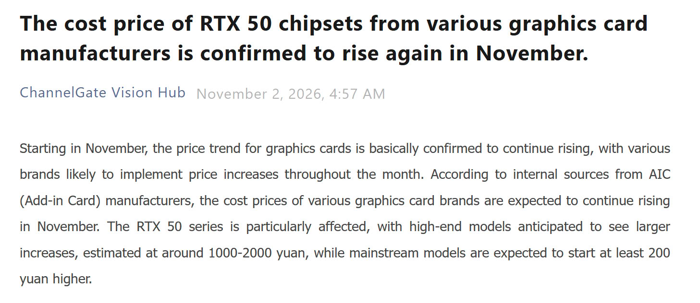
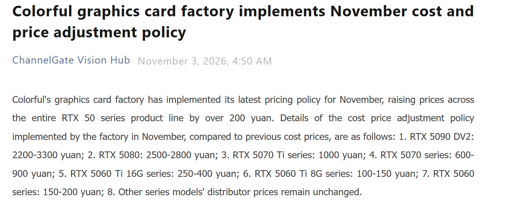
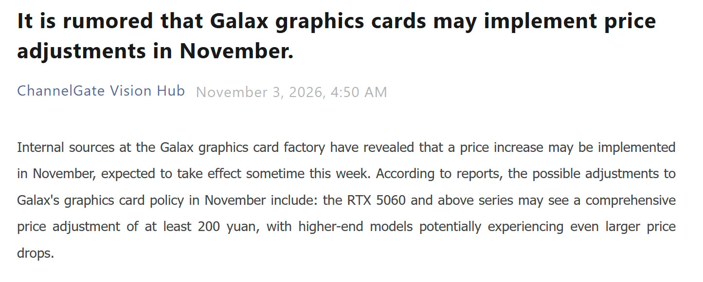

The RTX 50 is getting more expensive again, and this time the notice comes with figures per model. ChannelGate, the Chinese outlet that tracks factory channel prices for graphics cards, published on November 2 that AIC manufacturers have confirmed a cost increase for the entire RTX 50 family during this month. The list ranges from 3,300 yuan (about $500) for the RTX 5090 DV2 to 150 yuan (about $22) for the RTX 5060.

The data has a fine print that is worth reading before panicking over the highest figure: these are cost prices for distributors, not retail selling prices. Colorful has already applied its November tariff — which makes it the confirmed part of the information — and GALAX is studying a similar adjustment for this same week, according to internal sources cited by ChannelGate.

## Which RTX 50 models are rising in price and by how much

The figures in yuan are identical in both versions of the table that have circulated, from TechPowerUp and Wccftech, and match Colorful's factory notice.

| Model | Cost increase in China | Approximate equivalent |
| --- | --- | --- |
| RTX 5090 DV2 | 2,200–3,300 yuan | $329–$494 |
| RTX 5080 | 2,500–2,800 yuan | $374–$419 |
| RTX 5070 Ti | 1,000 yuan | $150 |
| RTX 5070 | 600–900 yuan | $90–$135 |
| RTX 5060 Ti 16 GB | 250–400 yuan | $37–$60 |
| RTX 5060 Ti 8 GB | 100–150 yuan | $15–$22 |
| RTX 5060 | 150–200 yuan | $22–$30 |

The column in dollars is an approximate conversion and does not match across all sources: it is the $329–$494 calculated by TechPowerUp and the $374–$419 for the RTX 5080, while Wccftech rounds to $330–$550 and $380–$450. The original amount, published by ChannelGate, is in yuan, and there is no discrepancy between media outlets there. That is why the headline of "up to $500" must be read as an order of magnitude, not as a figure that will appear on a label.

## Memory decides which model is priced higher

The distribution of the increase is not uniform and follows the pattern already seen in previous hikes earlier this year: the more VRAM a card weighs, the more it rises. The 16 GB RTX 5060 Ti takes between 250 and 400 yuan, while the same card in its 8 GB version stays at 100–150. It is double the memory, and in this table, two to almost three times more increase.

The reason cited by sources is the same one dragging on the market since early in the year: demand for memory from the AI industry strains DRAM supply, and that adds to the rising cost of raw materials like copper used in the board and cooling system. NVIDIA does not appear as the origin of the announcement: what moves is the cost passed by assemblers, not a change in recommended price.

To gauge the increase, it helps to look at what has already risen in the range. According to TechSpot's analysis collected by Profesional Review, the RTX 5090 sells in the United States for over $9,000, a 370% more than its recommended price, and the global average sits 262% above. The RTX 5080 is 120% above its MSRP in the US, the RTX 5070 Ti is 67%, and the RTX 5070 is 64%; the 16 GB RTX 5060 Ti, most hit by memory prices, has risen 84% and hovers around $800. Wccftech adds that on Newegg there are listings for RTX 5090 over $10,000 and RTX 5080 over $2,000, more than double their launch price.

The immediate increase is from NVIDIA. AMD plans its own separate increment for November, according to reports collected by TechPowerUp, and the rest of the industry — including Radeon RX 9000 and Arc — drags along with the same supply problem.

## What it means if you are going to buy a GPU in Spain

None of the consulted sources publishes prices in euros. The increase is announced in yuan on factory cost, and the tariff that reaches a Spanish store is set by each distributor with the 21% VAT added, so direct conversion does not serve to calculate what it will cost here. What can be read precisely is the calendar: the adjustment applies to the channel this week and retail prices take one or two weeks to reflect it, so stock already on shelves is the last window for previous prices.

In absolute terms, the RTX 5060 is the one that gets cheaper least, but it also defines the threshold: it is the card with which you enter the generation, and any increase in the lowest step raises the starting point to play. The opposite case is the most uncomfortable: the 16 GB RTX 5060 Ti pays precisely for the VRAM that decides how many years the card lasts with high textures, so the gap between the 8 GB version and the 16 GB one widens at the worst possible moment.

There is a detail that says quite a bit about the state of the market: according to Wccftech, some manufacturers are encouraging distributors to look at previous generations, such as the RTX 3050 and RTX 3060. They are reasonable options in price per frame, but they leave out scaling technologies and frame generation that NVIDIA has presented this year, along with much of the purchase argument for the current generation.

With that landscape, the decision is no longer to wait for it to drop. The useful comparison is price per frame between what is available in stores today — a 16 GB RTX 5060 Ti, or an RX 9070 XT which also approaches $1,000 according to Wccftech — and not against the recommended price of a generation that is no longer obtainable at that figure. This week's increase is small in itself; what makes it relevant is that it arrives on a market that had already risen between 20% and 40% in several regions in October, according to Profesional Review. For whoever has decided the purchase, the margin for waiting is closing.

Price tracking for this generation remains in the [graphics cards](/noticias/tarjetas-graficas/) section of the portal.
