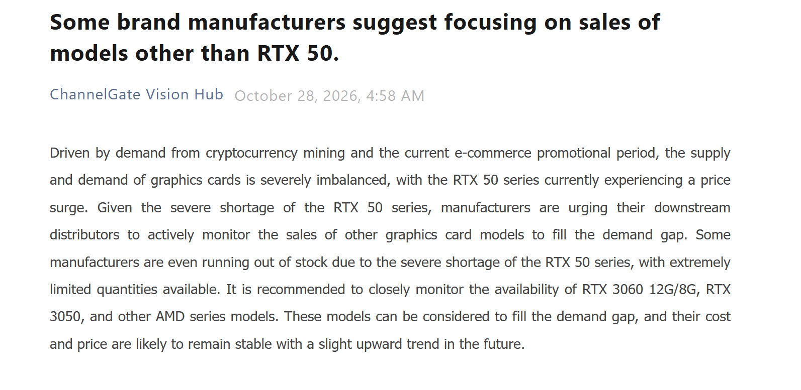

Asian graphics card manufacturers, with China as the epicenter, have begun recommending their distributors to look back at previous generations. The ChannelGate report collected by TechPowerUp, Wccftech and El Chapuzas Informático places in the center of that recommendation the **GeForce RTX 3060 in its 12 GB and 8 GB variants, the RTX 3050 and several AMD Radeon models** from previous tiers. The reason is simple: the inventory of GeForce RTX 50 has run short and there is nothing to cover demand at the entry segment.

## What the report says and where it comes from

The original document is dated October 28 and its argument does not point to a product decision by NVIDIA, but to an availability problem. According to that reading, cryptocurrency mining demand and the Chinese e-commerce promotional campaign have unbalanced supply and demand for cards, and the result is that some assemblers are left without RTX 50 units to serve. Faced with that gap, the instruction to the distribution chain is to monitor and push older models, with the warning that their cost should remain stable with a slight upward trend in the coming months.

It is worth separating two things that the headline mixes easily. One is availability: there are current-generation models that do not arrive. The other is price, and there the RTX 50s have been months away from resembling their reference rate, something already seen in the [NVIDIA denial of the RTX 5090](/noticias/tarjetas-graficas/nvidia-desmiente-rtx-5090/), where the company admitted tight supply without giving recovery figures.

## The RTX 3060 is not a relic: it's Steam's most used GPU

The detail that gives weight to the recommendation is Steam’s October 2026 hardware survey, in which the RTX 3060 regains first place. It is no coincidence: the card remained in intermittent production during the year. The 8 GB version was re-manufactured in the first quarter of 2026 and the 12 GB one was reactivated afterward, with ASUS, MSI, GALAX and Colorful receiving new chips according to El Chapuzas Informático. NVIDIA had already reintroduced the 12 GB variant in June with **3,584 CUDA cores, 12 GB of GDDR6, a 192-bit bus and Samsung’s 8 nm DUV node**, the same Ampere recipe from 2021.

In terms of performance per watt and price per frame, the RTX 3060 with 12 GB still defends itself in 1080p and reaches 1440p with moderate settings, provided it is not asked for intensive ray tracing or frame generation, which Ampere does not have. Its real advantage today is not speed: it is that 12 GB of VRAM avoids the bottlenecks that already appear in various launches with 8 GB, and that keeps it purchasable five years later. The fact that the RTX 5070 led Steam’s survey in [September](/noticias/tarjetas-graficas/rtx-5070-gpu-mas-popular-steam/) and ceded the spot a month later describes well the moment of the market.

## What it implies if you want to buy a GPU now

Availability may improve, but not cheapen. The report itself points to stable or rising prices, and the context supports it: GDDR6 has risen up to 10% and PCBs have become abruptly more expensive in the last quarter, according to El Chapuzas Informático analysis. That half estimates the result as an RTX 3060 sold in 2026 at double or triple its original price, and adds that AMD is preparing its third price hike in four months. With that panorama, the practical decision for the reader is less exciting than it seems:

- **If budget rules and the goal is 1080p**, an RTX 3060 with 12 GB remains a rational purchase, but only at a price that does not bring it close to an RTX 5060. Above that threshold, the new generation wins on efficiency and support for current technologies.
- **If an RTX 3050 appears**, it is advisable to look at VRAM before the model name: 8 GB already falls short in various current games.
- **If you can wait**, documented scarcity is not a good time to buy out of urgency. Waiting a quarter with normal inventory usually comes out better than paying the scarcity premium.

The paradox of the quarter is that the card returning to stores is one the market already had. Samsung’s 8 nm silicon remains available and the cost that truly weighs in this segment is not the GPU, but the accompanying GDDR6 memory, as El Chapuzas Informático analysis points out. Recovering Ampere is cheap for the manufacturer; for the buyer, the question remains the same as always: how many frames per euro, and at what resolution.
