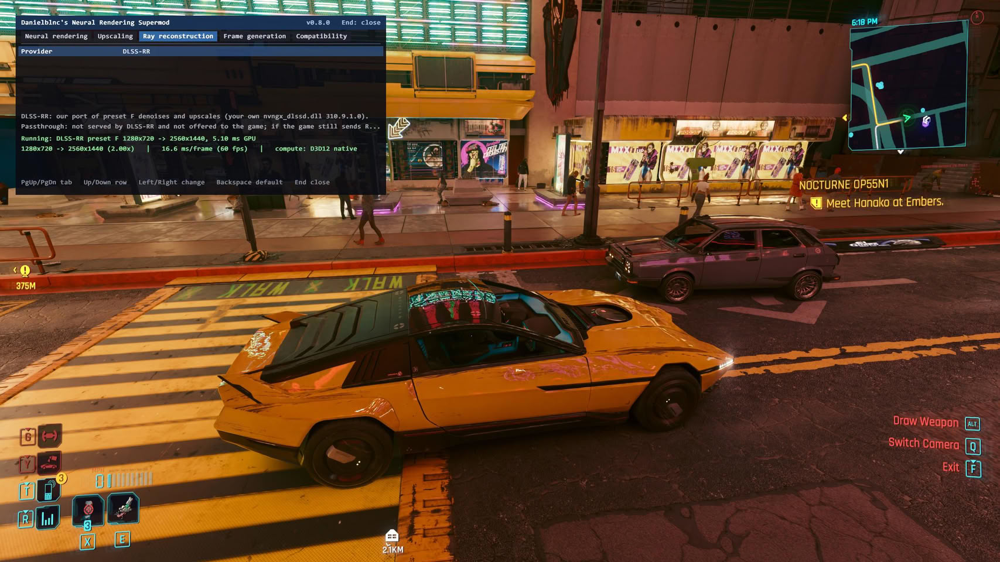

The Alpha 0.8.0 of the DLSS-NR on AMD mod, published on October 17 by developer Daniel Blanco, brings together almost the entire catalog of DLSS features for Radeon GPUs. The version adds Super Resolution 4.5, Ray Reconstruction and Frame Generation —with up to 4x multi-frame generation— to a project that in September had only managed to launch DLSS 5 Neural Rendering on AMD cards.

## Almost the entire DLSS stack, without a translation layer

According to the developer, the mod does not function as a translation layer: it re-implements DLSS runtimes from scratch with its own HIP kernels. The user provides their own NVIDIA DLLs; the software handles the rest. The split by architecture is as follows: RDNA 4 and RDNA 3 receive the full set of features, while RDNA 2 remains in an experimental phase and limited to Neural Rendering.

The list for Alpha 0.8.0 includes DLSS Super Resolution 4.5 (M and L models), Ray Reconstruction (F model) and Frame Generation with up to 4x multi-frame generation in games that expose the DLSS FG inputs. Additionally, the mod packages FSR 4.1.1, so scaling no longer depends on the installed driver. Installation is managed by the new NeuralHub manager, which detects games and centralizes files instead of distributing them in each folder.

## The declared goal: the RTX 5070 Ti

The developer claims that DLSS 5 Neural Rendering delivers around 90-100 FPS at 1080p on an RX 9070 XT, with the ambition of matching an RTX 5070 Ti. These are figures from the mod author himself, not independent measurements.

With Ray Reconstruction, the first results are disparate. A Reddit user reported that there was no performance loss in Cyberpunk 2077 with path tracing at 1440p on an RX 9070 XT; others, however, observed drops of up to 25%. The mod runs only on DirectX 12 games under Windows 11, and anti-cheat software blocks it: the recommendation is to stick to single-player titles.

## What changes for the Radeon user

For day-to-day use, the official route remains FSR: the RX 9070 XT itself already has FSR 4 via driver, and this same Alpha 0.8.0 packages FSR 4.1.1 within the mod. What the project demonstrates is different: that DLSS neural rendering is not tied to NVIDIA silicon, in line with other open-source approaches that have already brought DLSS 5 to [Vulkan and the browser](/noticias/dlss-5-reimplementacion-vulkan-open-source/) or the neural rendering experiments on the [RX 9000 with OptiScaler](/noticias/amd-renderizado-neuronal-rx-9000/). The alpha is experimental, with no support from NVIDIA or AMD, and its value today lies in what it anticipates rather than what it replaces.
