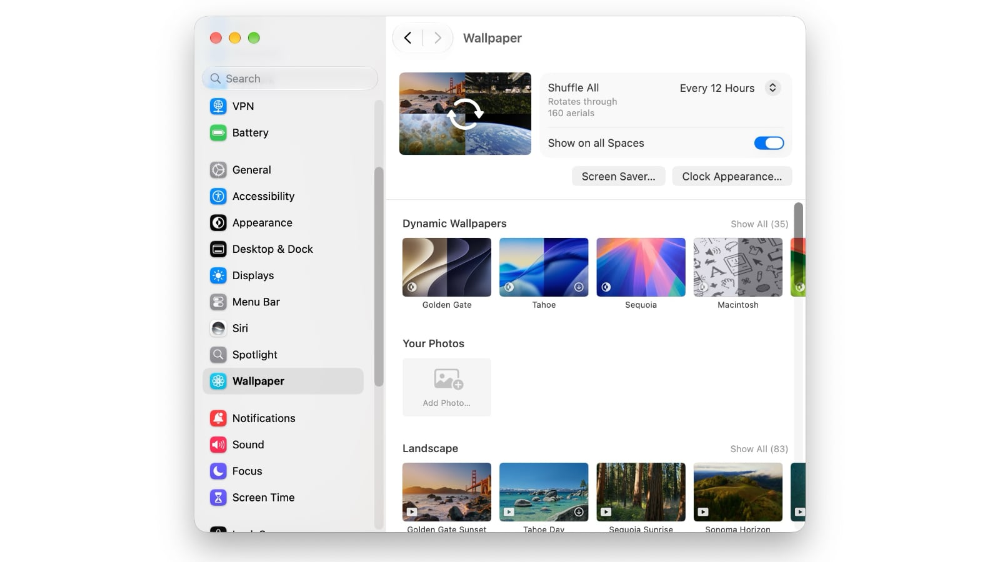

Aerials screen savers turn a Mac into a continuous video piece: landscapes, cities, underwater scenes and shots from space that move while the machine is idle. This guide explains how to enable them on macOS and how to tune them so that, on top of that, the image stays as the desktop wallpaper when the Mac is unlocked. It is meant for anyone with a desktop monitor in view, or who wants to give another use to a Mac that sits idle for long stretches.

## Requirements

Aerials arrived with macOS 14 Sonoma, so you need that version or a later one. Nothing has to be downloaded separately or paid for: it is part of the system and is configured from the macOS settings. The original article is up to date for macOS 27 Golden Gate.

As for hardware, Sonoma supports the iMac (2019 or later), iMac Pro (2017), MacBook Air (2018 or later), MacBook Pro (2018 or later), Mac mini (2018 or later), Mac Pro (2019 or later) and every Mac Studio model. If your machine supports a newer version, upgrading is still worthwhile.

## Steps to enable Aerials

### 1. Check your macOS version

Open the Apple menu in the top-left corner and go to **About This Mac**. If it says macOS 14 or later, you already have Aerials. If not, go to **System Settings > General > Software Update** to update. On older macOS versions that path appears as **System Preferences > Software Update**.

### 2. Set when the display turns off

Open **System Settings** and, in the sidebar, go to **Lock Screen**. At the top there are two **Turn display off** dropdown menus. Pick the time you prefer in both. The longer the first one, the more battery it drains; the second decides how long the screen stays on while the screen saver is running, at the cost of somewhat higher power use.

### 3. Open the Wallpaper panel

In the Settings sidebar, click **Wallpaper**. If you are still on macOS Sonoma, the path is **Settings > Screen Saver**.

### 4. Choose a scene or the random mode

Scroll through the list and select a specific scene from the four categories: **Landscape** (for example, Golden Gate Sunset or Tahoe Day), **Cityscape** (Dubai Skyline, Los Angeles Overpass), **Underwater** (Alaskan Jellies Light, California Dolphin Pod) and **Earth** (shots from space such as Middle East or North Africa). If you do not want to commit to a single one, go into **Shuffle Aerials**: you can alternate between the four categories or choose **Shuffle All** to rotate through every available set, 160 at the time the original was written. The Mac downloads new ones from time to time, and you can also decide how often they change.

### 5. Define when it starts and how it is used as wallpaper

Click the **Screen Saver…** button to choose how quickly the screen saver starts when the Mac goes idle. On that same screen you will see **Use Screen Saver**, with two options: **Automatic** and **Custom**. Automatic is the recommended one: when you unlock the Mac, the screen saver in progress stops little by little and becomes the desktop wallpaper; when the machine goes idle again, the windows disappear and playback continues where it left off. With Custom, on the other hand, the wallpaper stays on a different image.

### 6. Adjust the clock

The **Clock Appearance…** button lets you change the typeface shown on the lock screen and the screen saver, or make the clock never appear. The original advises against the **On Screen Saver and Lock Screen** option because it covers the Aerials views.

### 7. Extend the screen saver to every space

A final switch lets you show the screen saver on every space on the Mac, the additional desktops used to organize work.

## How to verify it worked

Leave the Mac without touching the keyboard or mouse until the screen saver activates: the chosen scene or the Shuffle rotation should appear. Then unlock the machine. With **Use Screen Saver** set to Automatic, the image will stop and become the desktop wallpaper. If you leave the Mac idle again, the windows will hide and the screen saver will resume playback. If the clock does not appear on either surface, check that in **Clock Appearance** you have not chosen the option that hides it.

## Limitations and caveats

- On LCD screens the screen saver no longer serves a practical purpose: it is there to decorate, not to protect the panel. Its usefulness could return with OLED panels, where burn-in is a real risk; the original notes that Apple could bring OLED to the MacBook Pro.
- Keeping the screen on longer with Aerials uses more battery and somewhat more electricity. Adjust the two **Turn display off** menus to how the machine is used.
- The path changes by version: on macOS Sonoma the panel is under **Settings > Screen Saver** and not Wallpaper.
- The screen saver is limited to hardware compatible with macOS 14 or later; it is not a separate app that can be installed on older machines.
- If you choose Custom, the desktop wallpaper will not be the screen saver image.

If you want to keep tweaking the system, the guide to [using Notify Me in Safari with macOS 27](/noticias/safari-notify-me-macos-27/) walks through another change in the same version, step by step.
