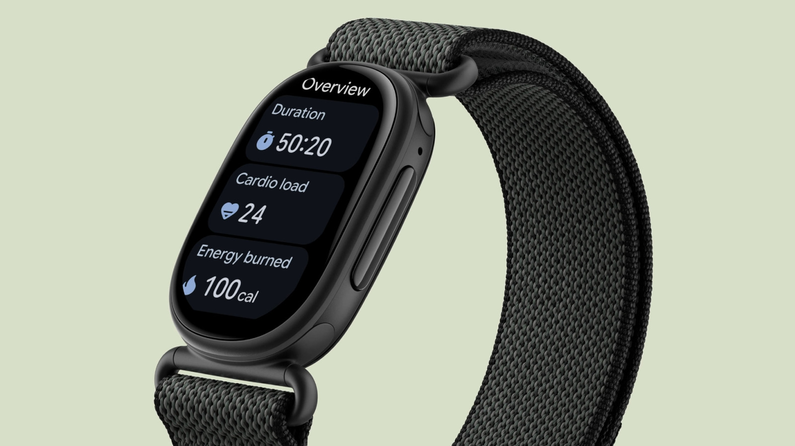
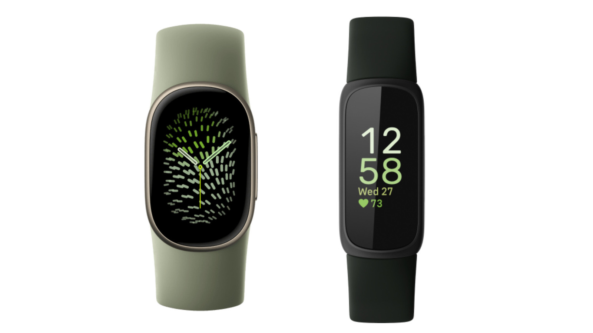
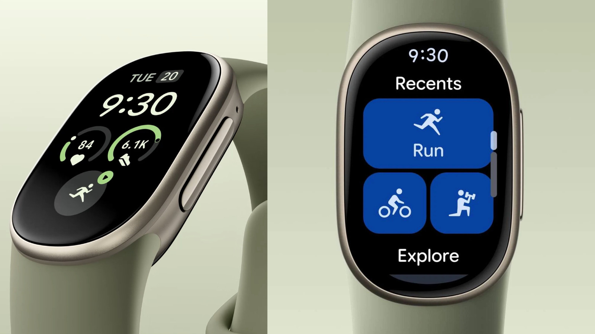

The [Fitbit Edge](/noticias/wearables/fitbit-edge-lanzamiento-oficial/) is the tracker with which Google wants to fill the gap between an activity band and a full smartwatch. The Fitbit Inspire 3 is the budget alternative that stays in the catalog. The price gap is clear: **$180** versus **$99.95**, 44% less. The question is whether that difference translates into something the user actually notices day to day.

## Two prices and two approaches

The Edge sells for $180, with a Stephen Curry orange edition that climbs to $220, $40 more than the base model. The Inspire 3 stays at $99.95. Both use an AMOLED screen, but the rest of the spec sheet marks out two products with different priorities: the Edge bets on sensors and independence from the phone; the Inspire 3, on price and battery life.

## Screen and build: aluminum versus plastic

The Edge's screen is 6.9 mm (0.27 inches) wider than the Inspire 3's. The dimensions are similar elsewhere: 39.2 x 25.5 x 11.5 mm on the Edge versus 39.32 x 18.6 x 11.75 mm on the Inspire 3.

The Edge's case is 100% recycled aluminum and its side button feels more tactile. It is available in olive green, black, white and coral peach, plus the Curry edition in orange. The Inspire 3 is more rectangular and relies on plastic, with three colors: pink, orange and black.

## GPS, Bluetooth and use without the phone

Here is one of the differences that weighs most. The Edge has built-in GPS and, according to Google, improves location accuracy by 40%. That lets you go for a run without carrying the phone. It also adds Bluetooth 5.4 to connect wireless headphones directly to the watch.

Both support Find My Device and app notifications when the phone is nearby. The Edge adds quick replies, music controls and weather forecasts, and is expected to add Maps soon. The Inspire 3 does not offer those functions, although it does show calendar notifications on screen.

## Sensors and health data: where the real leap is

The Edge tracks heart rate continuously and adds an ECG app with atrial fibrillation detection. It also offers monthly reports on blood pressure and insulin resistance, and can analyze glucose data the user logs on their own.

The Inspire 3 stays at the basics: optical heart rate monitor, blood oxygen and accelerometer. The Edge adds to that the ECG sensor, skin temperature, a gyroscope and an altimeter that help calculate position and elevation gain more accurately.

In physical activity, the Edge automatically detects 100 types of movement and supports more than 50 exercise modes; the Inspire 3 stays at 20. The new model also adds cardio load, target cardio load, floors climbed and heart rate while using gym machines.

## Battery life and water resistance

The Edge lasts up to a week per charge; the Inspire 3 reaches 10 days. The difference exists, but for someone who already charges the watch a couple of times a week it does not change the routine.

On water resistance they tie at 5 ATM under the ISO 22810:2010 standard: they withstand rain, showers and swimming in shallow water, but they are not designed for diving. The Edge adds IP68 certification against dust, something the Inspire 3 does not declare.

## Which to buy: Fitbit Edge or Inspire 3 depending on your profile

**Choose the Fitbit Edge** if you run or walk without the phone, want built-in GPS and are interested in the ECG with atrial fibrillation alerts. It also makes sense if you value the materials, the firmer button and features such as quick replies, music or the future Maps integration. It is the middle option for anyone who does not need a full smartwatch and prefers not to pay the price of a Pixel Watch.

**Choose the Inspire 3** if the goal is counting steps, sleep and heart rate without complications. It costs about $80 less, lasts three days longer per charge and still offers an AMOLED screen, blood oxygen and calendar notifications. For anyone who does not train outdoors or need an ECG, the jump to the Edge adds nothing they will use.

## What each one loses and when the upgrade is not worth it

The Inspire 3 loses GPS, ECG, temperature sensor, altimeter, gyroscope, premium materials and almost all smartwatch functions. In exchange, it gains $80 in savings and three days of battery. The Edge, for its part, loses those three days of autonomy and costs 44% more. Nor does it become a full smartwatch: Engadget places it below those that allow calls on their own, so anyone looking for total independence from the phone will have to look at another segment.

The upgrade is not worth it if you already own an Inspire 3 and only use it for sleep and steps, or if you charge the watch every few days without battery being a problem. Nor if the ECG is not going to change any health decision: it is worth remembering that these readings are indicative and do not replace a medical test. For everyone else, the Edge is the most sensible upgrade within Google's range.
