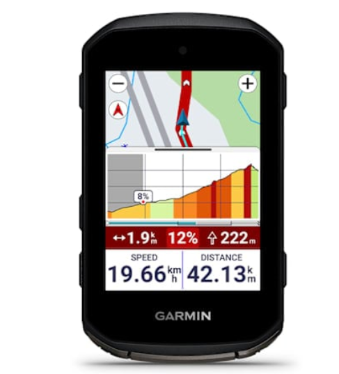
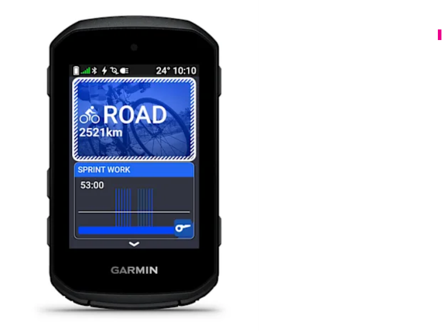

The Garmin Edge range currently has three bright-screen models on sale, at very different ages: the Edge 1060 arrived on 20 October 2026 as the first unit of the x60 generation, while the Edge 850 and the Edge 550 launched in September 2025 and belong to the x50 generation. The practical consequence is that all three share the same training core — ClimbPro, Power Guide, Course Demands, Cycling Ability, real-time stamina and Smart Fueling — so the extra money does not buy sports analysis. It buys screen, battery life, interface and extras.

## The three options in one line

- **Edge 1060** — €799.99 / $799.99 / £699.99. x60 generation, the most recent.
- **Edge 850** — €549.99 / $599.99 / £469.99. x50 generation.
- **Edge 550** — €449.99 / $499.99 / £379.99. x50 generation.

These are the launch prices reported by the original comparison; in Spain the euro price applies. Between the 1060 and the 850 there is a €250 difference, and between the 1060 and the 550, €350.

## What all three already do the same

Before looking upwards it is worth knowing what you do not lose by dropping down the range. All three calculate the difficulty of a climb with ClimbPro, set the pace with Power Guide, gather Course Demands and Cycling Ability, show real-time stamina and tell you when to eat with Smart Fueling. All three carry GroupRide with live location and incident alerts, multi-band GNSS, compatibility with the Varia radar and lights, incident detection and phone notifications on screen.

## What the Edge 1060 adds and what justifies the premium

The 1060 is the only one you can talk to. A microphone next to the speaker lets you ask for a route change, look up a number or report a pothole without letting go of the handlebar, and Garmin Messenger messages are read aloud with spoken replies. On top of that come four things neither of the other two has:

- **A 3.5-inch, 480 × 800 screen** against the 2.7-inch, 420 × 600 panel on the 850 and the 550.
- **Up to 20 hours of demanding use** (60 in battery-saver mode) against 12 (36 in saver).
- **Reverse charging** to top up a Varia light or your phone.
- **Expanded navigation**: it compares several routes to a destination before you set off, anticipates reported traffic and hazards, finds the shortest training loop with the fewest stops, accepts a point marked in Apple Maps as a destination and detects an active GroupRide nearby to offer joining without sharing a code. It also uploads TrainingPeaks plans to the device without a manual send.

The price of all that is not only monetary: the 1060 weighs 142 g and measures 107 mm long, 29 g and 15 mm more than the 850. On a road bike that difference decides whether the unit fits within the length of the stem.

## Garmin Edge 850 vs Edge 550: the same machine with another interface

The 550 is the 850 without a touchscreen, without a speaker and without Garmin Pay. It shares the screen, battery, sensors and training features, but the cuts go beyond those three headlines: storage drops to 32 GB against 64 GB, the pre-installed maps cover one region instead of two, and it cannot search for an address or create an out-and-back route on the device, so a new route means stopping and using your phone. The price difference is €100 and £90.

The real problem with the 550 is how you operate it. The menus of this generation were designed for a touchscreen, and the buttons-only version feels like an afterthought: an action that is a single tap on the 850 becomes a sequence of presses, and the layout still looks like a touchscreen with the touch taken away. That is the strongest argument for paying for the 850. The weight difference between the two — 110 g against 113 g — is irrelevant.

## Verdict by profile

- **Edge 1060.** For anyone who wants the biggest screen, the longest battery life among the bright-screen models and voice control. Also for anyone who does not want to buy a model that is replaced next year.
- **Edge 850.** The right choice for most road cyclists: the same training software, a body that fits within the stem and 12 hours that are enough if you charge after every ride. You give up the microphone, reverse charging and eight hours of battery.
- **Edge 550.** Only if you set up your data screens once and then simply ride, with gloves on in winter and without navigating to new places. Anyone who changes settings or navigates often will find the buttons-only menus heavy going.

## What does not change and what each one still lacks

None of the three charges by solar power: that is left to the Edge 1040 Solar, which remains on sale as the solar flagship with 45 hours of demanding use, 100 in saver mode and a dimmer MIP screen. The 850 and the 550 go without a microphone and without reverse charging. The 12 hours of battery life cover most rides, but not a long sportive with navigation active; the 1060's 20 hours do cover any single-day event.

There is also a calendar question. Following the two-year cycle Garmin has kept since the 1040, the 850 and the 550 should be replaced in 2027 by an 860 and a 560, so buying today means buying the last year of that generation at full price. Garmin has confirmed that part of the new software will arrive by update to the 850 and the 550, but not voice, which depends on the microphone.

## Before you pay: three checks

1. **Measure the stem length.** The 850 is 15 mm shorter than the 1060; on a road bike that separates a unit that fits from one that sticks out.
2. **Count the map regions you need.** The 550 includes one and does not allow address search on the device; the 850 and the 1060 include two and can.
3. **Confirm the generation.** x60 for the 1060, x50 for the 850 and the 550: it sets which software updates you can expect and for how long.

If the doubt is between the 850 and the 550, the question is not what hardware you need but how much you are going to touch the menu. And if the budget is tight, it is worth checking the street price before deciding: the three figures in this guide are launch prices.
