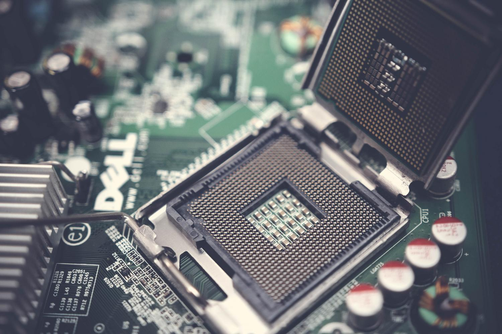
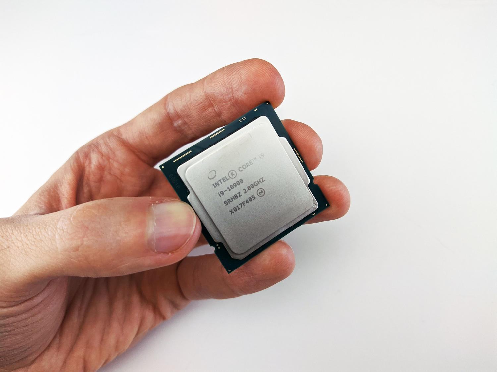
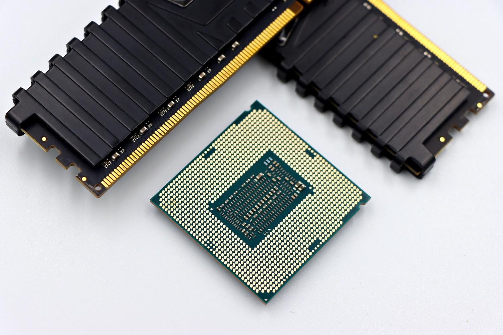

Choosing the processor is the decision that most conditions a PC's useful life, because it is the hardest piece to replace once the motherboard socket is set. This guide is for anyone building a system, buying a laptop, or upgrading their own, and wants to understand what to look at before spending money: cores, frequency, tier, and compatibility.

It's worth clarifying from the start: the CPU doesn't go alone. A powerful processor performs below expectations if the rest of the system isn't up to scratch, so the goal isn't the most expensive chip, but a balanced ensemble.

## Prerequisites

- Know the main use case for the machine: office work, gaming, editing, or professional work.
- Know your motherboard, especially its socket, if you're upgrading instead of building from scratch.
- Set a budget. The quality-price ratio is usually found in the mid-range tier.

## Step 1: Understand what the processor does and how it connects

The CPU, or Central Processing Unit, directs all tasks on the machine: it executes program instructions and transforms them into useful information. It's the chip that processes every click, every keystroke, and every calculation.

It installs on the motherboard in a space called a **socket**, the slot where the chip fits. That socket being compatible is vital: Intel Core processors usually use sockets like 1151 or LGA 1700, while AMD Ryzen chips use AM4 or AM5.

Inside the chip are three fundamental pieces: the **control unit**, which manages signals and organizes device responses; the **ALU (Arithmetic Logic Unit)**, in charge of mathematical and logical calculations; and the **memory unit**, where immediate data is stored.

## Step 2: Learn to read cores, threads, and frequency

A **core** is, in essence, an independent processor inside the chip: the more it has, the more real tasks it can process at once. **Threads**, for their part, are virtual lanes that optimize efficiency. Thanks to technologies like Intel's Hyper-Threading or AMD's SMT, a single core can manage two threads, improving multitasking even if it doesn't double raw power.

Speed is measured in gigahertz (GHz), which indicate processing cycles per second. It's worth distinguishing between **base frequency**, the guaranteed speed, and **turbo frequency**, the peak maximum the processor reaches when it needs an extra burst of power and temperature allows it.

Here come cooling and **TDP** (Thermal Design Power). If the processor overheats excessively, it lowers its speed to avoid damage: that's the phenomenon known as thermal throttling.

## Step 3: Choose your tier according to your use case

The most practical way not to get lost among models is to divide them by tiers:

- **Entry-tier**: Intel Celeron and Pentium, or AMD Athlon. Simple chips for browsing, using word processors, or watching series; they fall short on demanding tasks.
- **Mid-tier**: Intel Core i5 and AMD Ryzen 5. Versatile, designed for daily use, multitasking, and occasional gaming. This is where most people should move.
- **High-end**: Intel Core i7 and i9, or Ryzen 7 and 9. Designed for graphic design, 4K video editing, streaming, or professional gaming.
- **Servers and workstations**: Intel Xeon or AMD EPYC. Not for a common user, but for companies that need the machine running 24/7 processing large volumes of data.

## Step 4: Decide between Intel and AMD based on what you prioritize

Choosing between the two brands depends on what you're looking for. Intel has traditionally been the option for those who want **maximum single-core power** and solid gaming performance; its modern hybrid architectures combine performance (P) cores and efficiency (E) cores to optimize consumption. AMD has made a strong statement with the Ryzen series, offering **more cores at a more competitive price** and attractive thermal efficiency.

In pure gaming, AMD has innovated with **V-Cache 3D** technology (as in the Ryzen 7 9800X3D), which adds a massive amount of cache memory to boost FPS. Intel remains a benchmark for **multi-core performance** for professional work, though AMD has closed the gap with its high-end models.

Don't confuse the CPU with the **GPU (Graphics Processing Unit)**, specialized in mass calculations for rendering images. Some CPUs include integrated graphics and allow using the PC without a dedicated card; in AMD those chips are called **APUs** and are a good option for budget machines or Mini-PCs where a graphics card doesn't fit.

As for internal design, two architectures dominate: **x86-64**, standard on Windows and Linux due to its power, and **ARM**, queen of energy efficiency, used by mobile devices and Apple's chips (M1, M2, M3). The latter is what allows a laptop to last much longer on a single battery charge.

## How to verify you've made the right choice

Before going through checkout, answer three questions: what use will you give it, what's your budget, and is the chip compatible with your motherboard and your RAM.

A high-end CPU can be bottlenecked if the machine has little RAM or a slow mechanical hard drive. The ultimate test isn't the processor's price, but balance: whether the chip matches the real use case you'll give it — not the other way around.

## Warnings and limitations

- The CPU choice defines the computer's useful life: it's the hardest component to upgrade once the socket is set, so don't treat it as a minor expense.
- The jump to **DDR5** memory offers more bandwidth, but DDR4 remains a viable and cheap option for tight budgets. Check what your platform supports before deciding.
- Cooling matters: a powerful chip with insufficient dissipation will eventually lower its speed via thermal throttling.
- If you only want to browse and use lightweight programs, don't overpay for a high-end tier you won't make use of.
