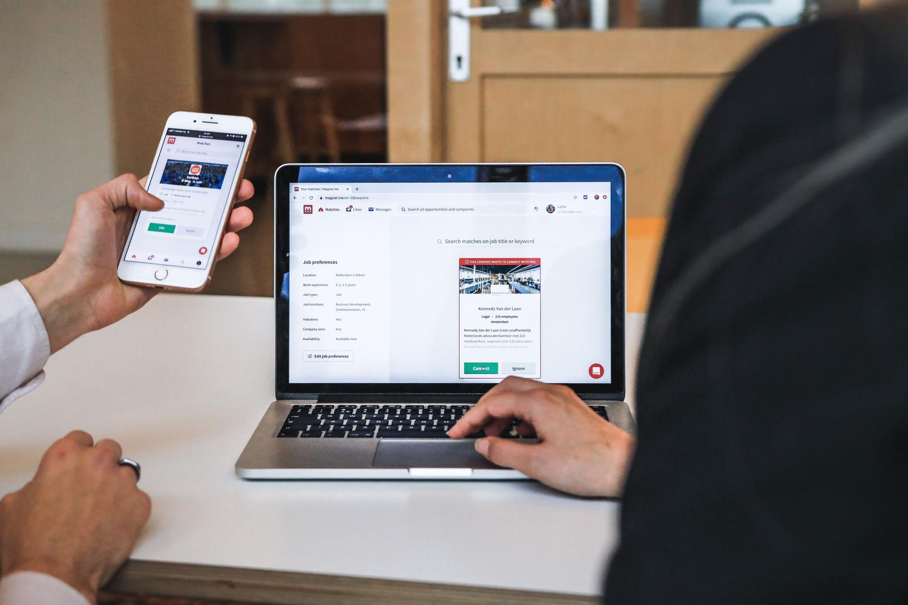
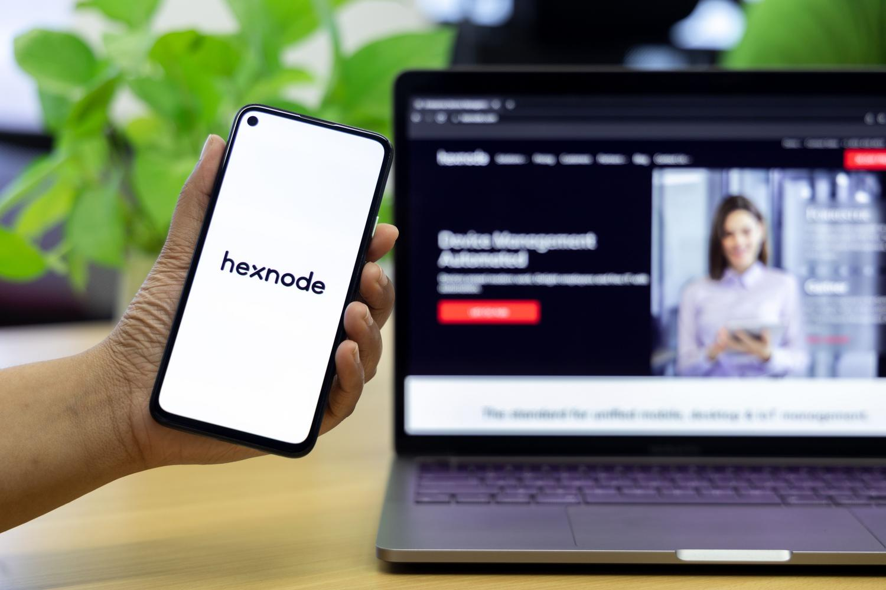

Changing computers or getting a new phone shouldn't force you to re-save useful web pages or rewrite the same passwords over and over. Linking your personal Google account in Chrome solves exactly that: once sync is enabled, the browser stops being a tool that stores data only on the local disk and instead replicates information encrypted in the cloud, so your preferences and logins follow you wherever you sign in.

This guide is for any Windows, macOS, or Linux user who wants to stop manually dragging data between devices. By the way, if you're interested in the Chrome ecosystem at a deeper level, you can also [convert an old Windows PC into a Chromebook with ChromeOS Flex](/noticias/windows-pc-to-chromebook/).

## Prerequisites

- An **active Google account**.
- **Chrome updated** to the latest version. If the browser is outdated, some sync options may not appear or may error out: force an update from the Help menu before proceeding.
- The **mobile phone in hand**. For security, Google may ask for two-step verification when detecting that you're signing in from a new device; this is confirmed via your mobile phone within seconds.

The menu structure is practically identical across all three systems, so these steps work on Windows, macOS, and Linux alike.

## How to Enable Sync Step by Step

1. **Open the profile menu.** Click the **Profile** icon in the top-right corner of Chrome.

2. **Sign in with your Google account.** Select the option **Enable sync** and enter your email address and password.

3. **Complete security verification.** If the system asks for it, confirm access via your mobile phone.

4. **Accept terms and choose scope.** You can sync all data or customize the selection—for example, sync bookmarks but not history.

5. **Check account status.** In the settings menu, the status should appear correctly as **synced**.

## How to Customize What Data Is Stored in the Cloud

If you decide later to change which data is synced, there's no need to sign out: go to **Sync and Google Services** and adjust categories to your liking.

## How to Verify It Worked

After accepting the terms, return to Chrome's settings menu and confirm that the account status shows as **synced**. Once confirmed, bookmarks, passwords, and history are replicated encrypted in the cloud: an unexpected format or loss of a device no longer erases your browsing trail.

## Benefits of Having Your Account Linked

- The **built-in password manager** fills out forms and only auto-completes data on the correct domain, protecting you from fraudulent websites.
- You can **check open tabs** on the mobile phone from the computer and vice versa—useful for not losing your thread while reading or shopping.
- If you lose your laptop or phone, you can **sign out remotely** from your Google account settings so no one accesses your private information.

## Chrome Profiles to Separate Personal and Professional Use

When the device is shared—partner, children, or coworkers—independent Chrome profiles prevent work sessions from interfering with leisure ones: each profile functions like a separate browser, with its own bookmarks, extensions, and cookies.

1. Go to the profile icon.
2. Select **Add profile**.
3. Customize it with a name, photo, and distinctive color for instant identification.

If someone needs to use your device briefly, **Guest Mode** is the recommended option: it creates a temporary window that is completely wiped upon closing, leaving no trace of browsing activity.

## Troubleshooting Common Issues

If you see a notice that sync has stopped, don't panic: it's usually something simple to fix.

- **You changed your Google account password.** Click the alert and enter the new key.
- **You've run out of storage space in your account.** Free up data or disable secondary categories.
- **An antivirus or security software blocks the connection** with Google servers. Add Chrome as an exception in your security program.
- **None of the above works.** Sign out completely and sign back in to refresh the connection with the servers.

## How to Disable Sync

If you decide you no longer want to sync your data, disable the feature from the profile menu. Note that although you **disable sync**, you'll still see your bookmarks and passwords on that device, but changes you make will no longer replicate across other devices or be saved in the cloud.

For those who want to erase all traces of their synced information from Google's servers, there is a specific option at `chrome.google.com/sync`, from which data deletion can be executed.

## Warnings and Limitations

- Enable sync only on **your own devices** and avoid it on public computers to protect your privacy.
- Disabling sync **does not delete local data**: the device retains bookmarks and passwords, but stops replicating them and saving them in the cloud. Deletion from servers is a separate action, at `chrome.google.com/sync`.
- The entire process depends on an active Google account and an updated browser; without those two conditions, sync options may not appear or may fail.
