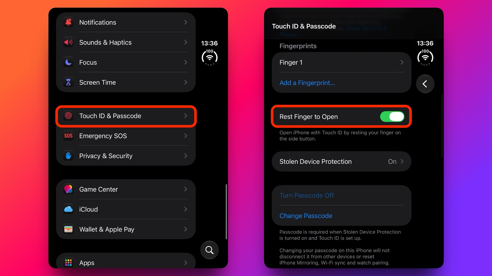

The **iPhone Duo can open the phone with Touch ID without swiping up** once it recognises the fingerprint. To do that you have to turn on **Rest Finger to Open**, an option that removes that second gesture. This guide follows the procedure described by MacRumors: it is aimed at people who already use the side button reader and would rather go straight in, instead of staying on the lock screen after identifying themselves.

## Requirements before changing Touch ID

The procedure starts from an **iPhone Duo with Touch ID already set up**. According to the source, this model uses a fingerprint reader built into the side button rather than Face ID. The original guide assumes the fingerprint was registered during initial setup; there are no instructions here for enrolling one.

It also helps to have the phone passcode at hand: one of the routes to the switch asks for it. To use direct opening afterwards, **the screen has to be on**; that is the state MacRumors specifies.

The menu names below are kept **in English, exactly as they appear in the source and its screenshots**. They are not a verified translation of the Spanish interface. If the phone shows other names and the option cannot be identified with confidence, do not flip switches by guesswork.

## How to turn on direct opening on the iPhone Duo

### 1. Open the Settings app

Go into **Settings**, the name the original guide uses for the iPhone settings app. From there you reach both documented locations of the same setting.

### 2. Enter Touch ID & Passcode

Select **Touch ID & Passcode**. Enter the device passcode when prompted to get into this menu. This is the route shown in the MacRumors screenshot.

### 3. Turn on Rest Finger to Open

Find **Rest Finger to Open** and turn its switch on. The explanation underneath says it lets you open the iPhone with Touch ID by resting your finger on the side button. That description helps tell the option apart from other fingerprint-related controls.

### Alternative route: the Accessibility menu

MacRumors documents a second location: **Settings → Accessibility → Side Button**. **Rest Finger to Open** also appears there, with the same explanation about resting your finger on the side button.

These are **two ways into the same setting**, not two features to enable separately. Using one of the routes is enough; there is no need to repeat the procedure in both.

## How to check that it worked

With the lock screen on, rest the finger you use for Touch ID on the side button. The expected result is that the phone opens after recognising the fingerprint **without asking for a swipe up**. That is the change to check, not a change in how you identify yourself.

If a swipe is still needed, check that the switch is on and that you are testing with the screen awake. The source offers no further procedure for fingerprint recognition failures, so this guide does not suggest security changes or resets.

## How to undo the change and what its limits are

To get the previous behaviour back, return to one of the routes above and **turn Rest Finger to Open off**. After fingerprint authentication you will have to swipe up from the bottom of the lock screen again to get in.

The option removes a gesture, but it **does not remove Touch ID authentication**. Nor should this procedure be extended to models with Face ID: the original tutorial is about the iPhone Duo and its side reader. No hands-on test of the device was carried out; the steps come from the MacRumors guide.

For another customisation of that screen, we also have our guide on [how to restore the volume bar on the iPhone lock screen](/en/news/restore-volume-bar-iphone-lock-screen/).
