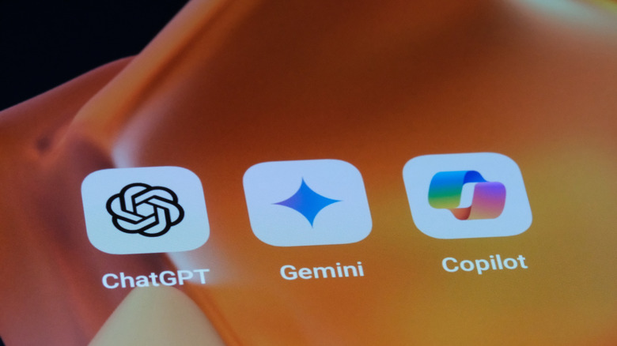

# How to Use SynthID Detector to Check If an Image Is AI-Generated

More and more images, videos and audio generated by AI are circulating, and it's useful to be able to check whether a specific file was made by a person or a model. SynthID Detector is the website Google made its detection system accessible through: you upload a file and the tool tells you if it carries the watermark that SynthID adds to what Google's AI generates. This guide explains how to use it step by step, what's needed before starting and what its response doesn't resolve.

## Prerequisites

- A browser with an internet connection.
- A Google, OpenAI or Apple account: the tool requires logging in to be able to use it.
- The file you want to check, whether it's an image, a video or an audio file.
- Usage quota: around 10 checks per day, according to Engadget, citing a Google spokesperson who spoke with Ars Technica.

## Steps

### 1. Open SynthID.com

The tool is called SynthID Detector and opens from the address `synthid.com`.

### 2. Log in with a Google, OpenAI or Apple account

SynthID Detector only works with an active session and accepts any of those three accounts. Without identifying yourself, you can't proceed to the check.

### 3. Upload the image, video or audio file

Select the file you want to check and upload it to the website. The process is the same whether it's an image, a video or an audio file.

### 4. Wait for Google's response

The procedure takes a few seconds. SynthID Detector scans the file for the watermark and returns the result as soon as it has it.

### 5. Read the result

The answer is yes or no: the tool indicates whether it found the watermark or not. There's no score or intermediate report.

## How SynthID Detector Works

Since 2023, SynthID incorporates an imperceptible tag into AI-generated content. The Gemini model leaves that mark on everything it creates, and SynthID Detector simply looks for it: that's why its response only confirms whether the mark is present or not. By limiting itself to detecting a pre-existing watermark instead of analyzing suspicious patterns in the file, the tool avoids false positives.

On this site we've already worked with that model in practice; a good example is [this guide to converting YouTube videos into a study guide with Gemini Notebook](/noticias/gemini-notebook-youtube-study-guide/).

The check doesn't stop at Google. The detector also looks for marks left by SynthID partners, so it can identify content created with models from OpenAI, NVIDIA or Kakao in addition to those from Gemini. Apple is also part of the program, although support for detecting its creations is still in development.

*Image: Robert Way/Getty Images.*

Google also states that SynthID signatures persist even after the content is edited following generation.

## How to Verify It Worked

- If you receive a response in a few seconds, the check completed normally.
- Run a control test with a known source file: Gemini creates everything with a SynthID mark from the moment of generation, so an image output from that model should return an affirmative response.
- Verify you uploaded the correct file: the response refers only to that specific file.

## Warnings and Limitations

- **Only detects SynthID marks.** The detector doesn't analyze the file; it only looks for the mark, so anything generated by a model without it goes unnoticed. Meta's tools don't use SynthID and fall outside its scope.
- **A negative result proves nothing.** It simply means no mark was found: it doesn't turn the file into proof of human authorship.
- **It doesn't say which part is AI-generated.** The detector only reports whether the mark exists, without indicating which fragments of the file were generated.
- **Mandatory session and daily quota.** You need a Google, OpenAI or Apple account, and that usage limit exists, according to Google, so no one takes the detector's responses as guidance for removing the watermark.
- **No absolute guarantee.** Google admits that although signatures survive edits, someone can always find a way to bypass them.

If you need another route, OpenAI maintains its own detector, which reviews both metadata and SynthID marks, and Meta offers Content Seal with [its online detector](https://meta.ai/identification). Engadget also reports on a 2026 Reuters report in which that detection from Meta failed with some of its own cropped images. Anthropic and Microsoft already mark content without yet offering a tool to the public: none of these options covers all generative AI, each one looks for its own mark.
