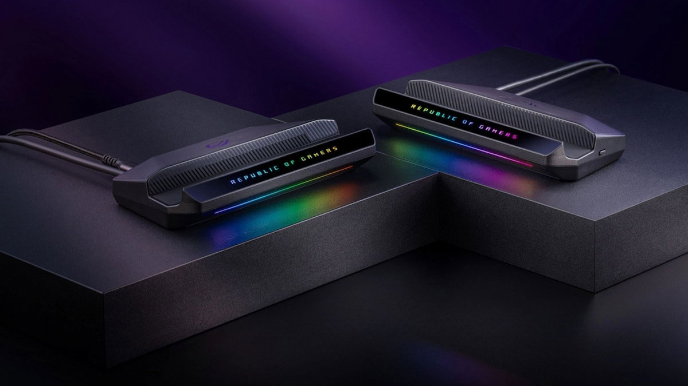

The ROG Ally is a computer in a handheld console form factor, so it can already drive a large screen without any dock in between. All it takes is a USB-C cable that ends in HDMI or DisplayPort. The problem is that this improvised setup is not as convenient as the one a Switch offers. That is what the ROG Bulwark DG310, ASUS's official dock, is for: the console connects through a single USB-C cable and the rest of the installation is collected in one accessory.

This guide is for you if you already own a ROG Ally and want to move it to the living room without giving up handheld mode. It only covers what the original AVPasión article documents; if a detail does not appear there, it does not appear here either.

## What it solves and who it is for

The dock turns the console into a permanent desktop machine, connected to a television, without unplugging and replugging cables every time. It is aimed at anyone who wants to play on the big screen at home and keep using the Ally outside it.

It is not a magical transformation: the console remains the same and the dock adds no extra power. What it adds is fixed connections and a single cable to the console.

## Requirements

- **A ROG Ally console.** The original mentions the ROG Ally family and, specifically, the special edition made in collaboration with Xbox. It does not list other models, so it is worth checking yours before buying.
- **The ASUS ROG Bulwark DG310 dock**, the version announced in October 2026. It is the update to the 2025 Bulwark.
- **A television with an HDMI input.** The dock is designed to connect to a TV and its video output is HDMI 2.1.
- **A USB-C cable** to link the dock to the console's port.

The article does not mention any software version, any system menu, or a controller included in the box. That is why there are no configuration steps in this guide: they cannot be verified.

## Steps

### 1. Check that your ROG Ally is compatible

The dock was developed with the ROG Ally handhelds in mind, including the Xbox collaboration edition. Verify your model before going further: the original does not promise compatibility with other brands.

### 2. Connect the dock to the console over USB-C

The ROG Bulwark DG310 works like any other dock: it connects through a single USB-C port that goes directly into the console's own port. That is the only link between the two devices.

### 3. Send the image to the television over HDMI

Connect the television to the dock's HDMI 2.1 port. The accessory is designed precisely for that use: taking the console out of handheld mode and playing on a large screen.

### 4. Add wired networking and peripherals (optional)

The dock offers six outputs in total. Besides the console's USB-C and the HDMI 2.1, it includes a 1 Gb Ethernet port and three USB-A 3.2 ports. You can use the Ethernet for a wired connection and the USB-A ports for a keyboard, mouse or storage.

### 5. The no-dock alternative

If you would rather not buy the accessory, the original points out that any console of this kind, being a computer, can play in desktop mode with a USB-C cable connected to an HDMI or DisplayPort output. It is less convenient, but it works. And if what you want is to squeeze more out of the Ally without changing devices, there is also room on the upscaling side: [HelixSR brings NVIDIA's DLSS to AMD handhelds like this one](/noticias/tarjetas-graficas/helixsr-dlss-steam-deck-rog-ally/).

## How to verify it worked

The original does not describe a check menu, so verification is physical: if the television shows the console's image through the dock's HDMI, the connection is done. You can then confirm that the peripherals plugged into the USB-A ports respond and that the Ethernet network links up, if you decided to use it.

## Limitations and what it does not do

- **It adds no performance.** The dock is a hub of connections, not an external GPU. The console keeps its hardware and its handheld focus, intended for lower resolutions.
- **It does not include a controller.** The original does not mention one in the box; if you want to play comfortably in the living room, you will have to bring your own.
- **It is not the cheapest option for playing only in the living room.** The piece's own author recommends using the Ally mainly in handheld mode and leaving the dock as a second option. If you are going to play on the TV most of the time, a PC offers better value for money.
- **Price.** The ROG Bulwark DG310 sells for 99 dollars; in Europe it is expected to land around 120 euros, the same figure as the previous version.

In short: the dock does its job well if your usage is mixed and you want a tidy setup in the living room. If your intention is to play on the television almost all the time, the outlay makes less sense.
