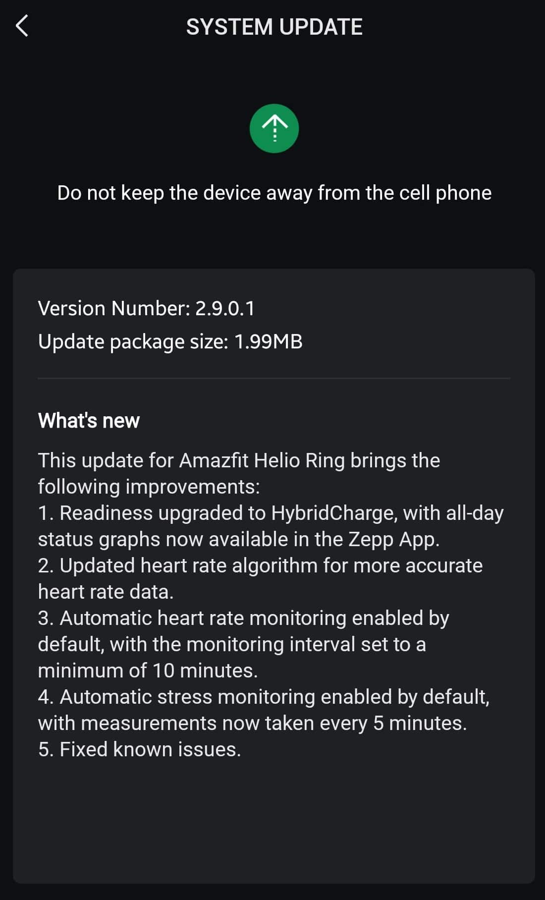

The **Amazfit Helio Ring receives HybridCharge**, a new way to check recovery status and daily load in Zepp, along with changes to automatic pulse and stress tracking. The update is version **2.9.0.1**, according to [Gadgets & Wearables](https://gadgetsandwearables.com/2026/10/31/amazfit-helio-ring-2-9-0-1-update/), which published a screenshot of its notes on October 31. Deployment is gradual: not all owners will see it available at the same time.

The novelty affects how ring data are presented and interpreted, not to a function that promises to accelerate physical recovery. For those who already check Zepp upon waking or before training, the relevant change is the move from Readiness to a system with status graphs throughout the day.

*Cover image: Zepp Health, distributed by Gadgets & Wearables.*

## What changes with HybridCharge on the Amazfit Helio Ring

Version notes indicate that **Readiness is replaced by HybridCharge** and that daily graphs are now available in the Zepp app. This is the most visible change in this release: checking no longer depends on the previous activity readiness scheme.

Gadgets & Wearables explains that HybridCharge combines BioCharge with Training Load and LifeLoad. The idea is to incorporate recovery, exercise load, and daily life context into the user status assessment. Its [previous system coverage](https://gadgetsandwearables.com/2026/06/05/amazfit-hybridcharge-schedule/) also describes manual contributions of context and perceived effort; that does not allow assuming all watch options are reproduced exactly in the ring.

For the owner, it is advisable to distinguish the new presentation from a demonstrated improvement of estimates. The screenshot confirms the incorporation of HybridCharge but does not provide clinical validation or a comparison quantifying how much it improves its recommendations. Here we gather documented novelties, not an independent device test.

*Screenshot of the Zepp update notes published by Gadgets & Wearables.*

## Pulse every ten minutes and stress every five

The changelog activates automatic heart rate tracking by default and sets a **minimum interval of ten minutes**. It also enables stress tracking by default, with measurements every five minutes. These are periodic records: they should not be confused with continuous second-by-second pulse readings.

Additionally, the notes announce a review of the cardiac algorithm aimed at obtaining more precise data and corrections to known issues. They do not detail which those failures are nor include error figures before and after. Therefore, greater precision should be understood as the goal announced by the manufacturer, not as a result verified by TechSpain24.

Discreet tracking is precisely one of the arguments for these formats, as with the [Qalo bracelet and ring combination](/noticias/wearables/qalo-pulsera-anillo/). In the Helio Ring, this update changes automatic configuration and data checking; stress estimates do not equate to a medical diagnosis.

## How to check its arrival and what remains to be measured

The outlet recommends checking the **System Update** section of the Zepp app over the coming days. Since it is a staggered deployment, the fact that the version does not yet appear does not demonstrate there is a problem with the ring. The published information does not set a universal availability date nor a specific date for Spain.

The other unknown is actual battery life. Recording data more frequently raises a reasonable question about consumption, but the source does not present battery measurements with this firmware. There is no basis to promise longer duration nor to affirm a concrete loss after installing it.

If you already use the Helio Ring to review rest and activity trends, this release deserves attention for HybridCharge and automatic adjustments. If what you expect is a demonstrated improvement in precision or autonomy, it is advisable to wait for comparable tests: update notes do not substitute those measurements.
