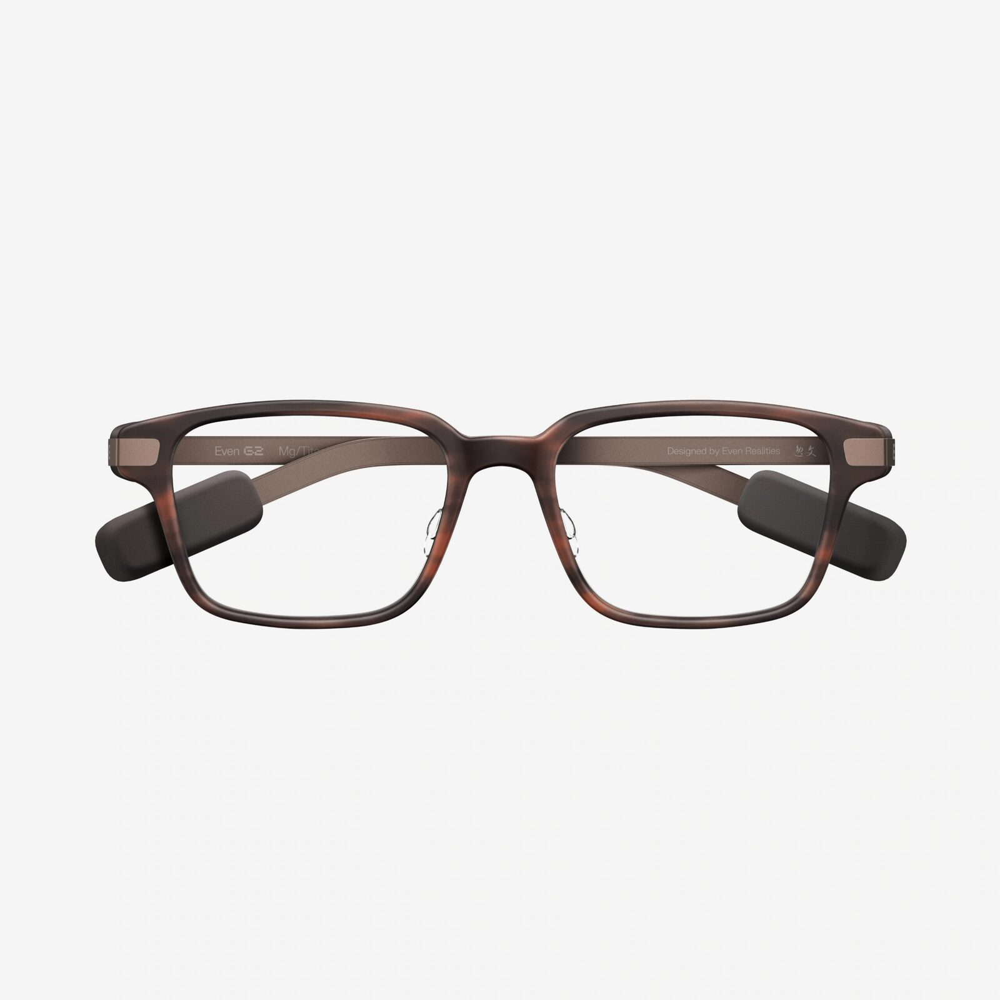

According to Android Headlines, Even Realities has released a software update for its Even G2 glasses, the biggest since April. What actually changes for someone already wearing them is not the colour of the frame but the memory: version V2.4.0 introduces a Knowledge Base where documents and conversations are stored so that the glasses keep the context and can lend a hand during a meeting.

It is worth pinning down the state of the information before going any further. Even Realities has not yet published an official changelog for V2.4.0 on its website or in its help centre, and the announcement arrives through the outlet cited. The Brown 2 colourway, the polarised clips and the chain are confirmed on the official product page. The software detail is recounted here as reported.

## What the Knowledge Base stores, and who decides what stays

The starting point is a personal knowledge base. Previous Conversate sessions — the feature that transcribes and summarises conversations — can be imported, or you can upload your own files. The glasses organise that material in a visual tree of connected topics, and the user decides what to add, what to update and what to delete.

Even AI 2.0 works on top of that base. The assistant keeps the thread across follow-up questions and lets you pick up a previous conversation without starting from scratch. The practical difference is the usual one: an assistant answering from thin air versus one that knows which project is being discussed. For a salesperson picking up an account again after two weeks, or for someone preparing a class with the previous term's material, that context is exactly what was missing.

Some questions still have no official answer: which file formats the import accepts, how much material fits, and whether the base travels with the account or with the phone. Neither Android Headlines nor the manufacturer's website details any of this, so it should not be taken for granted.

## In-meeting assistance: what is in beta

The second piece is AI Cue Expert Mode, presented as a conversation expert inside your field of view. During a sales call, an interview or a class it can show relevant information, flag questions that went unanswered and suggest next steps. All without looking away from the person you are talking to, which is the only reason glasses with a display make sense in that scenario.

Conversate Pro Mode and Insights are added to that, the two features the company places in beta. They go beyond the meeting summary: they highlight priorities, potential risks and recommended next steps, and each conclusion is linked to the specific moment in the conversation it came from. That link is what separates a decorative summary from something verifiable; without it there is no way to check whether the system understood or made things up.

For now there are no details on country availability or supported languages for these two features, and the beta may change before it reaches everyone. A dark interface also appears, a minor detail but an expected one for people using the glasses at night or indoors in low light.

## Conversations and documents leave the device

Here is the part the announcement glosses over. A Knowledge Base that imports conversations and documents means processing that material on an external service, and that includes third-party voices that have not given permission. Even Realities' privacy centre describes the current handling: Conversate and Even AI process in the cloud, audio is worked on in segments and each segment is deleted as soon as it is transcribed, the AI memory can be switched on or off in the settings, the data is not used to train generative models, and traffic is encrypted in transit and at rest. Records can be reviewed and deleted.

That policy describes the existing features, not specifically the Knowledge Base, and the company has not explained what changes when documents are uploaded. Two caveats follow without needing to invent anything. The first: uploading minutes, a contract or a recording of a client turns the glasses into custodians of data that perhaps should not leave the laptop. The second: the fact that the glasses carry no camera removes the problem of recording images, not the problem of listening. The microphone is still there, and in Spain recording a conversation requires informing the participants; at work, in class or in a medical consultation there are also rules of the place itself.

The practical recommendation is the usual one for this category: say that you are transcribing, do not use them in confidential conversations without a clear framework, and review and delete records with the same habit you use to clear your inbox.

## The rest of the announcement: Brown 2, polarised clips and a chain

The rest is finish. Brown 2 is a new acetate frame with a warm tortoiseshell effect, a different pattern on each unit and 20 hours of polishing according to the manufacturer, which presents it as the lightest version of the G2 while keeping the fit and the screen sharpness. The Even G2 Polarized Sun Clips add grey mirrored lenses with 100 % UVA and UVB protection, in versions for frame A and frame B, and the Even G2 Chain is a stainless steel chain for wearing them around the neck between uses, aimed at people with no prescription who take them off and put them back on several times a day.

With all of this on the table, the decision depends on what they were bought for. If you already own the glasses and your day runs on meetings, interviews or classes, the Knowledge Base and persistent context are the update that justifies the outlay, as long as the beta holds up and the data handling suits you. If what you were waiting for was a camera or computer vision, this announcement does not bring it and it is worth waiting: Even Realities' camera-free approach is a product decision, not an intermediate step. You can follow the rest of the sector's news in the [wearables](/en/news/wearables/) section.
