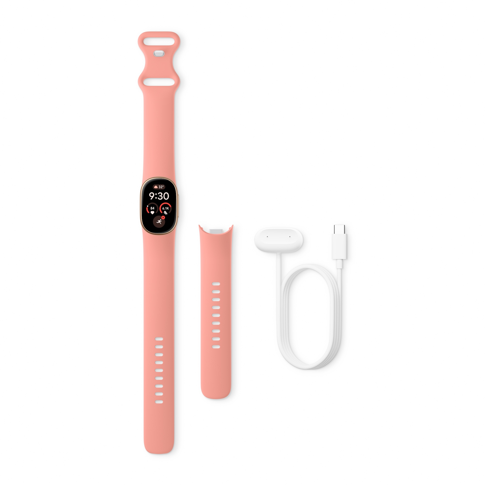
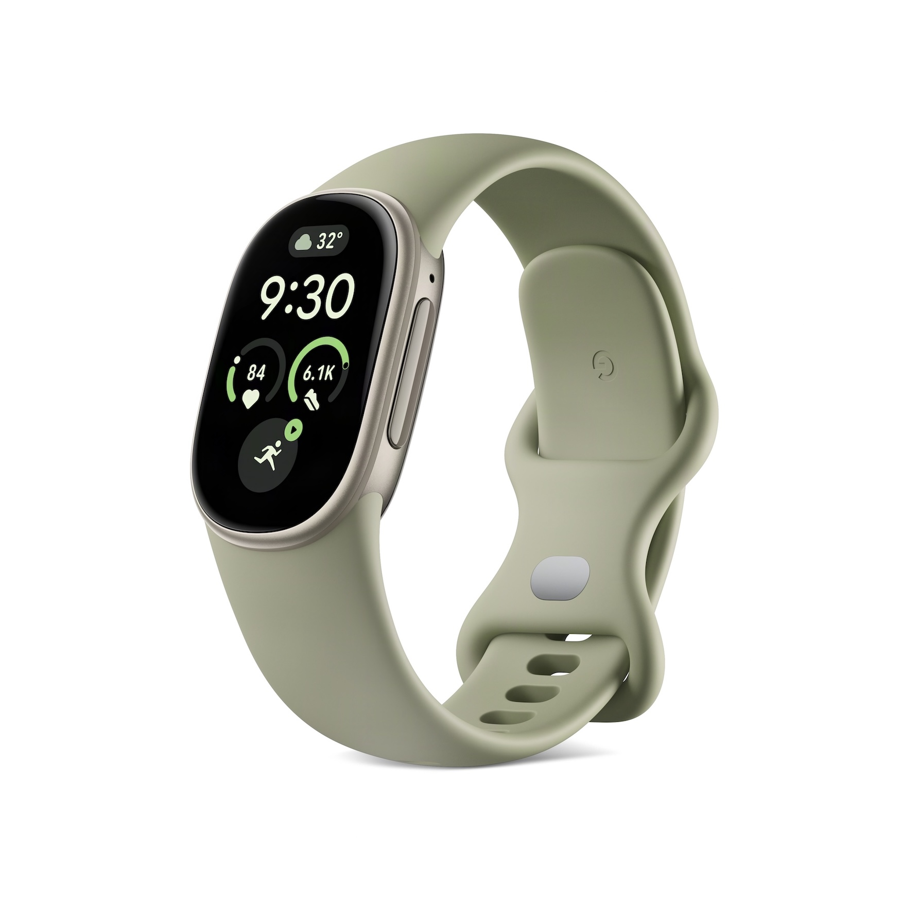
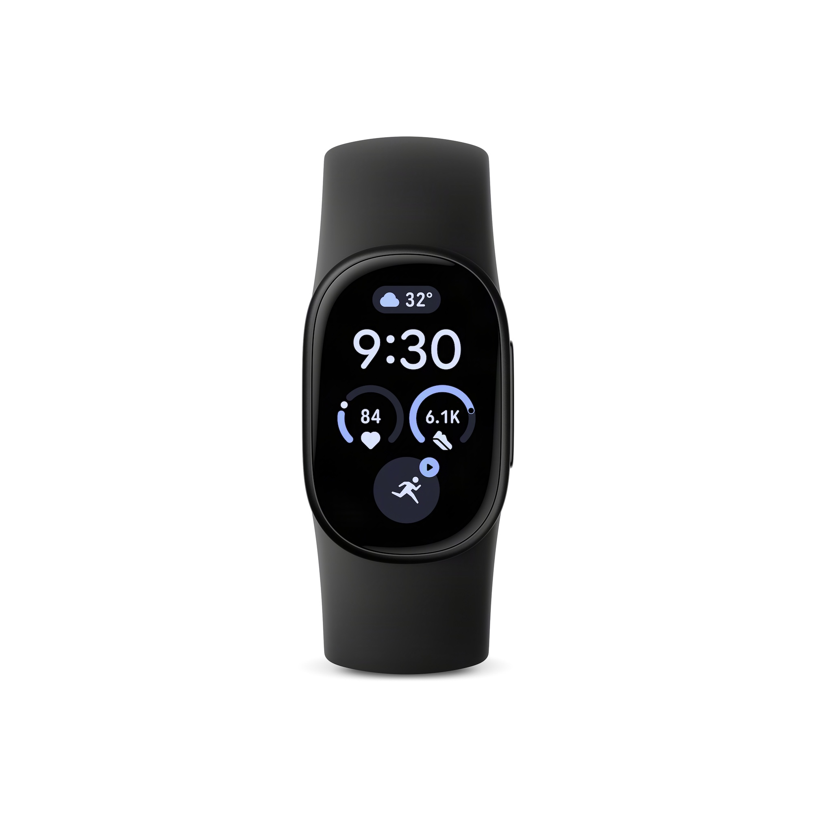
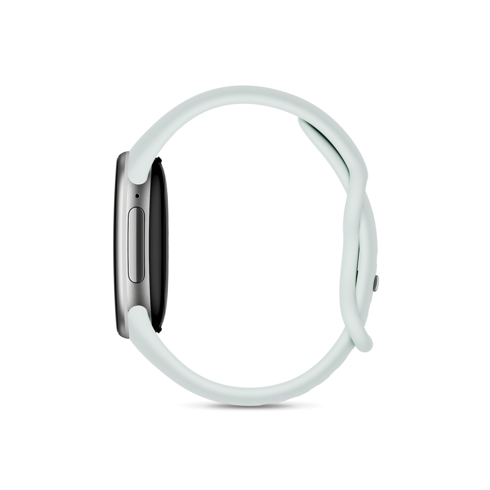
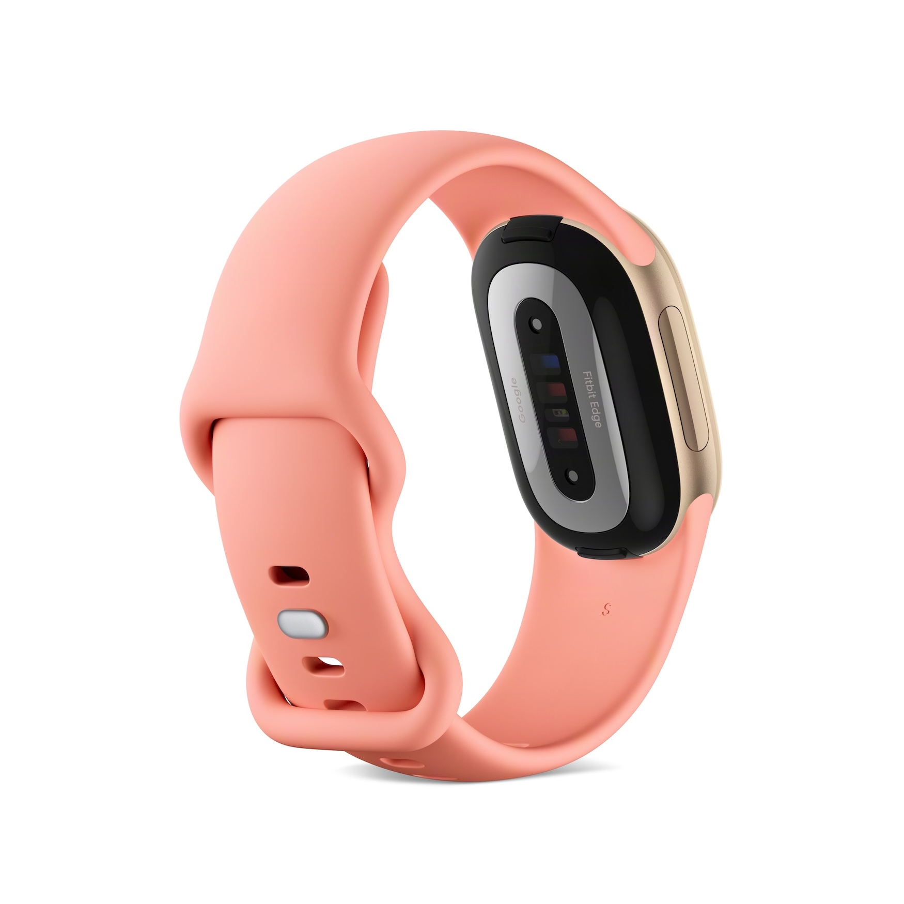
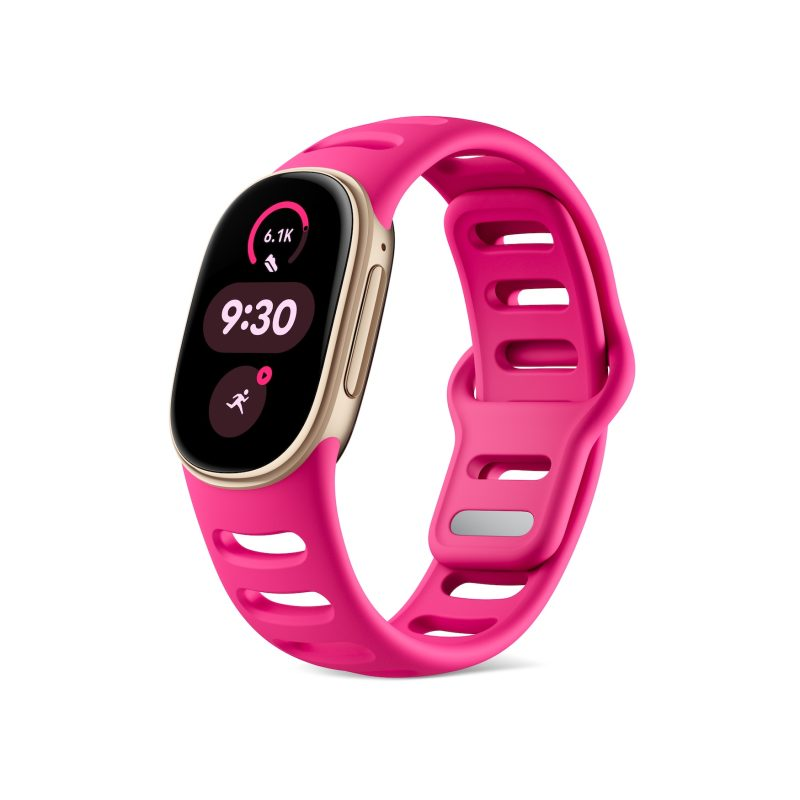
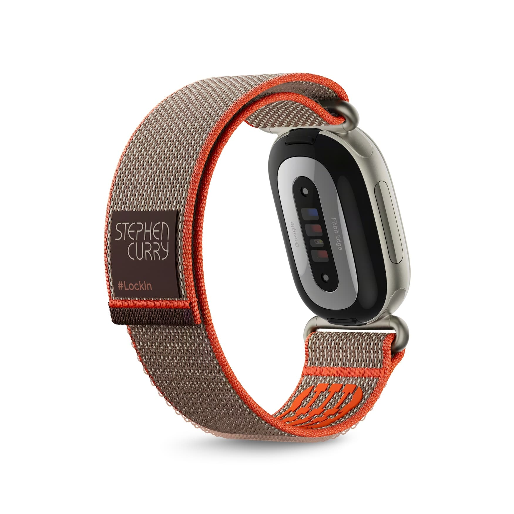

Google has officially announced the **Fitbit Edge**, its second smartwatch with a screen this year after the Fitbit Air which arrived in May. The proposal is the same as that family — an activity tracking band, not a full watch — but with a much more generous screen and a body designed for outdoor sports.

The change most noticeable on the wrist is precisely that: an elongated AMOLED screen, pill-shaped, protected by Gorilla Glass 3, which offers **46 % more visible surface area** than the Charge 6 of 2023. It’s the kind of difference that separates “checking the time” from “reading a notification without taking out your phone.”

## What’s inside (and why it matters)

The body measures 11.5 mm in thickness and is made of aluminum, with a nano-molding technique that, according to Google, makes the **GPS 40 % more precise** than the Charge 6. It also incorporates a dedicated **altimeter** for measuring elevation gain, something appreciated when hiking or trail running, which was previously resolved with estimates. On the right side there is a large button to control the device tactually, useful when your hands are wet — for example, while swimming. The assembly has **IP68 and 5ATM** protection against dust and water.

On the bottom face are the sensors: accelerometer, altimeter, ambient light sensor, far-field skin temperature sensor, gyroscope, heart rate sensor, multi-use electrical sensors (**ECG**) and red and infrared sensors (**SpO2**). It’s worth remembering: these are wellness metrics, not medical diagnoses, and none of them replaces a professional consultation.

The battery is one of the areas where the Edge stakes its real utility. Google figures it at **one week with the Always-On Display (AOD) turned off**, and that figure drops to around **two days** once you turn on AOD. It’s the same fine print as always: the advertised autonomy isn’t what you’ll see with the screen on all day. Charging is done with the Fitbit Air’s magnetic USB-C charger, **five minutes give a day of use**, and a full charge rounds about 90 minutes. Additionally, like the Pixel Watch 5, the device can be opened to **replace the battery**.

## What you can do with it (and what you can’t)

The Edge works with Android and iOS and runs a Fitbit system similar to the Air, but the larger screen enables a richer interface, inspired by the Pixel Watch 5. Google showed a long list of faces, analog and digital, with complications that are personalized from the Google Health app.

Swiping left or right from the face accesses tiles — quick-start exercises, focus metrics, sleep, heart health, cycle health, weather, timers, alarms and music controls — and their order is configurable. Here there’s a clear improvement over the Charge 6: **music controls work with any app** on the paired phone, and notifications also arrive. The exercise app records **more than 50 types of activity** with real-time guidance, and the device can emit heart rate to compatible equipment.

Now, the limitations, which are what decide the purchase. **Quick message replies stay on Android** due to iOS restrictions. There’s navigation with Google Maps, but **there is no Google Wallet** because the Edge also lacks NFC: if you pay with the watch, it’s not your device. Automatic activity detection, however, improves with the same contextual reasoning “with AI” as the Air, learns your habits and promises to cover more than 100 activities. Fitbit Air, Edge and Pixel Watch 5 can coexist in the same account with fluid switching between them.

## Price, bands and availability

The Fitbit Edge costs **$179.99**, with reservations open from today and **availability on October 27**. It comes in four combinations: matte black aluminum with Obsidian band, polished silver aluminum with Fog band, satin pyrite aluminum with Olive band and champagne gold with Canyon band. There is a **Stephen Curry Special Edition for $219.99** with a custom band.

The bands change with a new exchange mechanism and there are four additional designs: Active Sport (extra soft silicone with large perforations) for $39.99, Magnet Band (no clasp, with integrated magnets) for $59.99, Metal Links for $149.99 and Performance Loop (elastic and micro-adjustable) for $49.99.

Some of those finishes, in images:

The Stephen Curry Special Edition adds its own custom band:

The decision, as always, depends on a single question: **are you going to use it for real?** If you want to follow workouts with reliable GPS, control sleep and carry a screen that’s readable in the sun without giving up a week of battery — and you don’t mind not being able to pay with your wrist — the Edge is a sensible option within its range. If what you’re looking for is a full watch, with NFC, third-party apps and payments, this Fitbit isn’t that product: there you have to look toward another segment.
