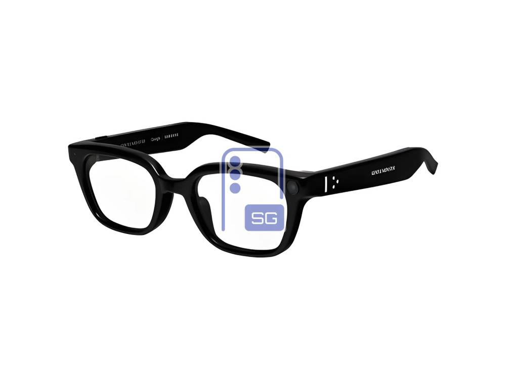
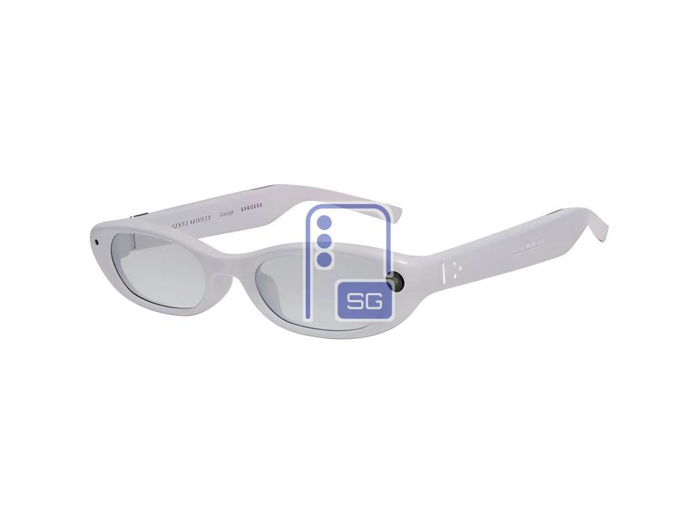
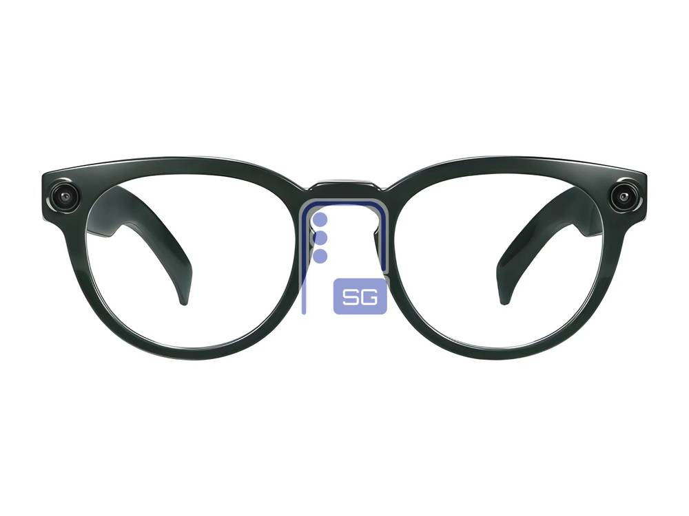

# Galaxy Glasses leaked in full: 41 grams, no screen and up to 16 variants

The figure that decides whether smart glasses are worn all day or end up in a drawer is not the processor: it’s the weight. The leak published by SammyGuru —and picked up later by outlets like Android Police— claims that Samsung’s Galaxy Glasses weigh around 41 grams with standard lenses, below the 51.5 grams of Meta Ray-Ban’s third generation. This is data that Samsung has not confirmed and which should be read with caution, but it points directly to the point that is noticeable without turning them on: wearing them on your face for hours.

## What has been leaked (and what hasn’t)

It’s worth separating what the leak says from what the brand has stated aloud. The confirmed information is little: the glasses exist, they run on Android XR and will arrive before the end of 2026. Samsung showed them for the first time in July, during the Galaxy Z Fold 8 event, without giving a price or date, and most rumors place the launch in November. The rest of the technical sheet circulating now comes from SammyGuru and is not backed by the manufacturer.

According to that information, the glasses would be as follows:

- **Weight:** around 41 g with standard lenses; prescription lenses add a bit more.
- **Processor:** Qualcomm Snapdragon AR1 Gen 1.
- **Memory and storage:** 2 GB of RAM and 64 GB for photos and videos.
- **Camera:** 12 MP, with video recording in 3K at 30 fps.
- **Audio:** two open-ear speakers and four microphones.
- **Battery:** up to 9 hours on the glasses, extendable to 72 hours with the charging case.
- **Water resistance:** IPX4; the case is not certified.
- **Screen:** none.

That last line is what changes daily use the most. There is no projection or information layer over the world: the glasses listen, speak and capture. Gemini responses and instructions arrive through the speakers, and it is the four microphones that sustain calls and voice commands. The approach resembles a camera earpiece more than augmented reality glasses that promise to overlay data onto what you see.

## Gentle Monster offers six shapes and 16 variants; Warby Parker, three models

The most revealing part of the leak is not the electronics, but how many frames there will be. Gentle Monster would prepare six different shapes distributed across 16 versions: one square, another more round, a thicker square, one in cat-eye style and two oval ones, one narrow and one wider. Colors would include black, burgundy and cream, with transparent lenses, light blue, browns or grays depending on the combination.

Warby Parker, for its part, would have three designs with their own names: Alden, Reid and Wren. Alden and Wren would arrive in Pine (dark green) and Saddle (reddish brown), while Reid would stay in Jet Black. Each frame and color could be chosen with transparent lenses or as sunglasses, which adds up to 10 versions in total. Warby Parker would also count with its own charging case in navy blue.

That there are so many shapes and colors is a signal of where Samsung is pointing: it does not want to sell a technological gadget, but normal glasses among which to choose. The uncomfortable question is whether anyone will pay for a product that, beneath the frame, does almost the same thing as Meta Ray-Bans.

## When they arrive and with what limitations

The leak places the launch in November, with initial availability limited to South Korea and the United States. Those from Gentle Monster would be sold in both countries; those from Warby Parker, only in the US. They will not be on any storefront either: they will be marketed on each glasses brand’s websites and stores and in Samsung Experience Stores in the US. The price remains unannounced.

There are also requirements worth knowing about before getting excited. For Galaxy-specific functions, a recent Galaxy S, Z Fold or Z Flip with One UI 9 or later is needed; watch features require a Galaxy Watch with Wear OS 7 or later. The glasses also work with other Android mobiles and iPhones, but without those extra features. Samsung, for its part, says its services are intended for people over 18 years old. In South Korea, spoken instructions will arrive via Naver Maps in addition to Google Maps.

## What this means for potential buyers

If what you’re looking for is having the assistant attached to your face —asking something, taking a photo or answering a message without pulling out the phone— this approach makes sense, and the 41 grams are the best news of the leak: it’s the figure that decides whether you put them on every morning or only when you remember. If what you expect is augmented reality glasses with an information visual layer, these are not them: there is no screen. And if the price, still in the air, ends up close to that of its rivals, weight will be the argument that decides the purchase; if it goes very high above, no frame will compensate for it.
