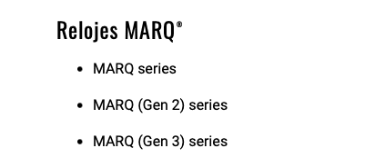

Garmin hasn't announced anything yet, but its Spanish support pages already write the name we've been waiting four years for: **MARQ Gen 3**. The specialized media outlet Garmin Rumors published the finding, and it fits the calendar: the MARQ Gen 2 was presented on October 11, 2022. Four years exactly.

For someone looking at these pages like one looks at a shop window, the question isn't whether Garmin is preparing a new generation—that was already assumed—but whether this time the leap will be noticeable on the wrist and not just in the technical specs.

## Where the MARQ Gen 3 Appears

The clearest reference is on the Spanish support page regarding compatibility with Garmin Explore. Within the MARQ category, Garmin lists the original series, the MARQ Gen 2, and, in third place, a MARQ Gen 3 that still cannot be purchased.

It's not an isolated case. The same name appears in two other Spanish help articles: one about accessory connection and another about how to add weather locations to the brand's watches. The compatibility list with Explore also appears on Garmin's regional sites for Chile and Argentina.

The nuance that prevents blowing the trumpet prematurely: the equivalent English pages haven't changed. They still list the MARQ Gen 2 as the latest generation. Either the change slipped into only the Spanish support, or someone published it too early.

## Four Years Is a Long Time for a Watch

The MARQ Gen 2 arrived in October 2022 with an AMOLED screen, touch controls, Grade 5 titanium case, and multi-band GPS. Since then, the collection has been refreshed mostly in materials: carbon fiber versions for the Athlete, Golfer, and Commander in 2023, and a Damascus steel edition for the Adventurer in 2024.

In terms of platform, not much. And there lies the discomfort: it is Garmin's most expensive range, but internally it drags along a previous technical base. Meanwhile, the house's premium watches have continued to advance. The Fenix 9 family arrived in August and the Enduro 4 appeared this month with more storage and new training tools.

Whoever buys a MARQ pays luxury watch prices for a design and materials that remain excellent, but the electronics driving them belong to a previous generation. A MARQ Gen 3 would be, precisely, the way to close that gap.

## What Can Be Expected

For now there is only one name on a help page. Logic points to Garmin bringing the MARQ closer to the Fenix 9 platform, while maintaining specialized versions for athletes, golfers, pilots, and mountain users. Which specific functions would be transferred is, as of today, an unknown.

Price doesn't invite optimism either. The MARQ Gen 2 started at $1,900 in 2022, and the most expensive original model hovered around $2,400. Then came the carbon editions, which pushed the range even higher. No one should expect the Gen 3 to be cheap.

## So, Should I Wait?

If you have a MARQ Gen 2 and what's missing is platform and new functions, this leak is a good reason to wait a bit longer: the current watch remains excellent, but it pays a premium for 2022 technology. If you were thinking of buying Garmin's top-of-the-range now and price isn't an issue, waiting for the brand to confirm—or disprove—the Gen 3 is the prudent move. And if the functions of a Fenix 9 without the titanium case are enough for you, there's no reason to wait for anyone.
