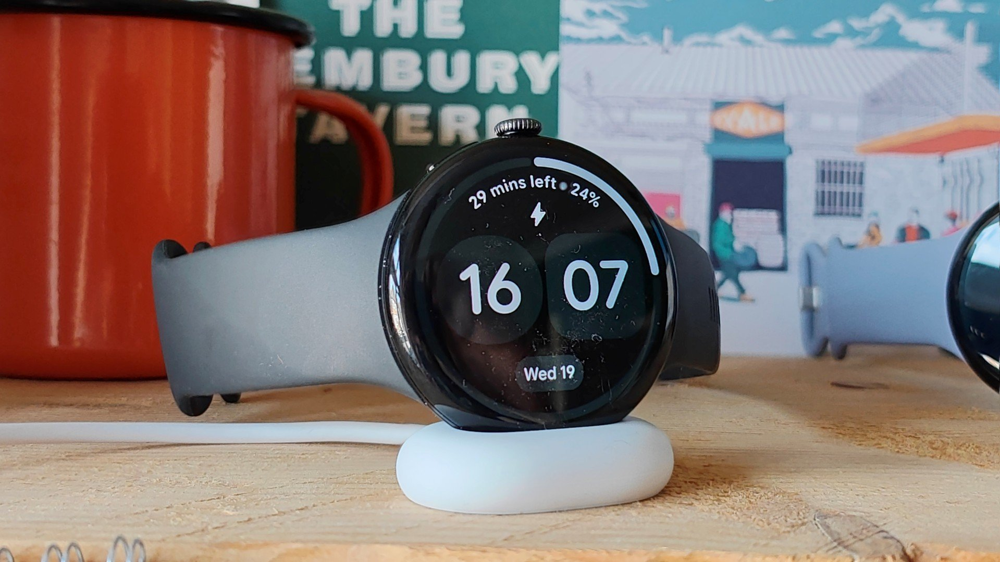

The Pixel Watch stopped lasting until night. Over the past week, users across several generations of the watch watched battery life collapse to around 12 hours with the device barely used, and Google has already started rolling out the solution. The detail that matters on the wrist is how it arrives: there is no need to wait for a Wear OS update, updating the watch's apps from the Play Store is enough. Google confirmed it to *Android Authority* with this statement:

> "The fix for the battery drain issue, which affects a small number of Pixel Watch users, has started rolling out and will be complete over the next two days. To apply it, update the Pixel Watch apps by pressing the crown, opening the Play Store app and tapping **Manage apps > Update all**."

The quotation is translated from the Spanish text; the menu names are the ones Google uses in its instructions.

## A patch that arrives through the apps

Google is not publishing a system update, but a batch of app updates installed from the watch's own store. *Android Police* says so explicitly, and that route explains two things. The first, why there is no Wear OS build number to check to know whether you already have it: the only clue is the Play Store no longer offering pending updates. The second, why the fault fits a background service or a misbehaving Wear OS app rather than a sudden hardware defect, which was the hypothesis being considered when the reports began to pile up.

Google has not detailed which app was causing the drain. Nor has it published a release note with the contents of the fix, so the real check is the usual one: use the watch for a full day and see whether it lasts what it used to.

The episode fits a watch whose software has long been delivered in instalments: health features have also arrived through app updates, as happened with [Health Guardian on the Pixel Watch](/noticias/pixel-watch-health-guardian-gratis/).

## Which models are affected and how much battery life is lost

The figures from the outlets that have followed the case agree on the essentials and differ on scope. *Android Authority* speaks of "several generations" and puts battery life at around 12 hours on devices that were barely used. *Android Police* narrows the reports to the models currently supported, from the Pixel Watch 2 to the Pixel Watch 5, and cites 12 to 16 hours where there used to be almost two days. *Tech Advisor* also limits the range to the Pixel Watch 2 through the Pixel Watch 5 and describes drops from 24 or even 48 hours down to 12.

The discrepancy lies with the oldest model: the metadata of the *Android Authority* article includes tags for the first Pixel Watch, but its text does not confirm that this model is affected, and the other two reports start at the Pixel Watch 2. Google, for its part, limits itself to "a small number of users" without giving a list of models, so the safest reference is the Pixel Watch 2 and later.

*The Pixel Watch 5, on its charger. Image: Chris Martin / Foundry, via Tech Advisor.*

## How to check whether your Pixel Watch already has the fix

These are the steps Google gives, in the exact order of its instructions:

1. Press the crown to open the watch's app list.
2. Open the **Play Store** app on the Pixel Watch.
3. Tap **Manage apps** and then **Update all**. If the watch's interface is in Spanish, both labels appear translated.
4. Leave the watch on the charger while the updates install if the battery is low; there are several downloads and it is best not to stop halfway.
5. Restart the watch when it finishes. *Android Police* recommends it as the close of the process, although Google does not mention it in its statement.

Looking for a system patch is no way to verify the result: there is not one. The practical approach is to leave a full day of use, with the always-on display on the same setting you had and the tracking you normally use, and compare the remaining percentage when you go to bed with the one from the past few days. If it is still around 12 hours after a full charge and a restart, either the rollout has not reached your unit yet or the drain has another cause.

## What remains outstanding

The rollout is staged and Google estimates it will be complete in a couple of days, so it is normal for the watch's Play Store to show nothing yet: if no pending update appears, it is a matter of looking again later. There is also no date for a system-level patch, because the fix does not go that route, nor an official explanation of which app was responsible.

If your Pixel Watch has dropped to 12 hours, update the apps today and give it a full charge before writing the watch off: the problem is software and the solution is already circulating. If your unit still lasts what it always did, there is nothing to do, because the fault never touched you. And if, after updating and restarting, battery life does not return to its previous level, the next step is to review which apps remain active in the background before assuming the battery is degraded.
