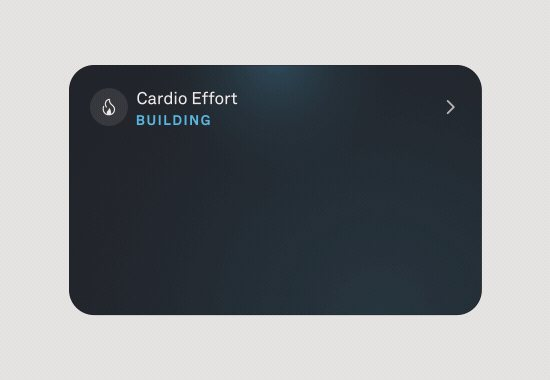
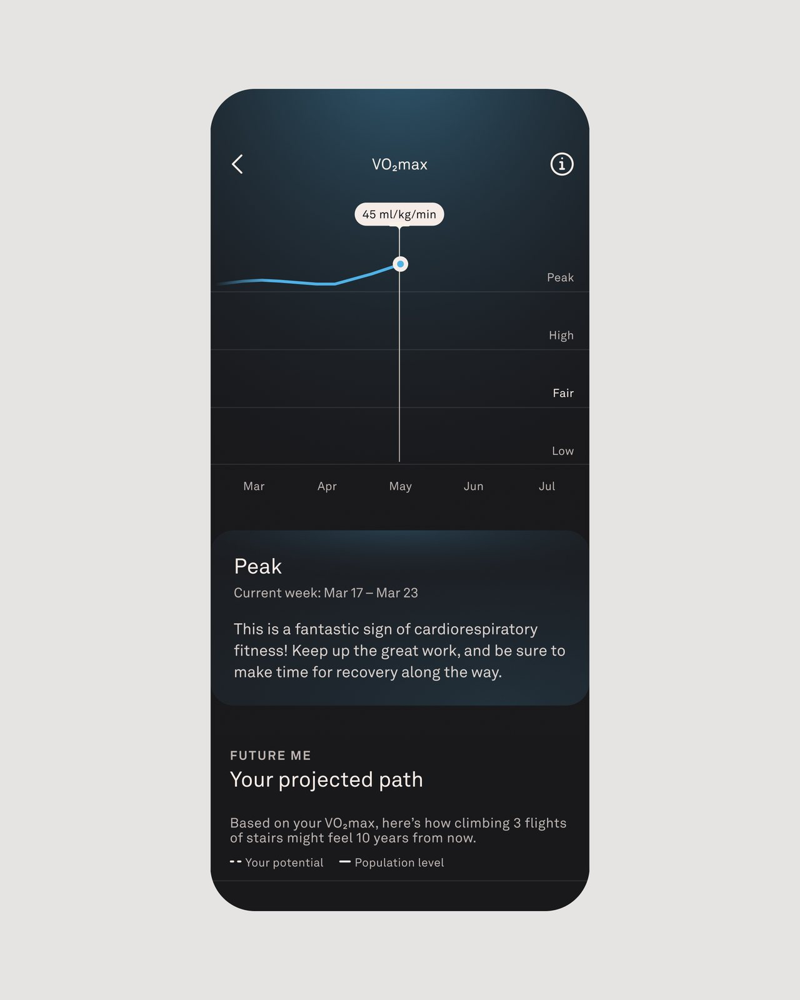

**Oura is adding Cardio Effort to put the week’s cardiovascular load in context and testing an automatic VO2 max estimate.** These are two different readings: one summarizes the effort of recorded activities; the other estimates aerobic capacity from GPS-enabled sessions. The brand introduced both changes on October 20, but the second remains experimental within Oura Labs.

## Cardio Effort compares the week with personal history

According to Oura, Cardio Effort combines duration and intensity and uses heart-rate response when sufficient data is available. It is not the same as counting steps or measuring a session’s muscular difficulty: a demanding strength workout can generate less cardiovascular load than another activity that keeps heart rate elevated for longer.

Load accumulates from the start of the week and is compared with a personal range based on recent activity. The app places it in five bands, from Light to Reaching, with Fair, Maintaining and Building in between. **It is not a score out of one hundred or a number to maximize.** Maintaining represents load close to the usual level, not a failed goal.

Manually added activities can also receive an estimate, identified as such. That distinction matters when heart-rate readings are missing: the record still provides context, but should not be confused with a session documented with all its data.

## Automatic VO2 max needs five qualifying activities

The automatic VO2 max feature is available in Oura Labs for **Oura Ring Gen3 and later**. After it is enabled, it requires five qualifying GPS-enabled activities, including walks, runs or hikes, to provide the first estimate. These are five sessions that meet the requirements, not five different sports.

Oura presents this option as an alternative to the dedicated six-minute walking test. The app’s heart-health area shows the estimate, its category and its trend over time. More qualifying activities can update it, although the brand warns that it will not necessarily change after every workout.

## Help interpreting trends, not a diagnosis

The practical change is being able to look separately at accumulated effort and the evolution of estimated aerobic capacity. As we explained when discussing [VO2 max and wearable data](/noticias/vo2-max-estrategias-datos-wearables/), the measurement’s context matters as much as the number.

Oura Labs brings together features under development that may change in response to user feedback. **The ring’s estimate is not a clinical oxygen-consumption test or a medical diagnosis.** The app allows external laboratory or device results to be saved, but those records remain separate and do not replace its automatic estimate.

*Images: Oura. The Cardio Effort view comes from an official animation and is reproduced as a still frame.*
