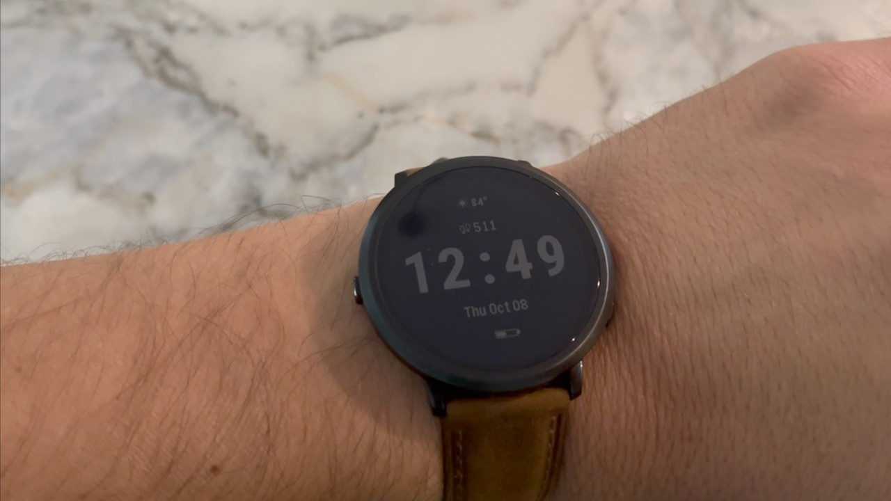

The Pebble Round 2 has not yet reached its buyers, but whoever has worn it for months already has an opinion formed. A beta tester has published a video on YouTube with his impressions of daily use, and the balance is very positive: a round, thin, and comfortable watch that, placed alongside thicker rivals, leaves them in the dust. It is worth specifying which product we are talking about: this is the Pebble Round 2 wristwatch, not the [Pebble Index 01 ring](/noticias/wearables/anillo-pebble-sin-carga/), the brand's other proposal, which has nothing to do with it.

## Thin and comfortable design: the strong point of the Pebble Round 2

The video is signed by Nick Lum, a tester who claims to have a unit identical to those that will be sent to customers, and he compares it face-to-face with the Pebble Time 2 and the Garmin Forerunner 165. According to Notebookcheck, the conclusion is clear in favor of the Round 2 regarding thickness: it measures 8.1 mm, considerably less than much of its competition. On the wrist, that difference translates into something concrete: the watch slides under a shirt sleeve without snagging.

This is aided by the fact that it does not incorporate a heart rate sensor, which allows the case to lie completely flat against the skin. Lum adds that after months of daily use, the unit is still like new, and since getting the Round 2 he has hardly worn the Time 2.

## Buttons that sometimes don't respond

The negative point of the video concerns the physical buttons: sometimes they give the sensation of having been pressed without the watch registering the command. Lum comments that he spoke with Pebble founder Eric Migicovsky about it, and that the problem also appeared in a replacement unit. It seems to depend partly on how you press them, but it is a flaw that can be annoying in daily use.

## Irregular battery life: between 5 and 14 days

The battery has been another inconsistent area during the tests. The tester has recorded figures ranging from 5 to 14 days depending on the configuration, and possibly depending on the software updates that were installed during that period. His last data point is around 10 days, at the lower end of the 10 to 14 days that Pebble announces.

To stretch battery life, he recommends avoiding faces that show seconds and disabling the progress monitor in the music app. These are two simple adjustments that, according to his experience, make a difference.

## Price, delay, and availability

The Pebble Round 2 costs $199. Its shipping was scheduled for May, but production problems forced a delay. Now, according to Notebookcheck, manufacturing has already started, although most customers might not receive their watch until December.

For those still waiting, these impressions are mostly reassuring: the design and comfort meet what was promised. The question is whether those elusive buttons are enough to tarnish the rest.

The recommendation is the usual one in this segment: if you are looking for a thin, light watch with infrequent recharges, the Round 2 aims to deliver; if you depend on continuous pulse tracking or sports health metrics, this is not your watch, because it renounces the heart rate sensor. And if buttons are part of your daily use, it is advisable to wait for the first production units to confirm that the flaw was fixed.
