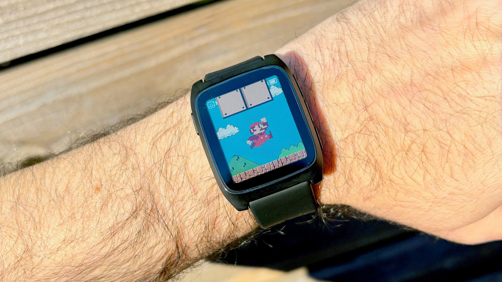
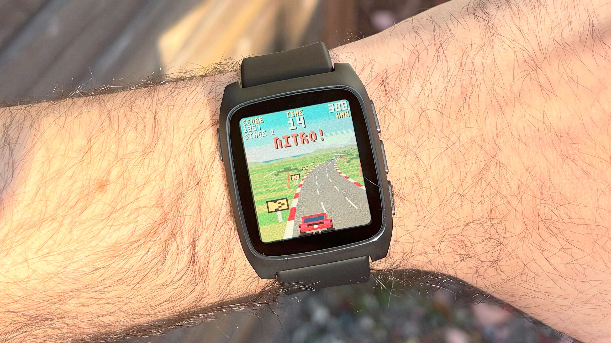

The Pebble Time 2 does not compete on the spec sheet. It is a watch built to tell the time, read notifications and entertain you for a while, and in exchange it promises something almost no rival can match: weeks without visiting a charger. Tom's Guide has published its first impressions after a short period of use, and the balance suggests its appeal lies less in what it measures and more in how it feels on the wrist.

## Pebble Time 2: a watch unlike the others

The case is rectangular and combines stainless steel with plastic. The result recalls the digital watches of the late eighties and early nineties, a reference the US outlet illustrates with the legendary Casio F-91W. There is no attempt to imitate the visual language of an Apple Watch or a Galaxy Watch: the Pebble Time 2 embraces its retro air and turns it into part of the proposition.

The display is the piece that explains almost everything. It is a 1.5-inch e-ink panel with 64 colours and touch support that stays always on. Under direct sunlight it is more comfortable to read than an AMOLED does not always manage, although under certain lighting conditions it can look somewhat dim or washed out. That is the price of a technology that prioritises power consumption over brightness.

## Price and availability

The price Tom's Guide works with is $225. The article does not detail the exact release date or the markets where it will be sold, so international availability remains unconfirmed. Nor does it specify shipping conditions or whether there will be versions with different finishes.

On the wrist, the watch relies on four physical buttons: three on the right side and one back button on the left. All of them have a generous ribbed texture and the whole thing conveys a sense of solid construction. The screen is protected by Gorilla Glass, although it protrudes above the bezel, something that invites thoughts of possible scratches with prolonged use.

## What works in daily use

Initial setup is quick and works with both Android and iOS. From there, the big argument is PebbleOS, an open and highly customisable system. Almost any action can be assigned to a long press of a button, and although the interface lacks the flashy animations of watchOS or Wear OS, moving through the menus is simple.

The ecosystem is another of its strengths: the Pebble store gathers more than 10,000 watch faces, apps and games, many of them free, and installation takes very little time. Among the available games, the outlet highlights Turbo Drift, a driving title with an Out Run feel, and mentions Pixel Miner, Strike Force and Rock Crusher as upcoming tests.

Battery life is the most striking promise. According to Pebble, the watch reaches up to 30 days per charge. That figure is explained by what it does not carry inside: there is no AMOLED display, no GPS and no cellular antenna. Those are components that make a product more expensive and drain the battery, and their absence defines the kind of watch this is.

## What does not convince

The health chapter is deliberately basic. The watch includes a continuous heart rate sensor, an accelerometer to count steps and record workouts, and offers data on sleep duration and the light and deep phases. It is a level of tracking typical of an entry-level band, not that of a sports watch: without GPS there is no route tracking or advanced training metrics.

The display also has its downside. Anyone coming from a bright panel will notice that e-ink loses vividness indoors with little light, and the glass raised above the bezel is a weak point for anyone careless with knocks. PebbleOS, for its part, does not aspire to the smoothness of closed platforms: anyone looking for polished animations and transitions will not find them here.

## Who it makes sense for, and who it does not

It makes sense if you are looking for a light, feature-focused watch with battery life that lets you forget about the charger for weeks, and if you feel like tinkering with watch faces, apps and games without depending on a closed ecosystem. Also if the retro design appeals to you rather than putting you off.

It does not make sense if your priority is GPS sports tracking, advanced health metrics or a bright and fluid display. In that case, a sports watch or a full smartwatch fits better. Anyone who prefers a round, thin format also has the [Pebble Round 2](/noticias/wearables/pebble-round-2-reloj/), another product from the brand with a different approach.

## What remains to be confirmed

Tom's Guide announces a full review, so several questions remain open: how long the battery actually lasts with intensive use and the always-on display, how accurate the heart rate and sleep tracking are, how the glass behaves with daily rubbing and to what extent the app catalogue stays up to date. There is also no confirmation on euro pricing or a sale date in Spain. Until then, the proposition rests on a simple and unusual idea: fewer features, much more battery life.
