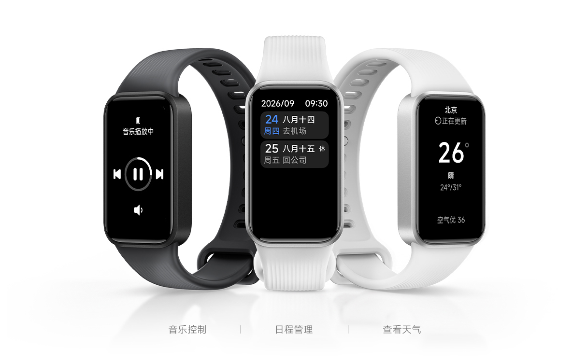
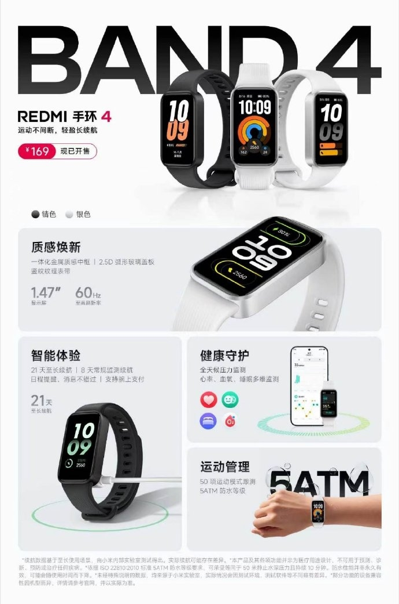

Spending less time thinking about the charger is the **REDMI Band 4**’s main selling point, but the full figure matters: up to 21 days of battery life falls to up to eight with regular monitoring. The tracker launched in China on October 20 for **169 yuan**, according to [MyDrivers](https://news.mydrivers.com/1/1158/1158901.htm) and [Gizmochina](https://www.gizmochina.com/2026/10/20/redmi-band-4-launches-with-a-21-day-battery-and-60hz-screen/), which agree on those details and its 60 Hz display.

## REDMI Band 4: a 1.47-inch, 60 Hz screen

Both outlets describe a **1.47-inch** panel with 2.5D cover glass and a 60 Hz refresh rate. MyDrivers adds a resolution of 172 × 320 pixels. On paper, that refresh rate points to smoother interface navigation; it is not a responsiveness measurement conducted by this outlet.

The design combines a metallic-looking frame with a vertically textured strap and a revised pin fastening. That finish is not enough to establish that the entire case is metal. MyDrivers also reports more than a hundred watch faces and two finishes, dark and silver.

## Up to 21 days of battery life, but eight with regular monitoring

The difference between the two battery-life scenarios is the most useful detail for anyone planning to wear it while sleeping too. MyDrivers puts battery capacity at **300 mAh** and reports up to eight days in regular monitoring mode, compared with the 21-day maximum. Gizmochina repeats both durations.

Three weeks should therefore not be read as a promise of use with every measurement enabled. The sources consulted do not provide a complete protocol for reproducing both results, and actual battery life has not been tested here. When comparing trackers, the functions left on in each scenario matter as much as the duration.

The distinction also applies when considering other products from the brand, such as the [Xiaomi Smart Band 11 and its different battery-life modes](/noticias/xiaomi-smart-band-11-watch-s5/): sharing a maximum figure does not make their usage conditions equivalent.

## Fifty sports modes and a 5 ATM water-resistance rating

The published information credits the Band 4 with **50 sports modes**, including running, cycling and table tennis, and a **5 ATM** water-resistance rating. These are advertised features, not the results of TechSpain24 training or immersion tests.

For everyday tracking, both outlets list heart rate, blood oxygen, stress and sleep recording, as well as women’s health tracking features. The presence of these tools does not by itself establish their clinical accuracy or make them a means of diagnosis.

Outside exercise, MyDrivers mentions music control, calendar reminders, weather information and device finding. Both articles also report WeChat and Alipay QR-code payments in China; that detail does not confirm compatibility with Spanish payment services.

## Price in China and the extent of confirmation

The **169 yuan** price refers to the Chinese launch described by the press. [Xiaomi’s official Chinese store](https://www.mi.com/shop/buy?product_id=25768) includes an entry for the REDMI Band 4 in its catalog, but the page accessible during this check did not show a complete listing with pricing and specifications. The figures above are therefore attributed to MyDrivers and Gizmochina, not to direct verification of the manufacturer’s technical documentation.

For anyone looking for a simple tracker to record activity and check information on their wrist, the product is worth following. If the priority is buying it in Spain or knowing how long it lasts with a particular configuration, local information and hands-on tests are still needed: these sources do not establish a Spanish release date or a price in euros.
