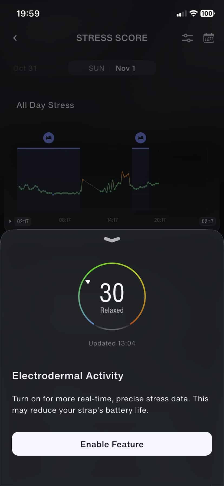
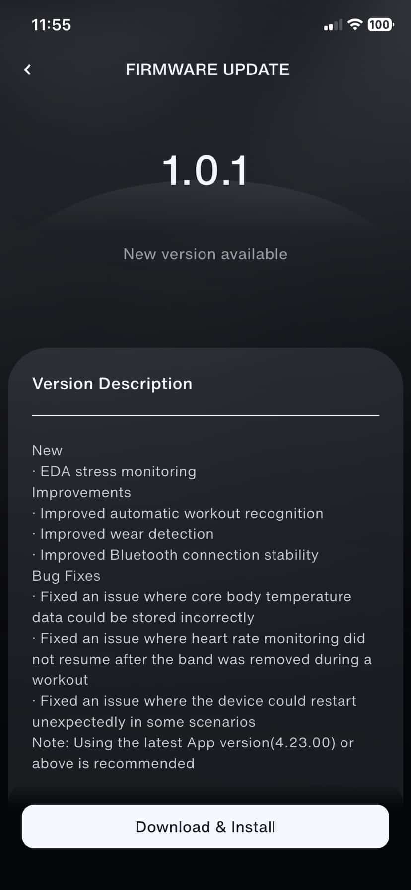

The **Speediance Strap Pro** begins to leverage its electrodermal activity sensor for stress tracking. According to [Gadgets & Wearables](https://gadgetsandwearables.com/2026/11/01/speediance-strap-pro-gets-eda-stress-monitoring/), firmware **1.0.1** incorporates this feature and improves automatic workout recognition. For those already using the screenless bracelet, the novelty is an additional signal in the app, not a diagnosis of how you feel: scores remain estimates that need context.

The outlet published the information on November 1st and presents it as the device's first firmware update. Its coverage includes two screenshots of the application: one with version notes and another with the option to enable electrodermal activity. These serve as documentary references for the changes, not results of a test performed by TechSpain24.

## What EDA brings to the Speediance Strap Pro

EDA stands for electrodermal activity. The sensor records small variations in the skin's electrical properties related to sweat gland activity. Gadgets & Wearables explains that this signal can indirectly reflect physiological stress. That is not equivalent to reading emotions or identifying a disease.

There is an important nuance for current users. Marko Maslakovic, author of the news and previous device analysis, points out that the bracelet already produced a minute-by-minute stress score during its tests. However, he considers that it then did not seem to use the EDA sensor data. The update should therefore not be interpreted as the arrival of the first stress indicator, but as the announced incorporation of this specific measurement.

The same outlet identifies the EDA sensor as one of the hardware differences between the Strap Pro and the version without the surname "Pro". This news refers to the Pro model; it does not confirm that the other bracelet receives an equivalent function.

*Screenshot published by Gadgets & Wearables. The app warns that enabling the function may reduce autonomy.*

The warning is as important as the new metric: the screen offers enabling EDA and warns of a possible impact on the battery. It does not provide a figure of hours or days lost. Nor does it allow proving a concrete improvement in accuracy, although the interface promotes more precise and real-time data.

## Firmware 1.0.1 and app 4.23.00: other changes

The version notes visible in Gadgets & Wearables' screenshot list improvements in **automatic workout recognition**, detection of whether the bracelet is worn, and Bluetooth connection stability. These are less flashy adjustments than a new metric but affect daily use: recording activity and maintaining communication with the phone form part of a screenless bracelet's basic experience.

The screenshot also collects three fixes: an issue that could incorrectly save central body temperature data, another that prevented resuming heart rate monitoring after taking off the bracelet during a workout, and unexpected reboots in certain situations. These are faults described in the changelog, not incidents we have reproduced.

*Changelog of the application reproduced by Gadgets & Wearables.*

To accompany firmware 1.0.1, the notice **recommends app version 4.23.00 or later**. It is advisable to keep that nuance: the text speaks of a recommendation, not documenting an obligatory blockage of previous versions. The outlet indicates that distribution is carried out via the Speediance app, without detailing a schedule by country nor guaranteeing that all users see the update simultaneously.

## An additional signal, not a medical evaluation

The practical question is whether the new information helps understand daily life without turning every number into an instruction. As context, we already explained [the limits of evidence regarding wearable recovery scores](/noticias/wearable-readiness-scores-evidence-gap/). That discussion does not validate or invalidate Speediance's EDA on its own, but reminds that showing an indicator and demonstrating a health benefit are different things.

The documentation cited here does not provide clinical validation of the new function nor comparative measurements of its accuracy. If you already have a Strap Pro and want to explore another personal tracking signal, the update deserves attention, keeping in mind the possible cost in autonomy. If you need to identify the cause of stress or make medical decisions, this score does not replace a professional evaluation.
