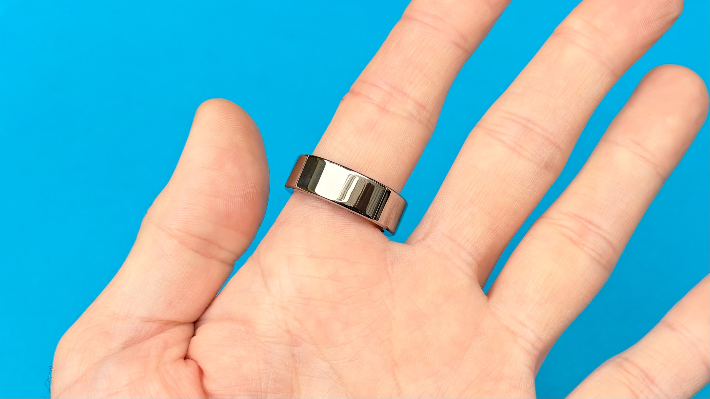
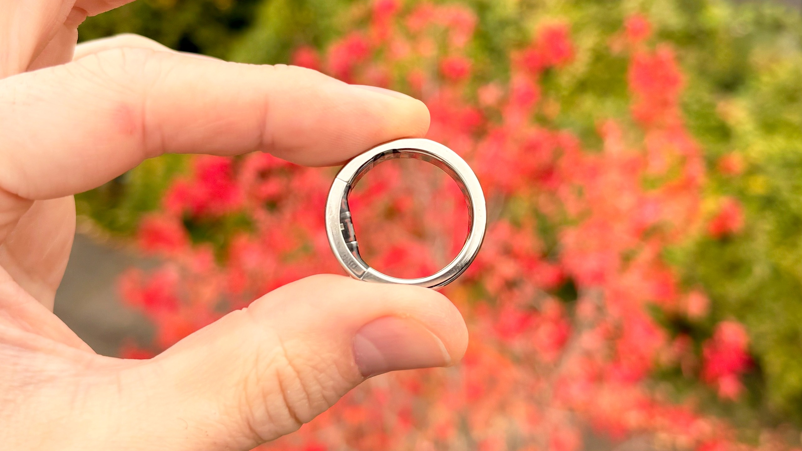
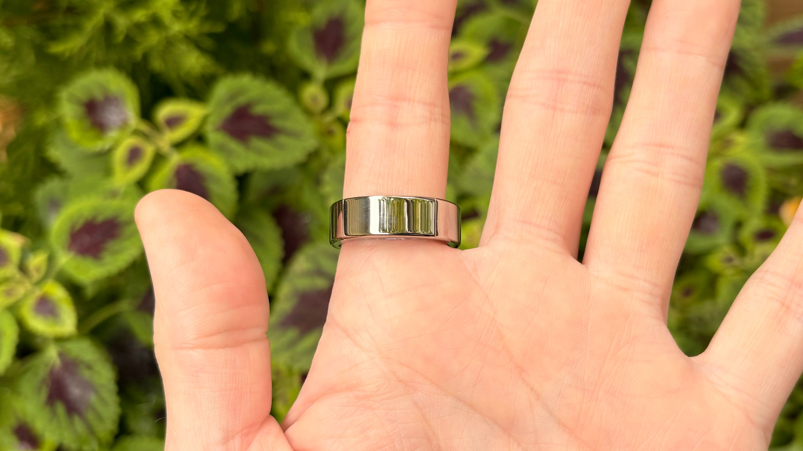
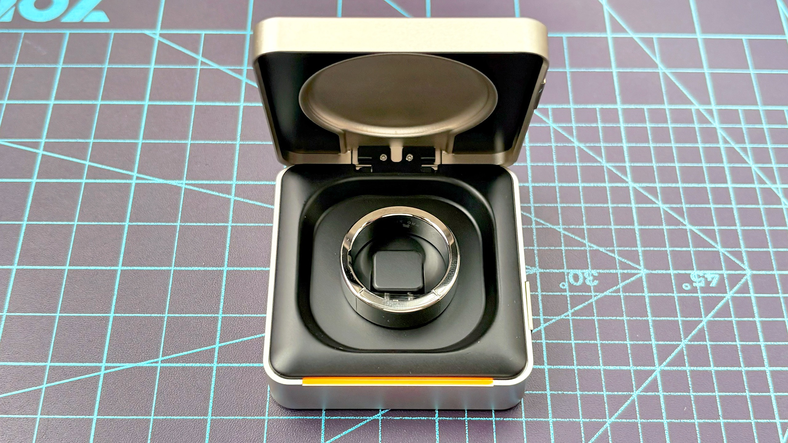

The **Ultrahuman Ring Pro** aims to track sleep and recovery without adding a fee for its core features. The ring is now in US stores for **479 dollars**, including a charging case, according to the hands-on impressions published by Tom’s Guide on October 30. The news is its arrival at US retailers: not a worldwide device debut or confirmation of pricing for Spain.

Dan Bracaglia, the author of the hands-on article, has been using it for a few days and is still preparing his full review. His observations help assess the design and commercial proposition, but do not establish sensor accuracy or real battery life. TechSpain24 has not tested the ring.

## Ultrahuman Ring Pro: what the subscription-free price includes

The 479 dollars cover the ring and Pro case. Tom’s Guide lists four finishes—gold, silver, black and titanium—and sizes 5 to 14. The lack of a fee refers to core features; it should not be interpreted as a guarantee of free access to every additional service in the ecosystem.

The financial comparison requires looking beyond the initial outlay. The outlet places the Ring Pro 79 dollars above the Oura Ring 5's starting price, but notes that the latter adds a subscription. For anyone intending to wear the same ring for years, cumulative cost matters as much as the price on the box. This is a US reference, not a direct equivalent in euros.

## More bulk on the finger and a redesigned body

The Ring Pro uses a single-piece titanium structure, also described on [Ultrahuman's official page](https://www.ultrahuman.com/us/ring-pro/). It includes ProRelease, a solution intended to make it easier for medical staff to cut the ring if an injury or swollen finger requires its removal. It is not a mechanism that opens it automatically.

Size is the most tangible trade-off. Bracaglia measured 4.52 grams for his silver size 11 unit and reports a band thickness of 2.6 mm, reaching approximately 4.8 mm at the sensors. Those figures describe that unit, not an identical weight for every size. Although he says he barely noticed it after a day, comfort remains a personal impression from brief use.

## Up to 15 days claimed, still awaiting a full test

Ultrahuman claims up to **15 days per charge**. The journalist has not yet checked whether his unit reaches that figure. For users, the potential advantage would be more nights tracking sleep and less time worrying about the charger, but there is no independent measurement here to establish that the promise has been met.

The manufacturer has also revised the heart-rate sensor and processing. Tom’s Guide has yet to check its accuracy against other devices: updated hardware does not by itself demonstrate better pulse, sleep or recovery readings. Nor does it turn these wellness indicators into a medical diagnosis.

## The case helps with travel; Spain remains unconfirmed

The case can recharge the ring twice, according to Tom’s Guide. That is where the figure of up to 45 days away from a socket comes from: it adds the initial charge and the recharges, rather than meaning you can wear the ring for 45 consecutive days without removing it. It includes indicator lights and audible and haptic alerts; the official website also advertises up to 45 days with the charger.

The product expands a platform we previously covered through [medical-history integration in the Ultrahuman app](/noticias/wearables/ultrahuman-historial-medico-anillo-inteligente/), a development separate from this hardware. For a purchase from Spain, the sources consulted do not confirm local pricing or distribution terms. If avoiding fees is the priority, the Ring Pro is worth watching; if you want proven battery life and accuracy before paying, it is worth waiting for the full review.

*Photographs: Dan Bracaglia / Tom’s Guide.*
