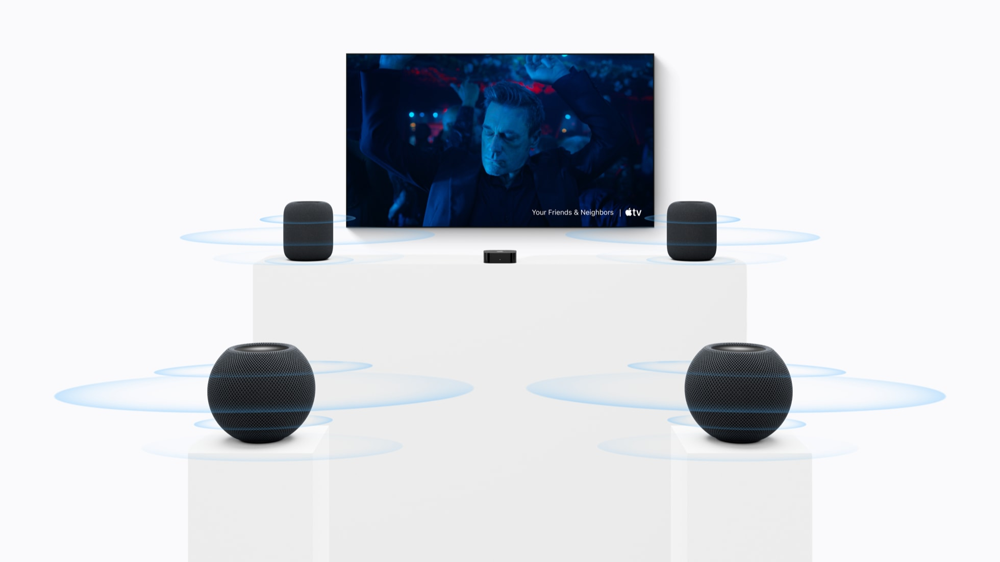

Apple ha puesto precio y fecha al relevo de su altavoz pequeño. El HomePod mini 2 costará 169 €, se puede reservar desde hoy y llegará a las tiendas el viernes 30 de octubre en cinco colores: rosa, verde, azul, blanco y medianoche. El nombre y la forma son continuistas, pero por dentro hay un cambio que no existía en el modelo de 2020: el altavoz pasa al chip S10 y estrena Sound Glow.

El lanzamiento forma parte del evento «Welcome Home» que Apple celebró el 13 de octubre y que también sirvió para presentar un nuevo Apple TV 4K y el HomeView, un altavoz con pantalla que, por ahora, no se venderá en España. Leídos juntos, los tres anuncios apuntan a una misma idea: cubrir el salón de arriba abajo y convertir el HomePod mini 2 en la puerta de entrada más barata al ecosistema de audio de la casa.

## Qué cambia en el HomePod mini 2

En lo acústico, el mini 2 mantiene el planteamiento del original: un transductor de rango completo y dos radiadores pasivos con cancelación de fuerza que, apoyados en el audio computacional, buscan llenar la habitación con un sonido de 360 grados. Lo nuevo es el chip S10, que sustituye al viejo S5 de 2020 y analiza la música en tiempo real para ajustar rango dinámico, volumen y rendimiento acústico. Se puede usar solo, en par estéreo o dentro de un sistema multizona, y también funciona como altavoz de un Mac con Wi‑Fi 6E o posterior.

La función más visible es Sound Glow: la parte superior, antes una simple superficie táctil, ahora se ilumina y late al ritmo de la música, reacciona a graves y agudos y toma el color de la portada del álbum que está sonando. Con un paisaje sonoro, como el de la lluvia, genera animaciones propias.

Donde más se nota el salto es en el cine en casa. Por primera vez, el HomePod mini 2 se puede combinar con el Apple TV 4K (4.ª generación) para montar un sonido envolvente de cuatro altavoces: dos delante y dos detrás, con cada pareja formada por el mismo modelo. El Apple TV 4K reconoce la posición de los altavoces en la sala y calibra tiempos y niveles de forma automática.

## El Apple TV 4K pone la parte del cine

El segundo anuncio es el Apple TV 4K (4.ª generación), que se puede reservar desde hoy, llega el 13 de noviembre y cuesta 349 €. El salto de rendimiento viene del chip A19: Apple cifra hasta un 50 % más de rendimiento de CPU y el doble en GPU respecto a la generación anterior, además de un decodificador AV1 dedicado que mejora la eficiencia del streaming.

En el salón, lo que más se nota es el micrófono. El nuevo Apple TV 4K incorpora tres micrófonos de campo lejano y cancelación de eco, de modo que se puede hablar con Siri sin usar el mando, incluso con audio sonando de fondo. El mando Siri Remote conserva su diseño, pero añade compatibilidad con Buscar y Búsqueda de Precisión y la opción de emitir un sonido para localizarlo cuando se pierde, la misma idea que ya usan los AirPods.

## HomeView: el altavoz con pantalla que se queda fuera de España

El tercer producto es el más distinto. El HomeView es un altavoz con una pantalla táctil Liquid Retina de 7 pulgadas, montada sobre una base con forma de cúpula y una bisagra de acero que permite inclinarla para mirarla cómodamente. Se vende en cuatro colores (plata, blanco estrella, rosa y gris espacial) y también en una versión de pared. Reconoce hasta seis personas por la cara y adapta la pantalla a cada una.

En sonido apunta más alto que el mini: dos altavoces de rango completo en la pantalla, un woofer orientado hacia abajo y dos radiadores pasivos en la base, todo con audio espacial y audio computacional.

Para el lector español, el problema es de disponibilidad. El HomeView se venderá en Estados Unidos por 299 dólares y llegará a países como Canadá, Reino Unido o Australia el 13 de noviembre. Apple confirma, en cambio, que no se venderá en la Unión Europea, y la razón que da es que Siri AI todavía no está disponible en iOS en la UE. La compañía asegura que sigue hablando con Bruselas para encontrar una salida.

## ¿Merece la pena?

Visto con precios de España, el HomePod mini 2 es la pieza más fácil de justificar: 169 € por un altavoz que se integra con el resto del ecosistema y que, en par, rinde como altavoz de escritorio para un Mac. Montar el cine en casa de cuatro altavoces, en cambio, obliga a comprar además el Apple TV 4K y un juego completo de altavoces, y ahí la cuenta crece. En su toma de contacto, Engadget encontró convincente la configuración de cuatro unidades, pero apuntó que el uso más realista para la mayoría es el par estéreo conectado al ordenador.

Queda una advertencia que conviene tener clara antes de reservar: el gran reclamo del lanzamiento, Siri AI, no llega de serie ni estará disponible al inicio en la UE. En iOS 27 ya existe la opción de [activar Siri AI o volver a Siri Classic](/noticias/siri-ai-ios-27/), pero en el HomePod mini 2 el asistente llegará, según Apple, con una futura actualización gratuita de software. Para un usuario en España, hoy las razones para comprar el altavoz son el chip S10, la iluminación sonora y el sonido envolvente, no el asistente.
