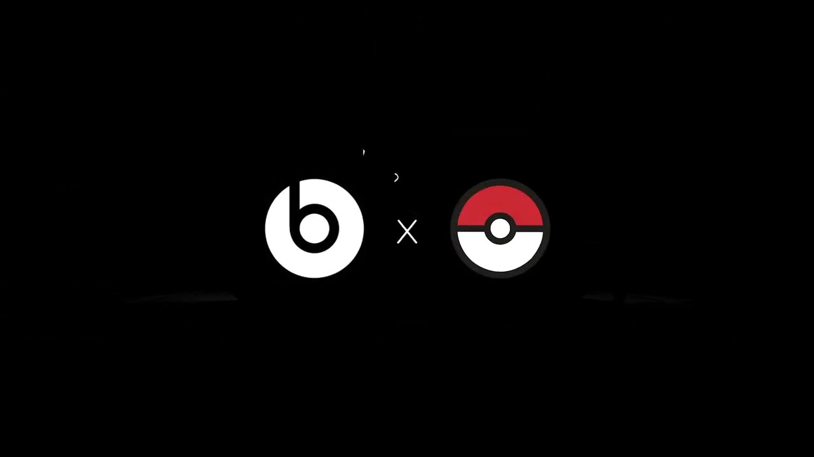

Beats ha publicado un vídeo corto en el que da a entender que prepara una colaboración con Pokémon. El clip, titulado «Time to catch something new», muestra un altavoz Beats Pill junto a los logotipos de Beats y una Poké Ball en paralelo, y todo apunta a que se trata de una edición especial del altavoz Bluetooth con la imagen de Pikachu. La compañía todavía no ha anunciado ni fecha de lanzamiento ni precio para esa versión.

## Un teaser sin producto a la vista

El vídeo se limita a insinuar: no enseña el altavoz terminado, sino el Beats Pill actual acompañado de los dos iconos. Es el patrón habitual de este tipo de anuncios, donde la marca confirma que hay algo en camino sin entrar en detalles técnicos ni de acabado. La única pista textual es el título del clip, que juega con el verbo «catch» de la saga.

## La pista que situó el producto antes del anuncio

Unos días antes de que Beats publicara el vídeo, el creador de contenido de Pokémon BritBratTV compartió en su canal de Twitch dos fotografías de lo que sería la caja de un Beats Pill con diseño de Pikachu en una tienda Target de Estados Unidos. Esa filtración es la que da forma al teaser: encaja con la idea de una edición temática del altavoz y no con un modelo nuevo. Aun así, se trata de una imagen sin confirmar por parte de la marca.

## El punto de partida: el Beats Pill actual

Apple recuperó el Beats Pill en 2024, después de haber descatalogado la versión anterior en 2022. En Estados Unidos, el altavoz Bluetooth tiene un precio habitual de 149,99 dólares. Si la colaboración con Pokémon se limita a un acabado y a la caja —lo más probable a la vista del teaser—, el punto a vigilar no es el rendimiento, que no cambiaría, sino cuánto sube el precio respecto a ese modelo base. Pikachu ya visitó Apple Park en agosto, un detalle que ahora encaja con el anuncio.

## ¿Merece la pena esperar?

Para quien busque sonido, la incógnita no está en el altavoz, sino en el sobrecoste de la edición especial. Si Beats mantiene el hardware y solo cambia el diseño, la decisión se reduce a cuánto se paga por la personalización de Pikachu frente al Beats Pill estándar de 149,99 dólares. Hasta que haya fecha y precio oficiales, conviene esperar: no hay ningún cambio técnico anunciado que justifique comprar antes.
