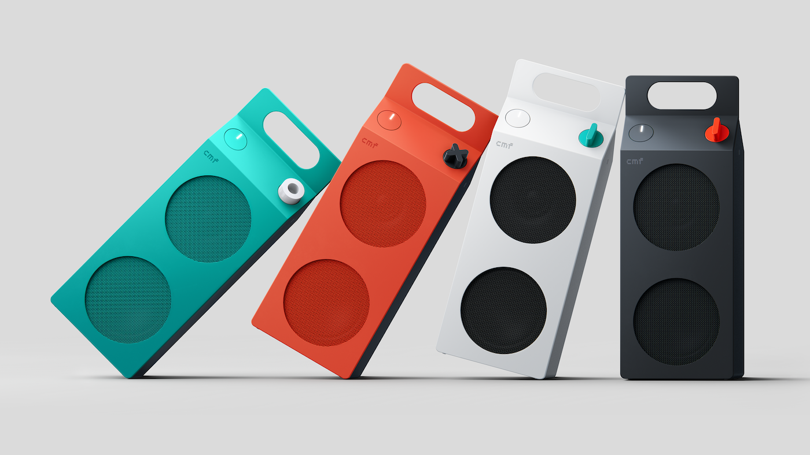

CMF, la submarca económica de Nothing, ha presentado sus primeros altavoces Bluetooth: los Speaker S y Speaker M. El modelo pequeño arranca en 59 dólares (49 libras) y el grande en 109 / 99, y ambos llegan en cuatro acabados —blanco, gris oscuro, naranja y turquesa—. La novedad sigue a los recientes auriculares Nothing Headphone (1) Pro y estrena la apuesta de la marca por el sonido portátil de precio ajustado.

## Dos formatos, dos usos

El Speaker S es el más compacto y está pensado para llevarlo encima y escuchar fuera de casa. Monta un driver «custom-tuned» de 45 mm y dos radiadores pasivos, la solución habitual en cajas pequeñas para reforzar los graves sin depender de un transductor grande.

El Speaker M cambia el enfoque: es más voluminoso y apunta a llenar una sala, con un rango de frecuencia declarado de 60 Hz a 20 kHz. Frente al S, aquí la prioridad es la cobertura más que el transporte.

## Lo que comparten: Bluetooth 6.0 y 18 horas

A pesar de la diferencia de tamaño, los dos modelos comparten buena parte de la ficha técnica. La autonomía declarada es de 18 horas de reproducción al 50 % de volumen con el modo Ultra Bass activado, un realce que añade peso a las pistas que lo necesitan; una carga rápida de 10 minutos da para una hora más de uso.

En conectividad, ambos adoptan Bluetooth 6.0, con un alcance anunciado de más de 100 metros entre altavoz y dispositivo, y soportan conexión dual, de modo que puedes alternar entre dos equipos sin volver a emparejarlos cada vez. Para el día a día, eso se traduce en algo sencillo: pasar del móvil al portátil sin interrumpir la reproducción.

En cuanto al audio en conjunto, CMF ofrece dos modos. El Stereo Mode convierte dos unidades —del S o del M— en un par estéreo con canales izquierdo y derecho. El Party Mode va más lejos y permite emparejar ambos modelos para sumar volumen, incluso con cajas compatibles de otras marcas.

## Diseño y personalización: el gancho real

Lo que ha puesto el foco sobre estos altavoces es la estética. Su silueta recuerda a un cartón de leche, un giro visual que los distancia de la competencia en el segmento de entrada. Sobre esa base, CMF añade un elemento poco habitual: los paneles frontales de ambos modelos son desmontables y se pueden cambiar por otro de distinto color.

La marca va un paso más allá y anima a quienes tienen impresora 3D a fabricarse sus propios paneles y mandos de volumen, con una guía publicada en su comunidad. Es un extra que no afecta al sonido, pero sí a la vida útil percibida del producto y a su encaje en la decoración de casa.

## ¿Merece la pena?

Sobre el papel, la relación calidad-precio de partida es razonable: Bluetooth 6.0, 18 horas y doble conexión son cifras competitivas para un altavoz portátil de este precio. Conviene separar lo medible de lo que aún no lo es: CMF declara rango de frecuencia y autonomía, pero no hay todavía mediciones independientes de distorsión ni de respuesta real, así que el rendimiento sonoro queda pendiente de comprobar en pruebas. El argumento fuerte, hoy, es el diseño y la personalización; el sonido habrá que juzgarlo al escucharlo.
