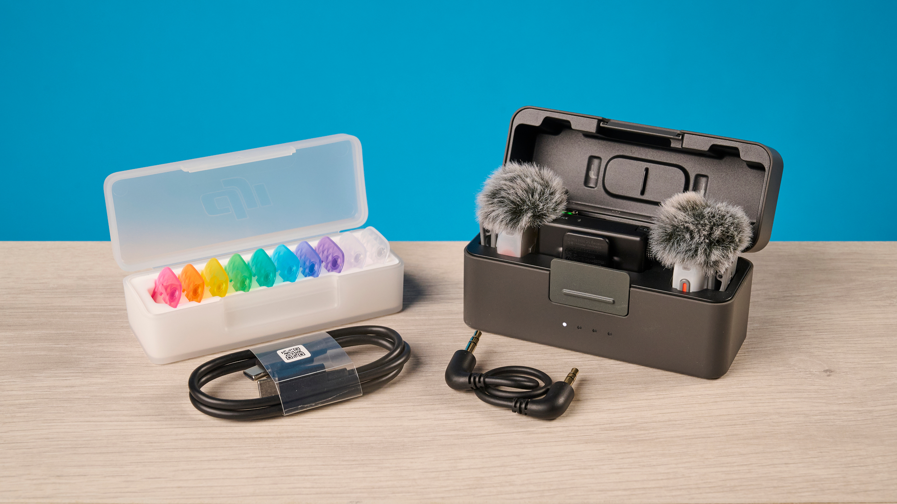
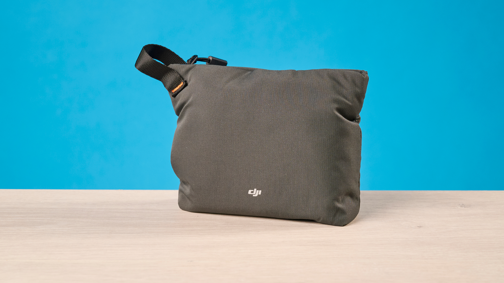
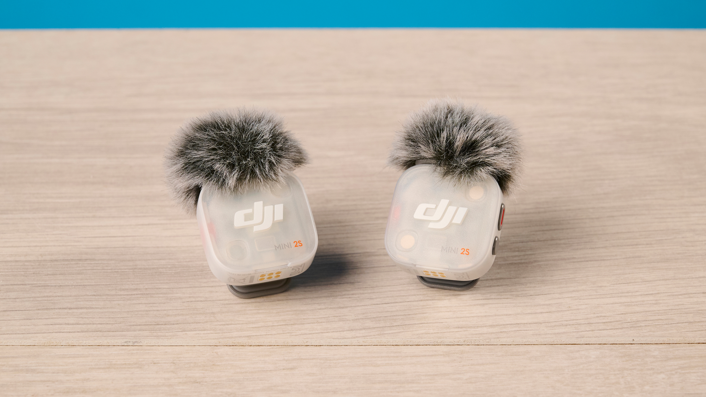
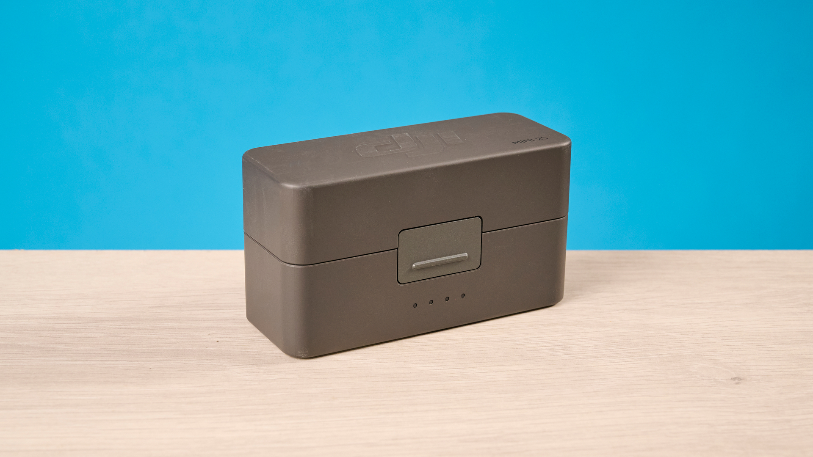
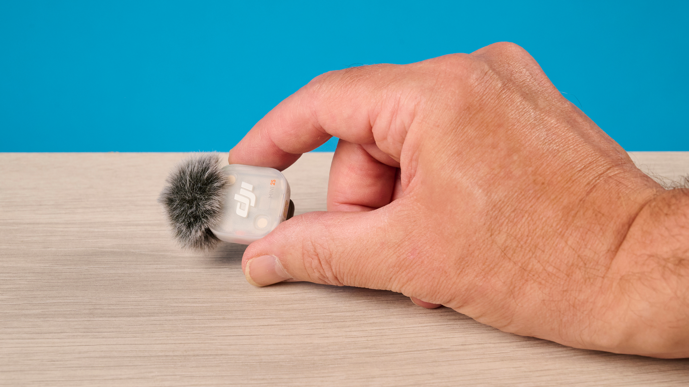
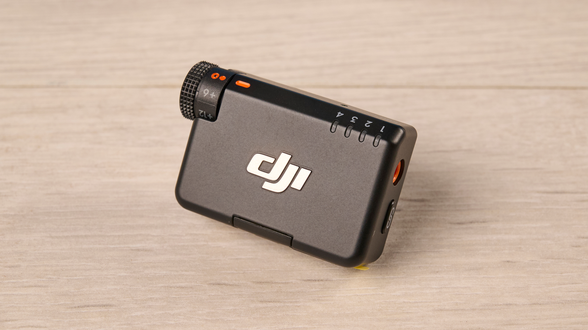
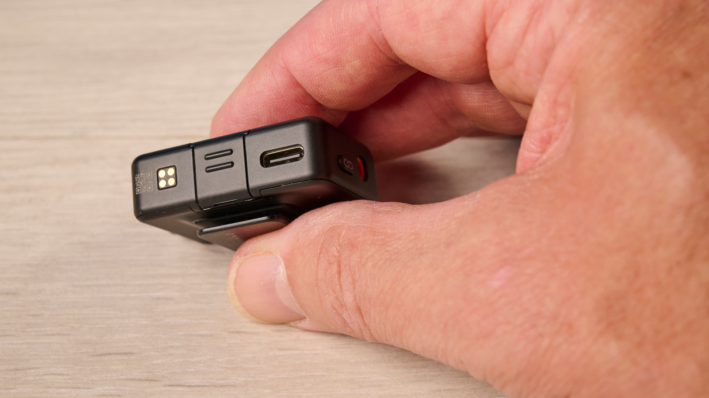

El DJI Mic Mini 2S se vende en Reino Unido por 169 libras en el kit de dos transmisores, un receptor y estuche de carga; la versión de un solo transmisor cuesta 79. Con ese precio se coloca bastante por debajo del DJI Mic 3 (259 libras) sin renunciar a la grabación interna a 32 bits flotante, una función que el Mic 3 sí incluye y que los Mic Mini anteriores no ofrecían. Tom's Guide publicó su análisis el 3 de noviembre y le otorga 4,4 sobre 5, con la etiqueta Editor's Choice y dos objeciones concretas: el pop de las plosivas y el volumen del receptor.

## Qué es y cuánto cuesta

El Mic Mini 2S es un sistema inalámbrico de dos piezas: un transmisor de pinza y un receptor que se enchufa por USB-C. Está pensado para grabar voz en vídeo y pódcast desde el móvil, el ordenador o una cámara, y según la review el receptor también admite cámaras tradicionales por cable de 3,5 mm y conexión Bluetooth. Con cámaras DJI, el sistema funciona dentro del ecosistema OsmoAudio sin necesidad de receptor.

La disponibilidad es la parte menos cómoda para un lector fuera del Reino Unido. Estados Unidos no tiene el producto a la venta por las restricciones regulatorias y de importación vigentes contra DJI, y allí el modelo anterior, el Mic Mini, sigue disponible por 99 dólares. El precio que cita el análisis está en libras, así que para comprar en España conviene confirmar el importe y el stock en la tienda de DJI antes de dar el desembolso por cerrado.

| Dato | Valor |
| --- | --- |
| Transmisor | 28,7 × 27,9 × 13,5 mm y unos 12 g |
| Receptor | 46,5 × 29,7 × 19,3 mm y unos 19 g |
| Estuche | 106,4 × 59,2 × 42,4 mm y unos 160 g |
| Cápsula | Omnidireccional |
| Grabación interna | 32 bits flotante, 14,5 GB |
| Conectividad | Bluetooth 6.0, USB-C y 3,5 mm |
| Alcance | Hasta 400 m |
| Autonomía | 11 h por transmisor, 10 h el receptor, 40 h con estuche |

Las medidas en milímetros y gramos son conversión de las pulgadas y onzas que publica el análisis.

Las imágenes del análisis muestran dos antivientos de pelo, un juego de piezas de colores para distinguir emisores y los dos cables, el USB-C y el de 3,5 mm. El estuche rígido, que además carga los transmisores, y una bolsa de tela completan el conjunto.

## 32 bits, cancelación de ruido y sibilancia

La grabación a 32 bits flotante es la novedad técnica que más peso tiene en la review. Captura un rango dinámico muy amplio, de modo que las partes más silenciosas se pueden subir en posproducción y los sonidos muy fuertes, como un grito, no se recortan: se pueden bajar después. El almacenamiento interno de 14,5 GB da para unas 22 horas en 32 bits o unas 28 horas en 24 bits, según los cálculos que maneja Tom's Guide. Quien ya trabaje a 32 bits encontrará el mismo principio en el [Insta360 Mic con pantalla de tinta electrónica](/noticias/audio/insta360-mic-pantalla-tinta-electronica-grabacion-32-bits/), aunque allí el enfoque del producto es otro.

En sibilancia y fricativas, esas eses, sh y efes que suelen producir silbidos molestos, el micrófono sale bien parado: en las pruebas del análisis aparecieron limpias y sin distorsión audible. La cancelación de ruido ambiental trabaja en dos niveles y, en la grabación de la autora, eliminó por completo los avisos del portátil que sonaban en la misma habitación. La comparación con el Mic Mini 2 es el dato más útil del texto: en esa misma situación, el modelo anterior dejaba el audio con un efecto «bajo el agua».

## Autonomía y conexión del DJI Mic Mini 2S

Cada transmisor aguanta 11 horas y el receptor 10; con el estuche, la cifra total llega a 40 horas. Son tres horas más por transmisor que las ocho que declara el Mic 3, suficientes para varias jornadas de grabación sin pasar por el cargador. El estuche suma la carga sin cables, y la review lo describe como el accesorio que resuelve una salida de fin de semana.

En conexión, la review destaca la sencillez: receptor USB-C para móvil u ordenador, cable de 3,5 mm para cámara y Bluetooth como tercera vía. Los transmisores y el receptor son compatibles hacia atrás con los del Mic Mini y el Mic Mini 2, y se pueden emparejar hasta cuatro. Eso permite añadir un transmisor 2S a un kit anterior y ganar cancelación de ruido y 32 bits sin cambiarlo todo. El Mic Mini 2, en cambio, admite dos micrófonos en el receptor. Si el uso principal es grabar con el móvil por USB-C, el [Sony ECM-AX10](/noticias/audio/sony-ecm-ax10-microfono-espacial/) es otra vía que no depende de un receptor independiente.

## Plosivas, receptor y veredicto

El primer defecto es acústico y aparece en las plosivas, las consonantes que empujan aire contra la cápsula: p, b, d y g. En las grabaciones del análisis, la p al inicio de palabra sonaba dura, con el aire audible entrando en el micrófono, y el resultado cansa al escuchar. El Mic Mini 2 no mostraba ese problema. La autora advierte de que la distancia a la boca influye, así que parte del comportamiento depende de cómo se coloque el micro; aun así, lo describe como un defecto del producto y no solo de la técnica.

El segundo es de diseño. El receptor mide unos 46 × 30 × 19 mm y, enchufado al móvil, impide apoyarlo plano o dejarlo de pie, además de cargar el peso en la parte superior. Tom's Guide señala el Insta360 Mic Air como alternativa más manejable en ese aspecto, aunque con menos funciones.

La comparación de precios que recoge la review deja clara la posición del producto:

| Modelo | Precio en el análisis |
| --- | --- |
| Insta360 Mic Air | 69 £ |
| DJI Mic Mini 2 | 89 £ |
| Rode Wireless Micro | 139 £ |
| DJI Mic Mini 2S | 169 £ |
| DJI Mic 3 | 259 £ |

El veredicto de Tom's Guide es favorable en lo esencial: por 169 libras se obtienen rasgos de la gama alta, como el 32 bits, una cancelación de ruido eficaz y 40 horas con estuche, a un precio bastante menor que el Mic 3. La recomendación se dirige a creadores que graban fuera, con ruido ambiente alrededor, y a quien da el salto a un inalámbrico por primera vez. Para trabajo profesional exigente, la propia review pide mirar otras opciones por el pop de las plosivas y el bulto del receptor.

¿Merece la pena? Si el uso principal es voz en exterior y el presupuesto pesa, sí: la diferencia con el Mic Mini 2 se justifica por la cancelación de ruido y la grabación a 32 bits. Si se graba en estudio, con el micro pegado a la boca y sin margen para repetir una toma, el ahorro frente al Mic 3 no compensa el riesgo de una p explosiva.

> Alcance: este artículo resume el análisis de Tom's Guide publicado el 3 de noviembre de 2026 y firmado por Ashley Thieme. Las mediciones, las impresiones de escucha y la puntuación son de ese medio; aquí no se ha probado el producto.
