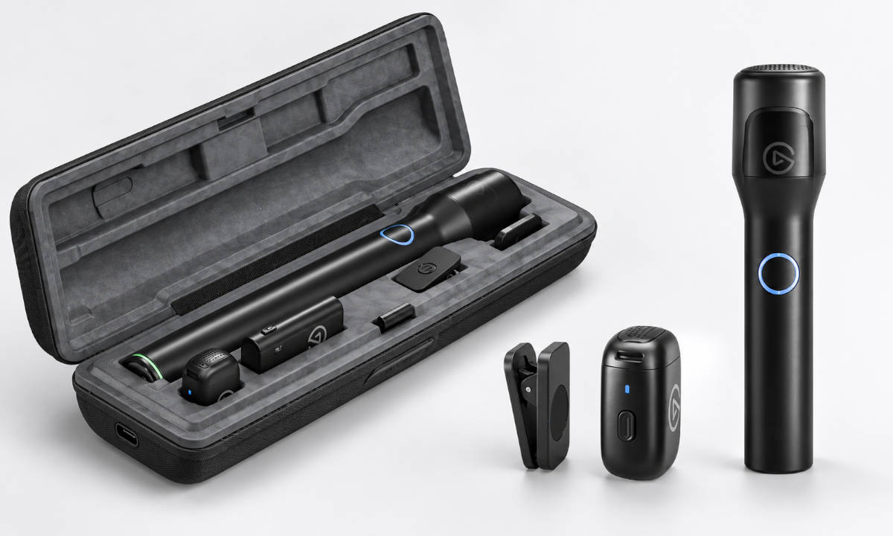

Elgato vende ya por 99 euros Wave Go, su primer micrófono inalámbrico concebido para grabar fuera del escritorio. Hasta ahora el audio de la firma —propiedad de Corsair— empezaba cuando el creador se sentaba frente al ordenador; este modelo rompe esa frontera con un sistema de dos piezas que funciona como micrófono de solapa y, con un accesorio, como micrófono de mano.

## Un micrófono, dos formatos

La pieza central es un transmisor de apenas 7 gramos que puede engancharse a la ropa mediante clip o placa magnética. El salto llega con el Smart Handle: al insertar el transmisor en ese mango, el equipo pasa a comportarse como un micrófono de mano de tamaño completo, al estilo de los que se usan en entrevistas. El propio sistema detecta en qué formato está colocado y ajusta su funcionamiento, de modo que pasar de hablar a cámara a entrevistar a alguien exige poco más que mover físicamente el micrófono.

Ese cambio de formato se apoya en EQ Shift, la función más distintiva del producto. Wave Go usa una cápsula de condensador electret omnidireccional y captura audio a 48 kHz y 24 bits, pero aplica un perfil tonal distinto según cómo se emplee. En formato de solapa modifica la ecualización para reducir el exceso de medios que suele provocar la colocación sobre la ropa y recuperar presencia en las frecuencias altas; al entrar en el Smart Handle cambia a otro perfil que añade más cuerpo en graves y medios para compensar las resonancias de usar esa misma cápsula como micrófono de mano.

## Procesado a bordo y enlace inalámbrico a 2,4 GHz

Elgato ha querido que grabar fuera de casa no obligue a configurar el sonido antes de empezar. Wave Go incorpora procesado directamente en el dispositivo —ganancia automática, EQ, limitador, compresor, cancelación de ruido, puerta de ruido y filtro de graves, entre otras funciones— y puede funcionar sin aplicación. No es un enfoque aislado: trasladar ese control al propio micrófono es la misma idea que siguen propuestas como el [Shure MV6 Gen 2](/noticias/shure-mv6-gen-2/). La app Wave Go para iOS, iPadOS y Android queda para tareas de control: consultar batería y emparejamiento, actualizar el firmware, ajustar la ganancia a mano o regular la intensidad de la reducción de ruido.

La conexión no recurre al Bluetooth. Wave Go trabaja sobre un enlace inalámbrico dedicado de 2,4 GHz, con un alcance de unos 30 metros y una latencia de 24 milisegundos o menos. El receptor se conecta por USB-C a smartphones, tablets y ordenadores, e incluye un puerto passthrough de 5 vatios para alimentar el dispositivo mientras se graba. Ese planteamiento también marca sus límites: no hay soporte para iPhone con Lightning ni conexión pensada para cámaras DSLR, mirrorless o equipos cinematográficos.

## Autonomía, precio y para quién es

La autonomía refuerza el enfoque móvil: el transmisor ofrece unas ocho horas por carga, pero el Smart Handle lleva su propia batería y puede recargarlo alrededor de cinco veces, lo que eleva el total hasta unas 48 horas. Diez minutos de carga dan cerca de una hora adicional. El estuche incluido recarga el conjunto cuando está conectado por USB-C, aunque no incorpora batería propia. El receptor admite dos transmisores a la vez, así que se puede grabar a dos personas con un único receptor añadiendo un segundo micrófono, que se venderá por 29,99 dólares.

Salir del escritorio no implica abandonarlo. Al conectar el receptor a un PC o Mac, Wave Go se integra con Wave Link 3.0, desde donde puede mezclarse con el audio del sistema y otras fuentes, además de recurrir a Voice Focus para reducir ruido de fondo y reverberación mediante IA.

Elgato Wave Go ya está a la venta por 99 euros, y en su lanzamiento lo acompaña una Day One Edition en color Sky Blue, limitada a 1.000 unidades y exclusiva de la tienda de la compañía. ¿Merece la pena? Para quien graba con el móvil y alterna entre hablar a cámara y entrevistar, el doble formato y las 48 horas de uso son los argumentos claros frente a kits de solapa con receptor aparte; quien necesite Lightning o conectar a una cámara tendrá que mirar otras opciones, porque Wave Go no las cubre.
