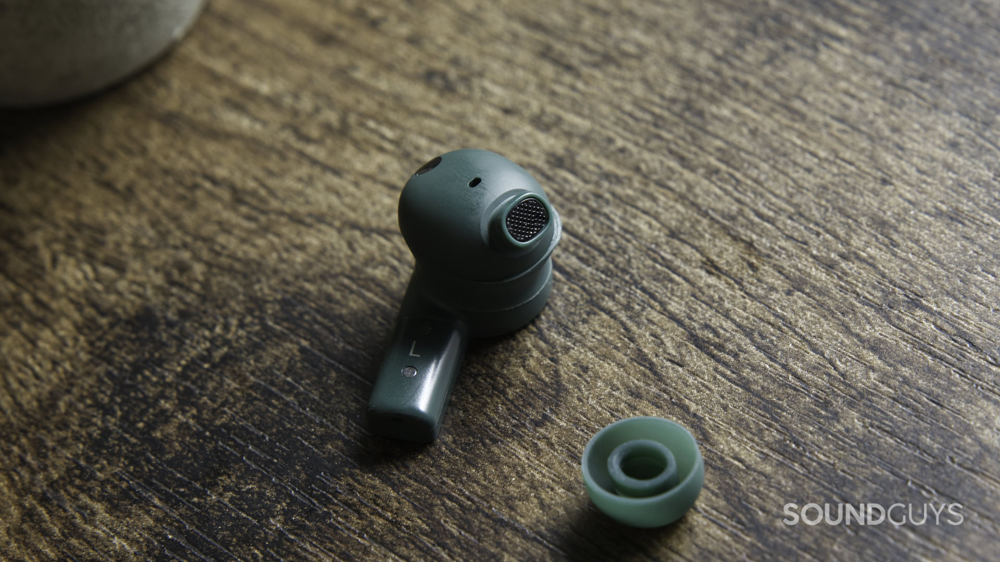
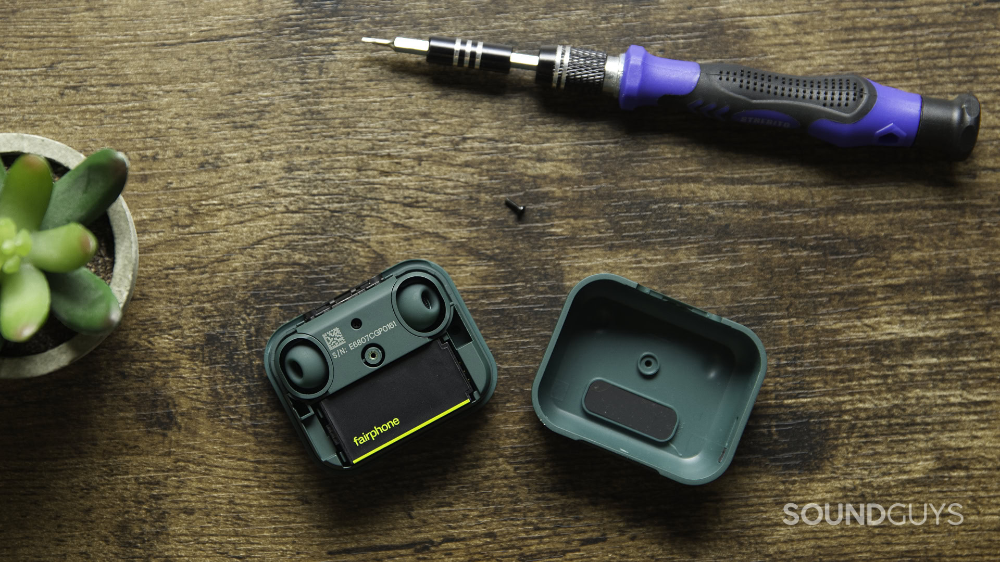
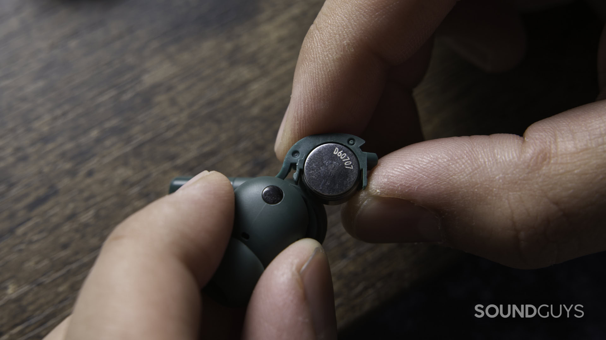

Los **Fairphone Fairbuds 2** tienen un precio original de **119 euros** y una fecha de lanzamiento fijada para el **2 de noviembre de 2026**, según el análisis publicado por SoundGuys. Su principal argumento no es una función de software: permiten sustituir las baterías de los auriculares y del estuche. A 30 de octubre, esa fecha sigue siendo futura; no debe confundirse la publicación del análisis con su disponibilidad comercial.

El medio ha probado durante tres días una unidad facilitada por Fairphone y combina sus impresiones con mediciones de laboratorio. El resultado dibuja una compra con prioridades claras: facilidad de mantenimiento a cambio de aceptar limitaciones en el sonido, la aplicación y las llamadas. No se trata de una prueba realizada por TechSpain24.

## Qué se puede reparar en los Fairbuds 2

Para acceder a la batería de cada auricular, SoundGuys explica que basta con retirar la cubierta de silicona y abrir el compartimento. La celda utilizada es una **LIR 1054**. La batería del estuche también resulta accesible, aunque en ese caso hay que retirar un tornillo con una punta Torx T4.

La diferencia práctica está en poder intervenir cuando la batería se desgaste, sin dar por terminado el uso de todo el producto. Eso no equivale a prometer una vida útil ilimitada: la reparabilidad describe el acceso a los componentes, no garantiza que nunca aparezcan otras averías.

El análisis también advierte de un detalle del montaje: hay que alinear correctamente una pequeña pestaña al cerrar el compartimento. Los auriculares cuentan con certificación IP54 y la cubierta de silicona debe proteger la zona de la batería. No son, por tanto, una invitación a utilizarlos bajo la ducha.

## Autonomía medida y cancelación: dos cifras distintas

Con la cancelación activa de ruido encendida, SoundGuys registró **5 horas y 29 minutos** en su prueba estandarizada de autonomía. Es un resultado algo inferior a las seis horas que el propio análisis atribuye a Fairphone. La cifra medida corresponde a las condiciones del laboratorio del medio: no asegura que todos los usuarios obtengan exactamente esa duración.

La cancelación activa redujo alrededor del 81 % del ruido según la métrica de sonoridad percibida utilizada por SoundGuys. No significa que elimine el 81 % de cualquier sonido en cualquier entorno. El autor señala que algunos ruidos agudos siguen atravesando el conjunto, una distinción importante si se buscan auriculares para aislarse en desplazamientos.

En conectividad, la ficha del análisis recoge Bluetooth 6.0, los códecs SBC, AAC, LC3 y LDAC y conexión multipunto con dos dispositivos simultáneos. Sin embargo, el probador encontró una incidencia de emparejamiento entre ambos auriculares que solo resolvió con un restablecimiento de fábrica. Es una observación de esa unidad, no una avería general demostrada.

## Sonido y micrófonos: dónde están las concesiones

Respecto a los Fairbuds originales, SoundGuys describe una mejora del sonido y del uso cotidiano, pero mantiene las reservas sobre su ajuste tonal. La aplicación incluye un ecualizador de cinco bandas que, según el medio, no basta para corregir sus problemas de afinación. Poder modificar el perfil tonal no implica disponer de un ajuste especialmente flexible.

La otra concesión aparece en las llamadas: el análisis detecta dificultades para rechazar ruido y destaca el viento como escenario problemático. Sirven para conversar, pero la recomendación del medio es menos favorable si se pretende hablar habitualmente mientras se camina por la calle.

Para quien valore conservar sus auriculares durante más tiempo, la sustitución de baterías es el argumento central de estos Fairbuds 2. Para quien priorice el sonido o las llamadas en exteriores, las reservas del análisis pesan más que esa ventaja. La batería reemplazable también aparece en formatos distintos, como los [auriculares Sonos Ace Ultra](/noticias/audio/sonos-ace-ultra-analisis/), pero no convierte automáticamente a ambos productos en alternativas equivalentes. Antes de comprar estos Fairphone, conviene comprobar la disponibilidad efectiva tras la fecha de lanzamiento que recoge SoundGuys.
