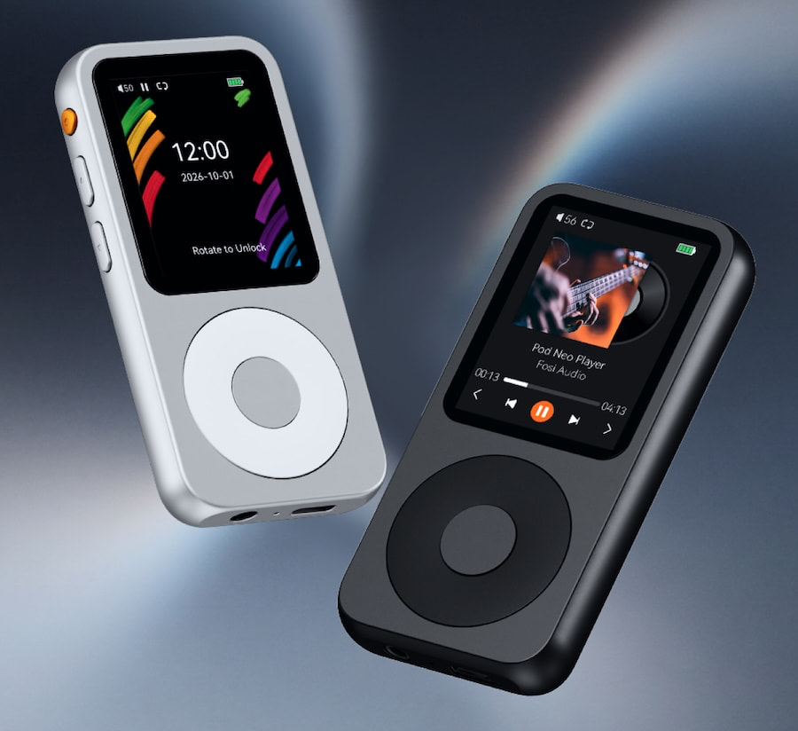

79,99 dólares es el precio de partida del Fosi Audio DAP Neo, un reproductor de audio digital portátil (DAP) que recupera la fórmula del iPod: carcasa metálica compacta, rueda de control táctil y almacenamiento ampliable. No hay aplicaciones de streaming, ni notificaciones, ni algoritmos decidiendo qué suena después. La pregunta, a estas alturas de 2026, es si eso sigue siendo un argumento de venta o solo nostalgia.

El DAP Neo es el tercer producto de la nueva línea **Fosi Moment**, que la compañía asocia con la idea de "escucha intencionada". Lo acompañan el reproductor de CD portátil DISC Nano, de 99 dólares, y el reproductor de CD Merak, de 140 dólares. Fosi ya mostró un prototipo temprano en el CanJam London 2026, y la sencillez fue justamente lo que llamó la atención de quienes lo probaron.

## Un DAC con nombre y apellido, y un soporte de formatos amplio

Bajo el exterior retro, el DAP Neo monta un DAC **Cirrus Logic CS43198** y reproduce archivos MP3, FLAC, WAV, APE, M4A y DSD. Es una base razonable para quien quiera construir su propia biblioteca portátil, aunque Fosi no ha detallado las tasas máximas de muestreo PCM ni las resoluciones DSD admitidas. La compañía declara una relación señal-ruido de 127 dB y una potencia de salida para auriculares de 129 mW, sin aclarar a qué impedancia se midió esa cifra.

La salida para auriculares es de 3,5 mm single-ended, y el Bluetooth queda como opción inalámbrica con una limitación clara: solo soporta el códec básico SBC, sin aptX, LDAC ni AAC. Quien quiera exprimir una colección sin pérdidas tendrá que tirar de cable. Tampoco hay salida balanceada de 4,4 mm, algo que a este precio no resulta sorprendente.

El almacenamiento llega con una tarjeta microSD de 16 o 64 GB incluida según la versión, ampliable hasta 256 GB. La pantalla es un panel TFT LCD de 2,4 pulgadas con resolución de 320 × 240, dentro de un chasis de metal mecanizado en CNC de 3,82 × 1,85 × 0,42 pulgadas y un peso de hasta 75 gramos. Fosi mantiene botones físicos en el lateral y una rueda de control, para no depender del táctil solo para cambiar de pista.

## Qué cambia para el usuario

El DAP Neo se ofrece en dos acabados, Galaxy y Obsidian, y su autonomía está cifrada en hasta 12 horas por carga, suficiente para desplazamientos diarios y sesiones largas. Incluye un cable USB para carga y transferencia de archivos.

La propuesta tiene un objetivo concreto: acercar a los oyentes más jóvenes la idea de poseer y reproducir su propia música sin depender de un smartphone ni de una suscripción. El obstáculo es el mismo que arrastra todo reproductor dedicado: exige descargar, organizar y gestionar archivos, algo que buena parte del público actual nunca ha hecho.

## Precio, competencia y lo que falta por saber

Hay dos versiones ya disponibles, en plateado o negro:

- Fosi Audio DAP Neo (16 GB): 79,99 dólares.
- Fosi Audio DAP Neo (64 GB): 119,99 dólares.

Los rivales directos que se suelen citar son el FiiO JM21 (259,99 dólares) y el FiiO M21 (369,99 dólares), ambos con Android, streaming, amplificación más potente y salidas balanceadas. Juegan en otra liga de precio, así que la comparación tiene sentido solo como referencia de lo que se gana al subir de tramo.

¿Merece la pena? Por 80 dólares, el DAP Neo reúne DAC dedicado, soporte de formatos sin pérdidas, Bluetooth y almacenamiento ampliable en un cuerpo metálico de 75 gramos. Quien busque un reproductor sin distracciones para llevarlo encima tiene aquí una puerta de entrada barata. Quien dependa del streaming o de auriculares exigentes debería esperar a que Fosi publique las resoluciones máximas y la impedancia de referencia: sin esos datos, no hay forma de saber cómo se comportará con modelos que pidan más corriente.
