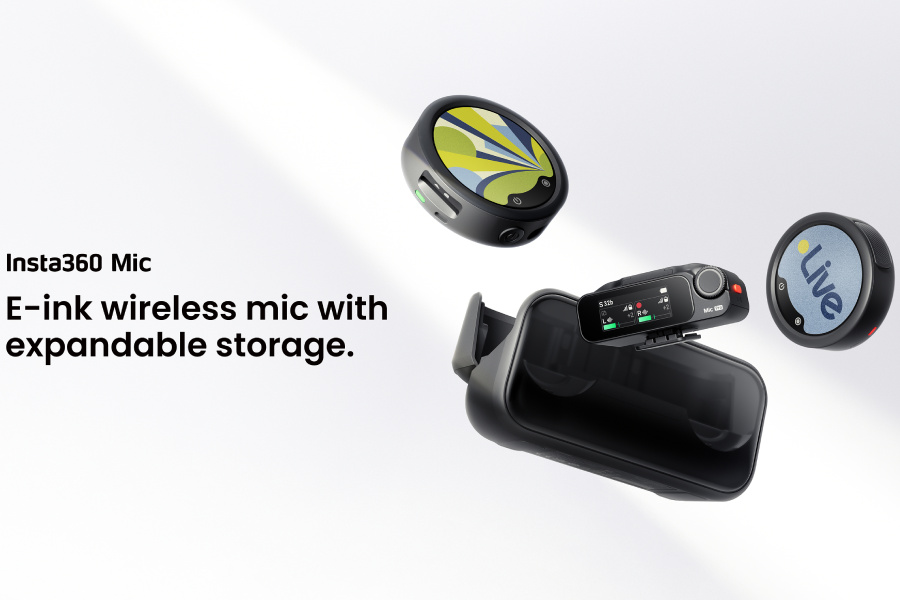

Los **79,99 dólares del Insta360 Mic corresponden al transmisor suelto**, no a un equipo con receptor. El nuevo micrófono inalámbrico, lanzado el 22 de octubre, combina una pantalla de tinta electrónica personalizable con una ranura microSD para guardar audio local en formato flotante de 32 bits. El kit con un transmisor y un receptor parte de 139,99 dólares, según el [comunicado de lanzamiento de Insta360](https://www.prnewswire.com/news-releases/insta360-launches-mic-to-complete-its-wireless-microphone-lineup-flagship-level-audio-for-everyday-creators-302916915.html).

La diferencia importa antes de comprar: un usuario con una cámara Insta360 compatible puede prescindir del receptor, mientras que conectar el sistema a otras cámaras exige revisar las conexiones. La marca sitúa este modelo entre el Mic Air de entrada y el Mic Pro, con una decisión clara: el almacenamiento del nuevo Mic depende de una tarjeta que se compra aparte.

## Insta360 Mic: pantalla personalizable y respaldo en microSD

La pantalla del transmisor mide **1,22 pulgadas**, utiliza seis colores y tiene una resolución de 240 × 208 píxeles. Permite subir una imagen, como un logotipo o una ilustración, en lugar de mostrar una marca fija sobre la ropa. También puede servir para identificar a los participantes de una conversación. Es una diferencia visual, no una prueba de mejor calidad de sonido.

La ranura microSD tiene una utilidad distinta: convierte el transmisor en una grabadora independiente. Con una tarjeta insertada admite grabación interna en 24 bits o flotante de 32 bits, como respaldo de lo que recibe el teléfono o la cámara. Sin tarjeta sigue funcionando como micrófono inalámbrico, pero no dispone de esa copia local.

**Los 32 bits flotantes se aplican únicamente a la grabación interna**, no a todas las salidas del sistema. El formato ofrece más margen para ajustar niveles durante la edición; no debe confundirse con una garantía de eliminar cualquier distorsión o ruido de la toma. La ficha oficial indica, además, que se genera un archivo nuevo automáticamente cada 30 minutos.

## Qué cámaras y teléfonos pueden utilizarlo

La conexión directa por Bluetooth admite Insta360 X6, X5, Luna Ultra, Luna Pro, GO Ultra y Ace Pro 2, con audio a 48 kHz y sin receptor. Para otras cámaras, el receptor se conecta a la entrada de micrófono mediante un cable de 3,5 mm; en teléfonos se puede utilizar el adaptador USB-C incluido.

No todas las conexiones Bluetooth son equivalentes. Insta360 aclara que el enlace directo del transmisor con un teléfono funciona con aplicaciones de terceros compatibles, **no con la aplicación de cámara nativa**, y captura audio a 16 kHz. Conviene comprobar este límite si la idea es comprar solo el transmisor para grabar con el móvil.

Un receptor admite hasta cuatro transmisores, incluidos modelos Mic y Mic Pro mezclados. Eso no significa disponer siempre de cuatro pistas independientes en la cámara: la salida de cuatro canales requiere determinados modelos Sony y el adaptador oficial, vendido por separado. En estéreo, con más de dos transmisores, el sistema agrupa las fuentes por parejas.

## Autonomía anunciada y diferencias frente al Mic Pro

Insta360 anuncia hasta 13 horas por transmisor y hasta 34 horas con el estuche. Son cifras de laboratorio obtenidas **con la grabación interna y la cancelación de ruido desactivadas**. Por tanto, no describen necesariamente una jornada grabando de forma continua en microSD con reducción de ruido.

El procesado incluye un chip dedicado a cancelación de ruido, dos modos de ganancia automática y tres preajustes de voz. El fabricante atribuye al sistema una reducción de ruido con menos artefactos; no se trata de un resultado de pruebas propias de esta publicación.

Frente al Mic Pro, el Mic emplea un único micrófono omnidireccional, en lugar de una matriz de tres micrófonos con varios patrones de captación. También sustituye los 32 GB integrados del Pro por almacenamiento ampliable mediante tarjeta. La pantalla compartida no hace, por tanto, equivalentes sus posibilidades de captación y almacenamiento.

## Precios: transmisor suelto o kit con receptor

La compañía anuncia disponibilidad global desde el 22 de octubre en su tienda oficial, Amazon y distribuidores autorizados, con estas referencias en dólares estadounidenses:

- **79,99 dólares:** un transmisor, sin receptor.
- **139,99 dólares:** un transmisor y un receptor.
- **249,99 dólares:** dos transmisores y un receptor.

Estas tarifas no confirman el precio final en España ni las existencias de un comercio concreto. Antes de comparar con otros equipos para creadores, como el [micrófono inalámbrico Elgato Wave Go](/noticias/audio/elgato-wave-go-microfono-inalambrico/), conviene igualar el contenido del paquete y las conexiones necesarias.

El argumento práctico del Mic está en conservar una copia local sin renunciar al envío inalámbrico. Para quien ya utiliza una cámara compatible, el transmisor suelto puede cubrir esa función; para otras configuraciones, el presupuesto debe contemplar el receptor, la tarjeta microSD y los adaptadores que correspondan. La pantalla personalizable llega después de esas comprobaciones, no las sustituye.
