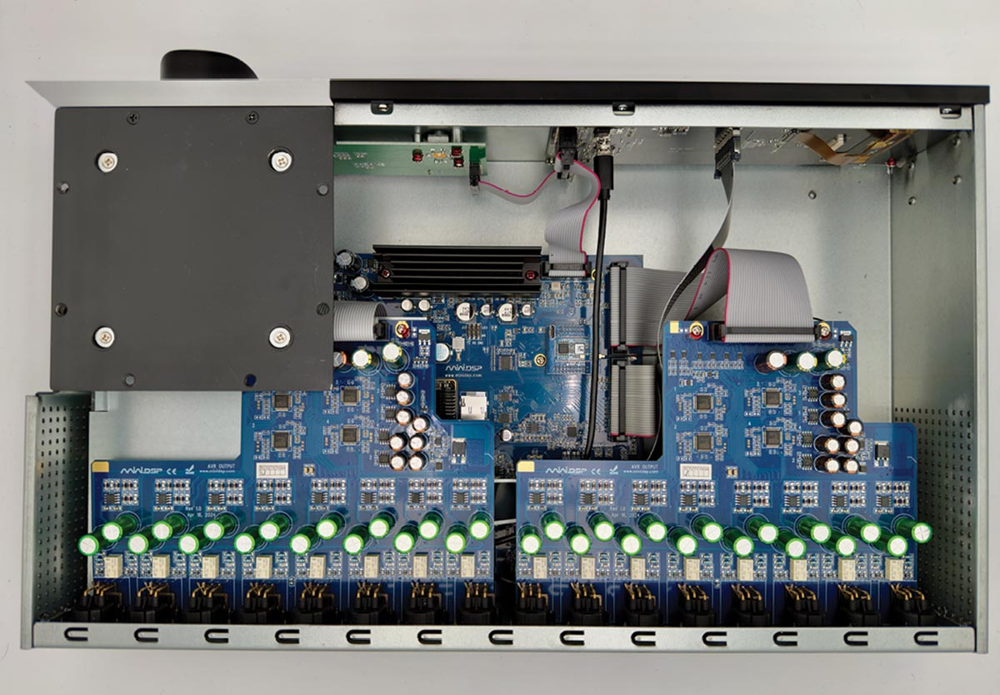
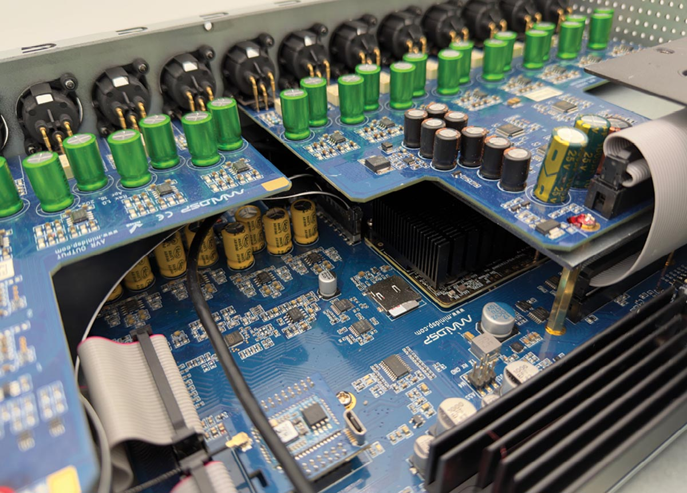
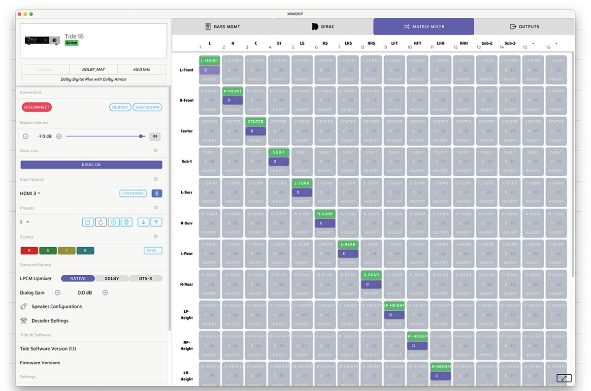
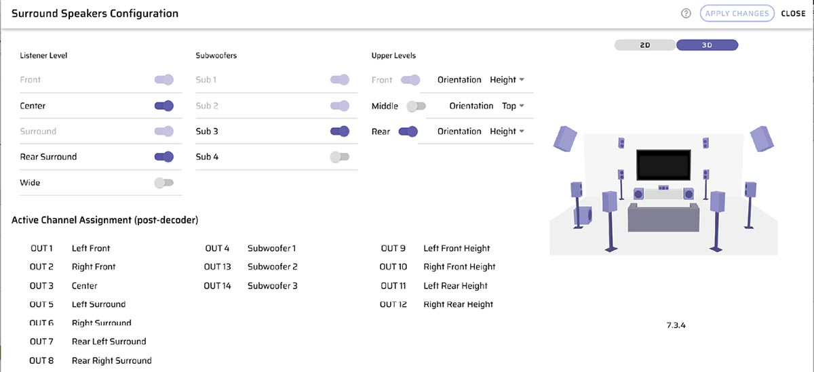
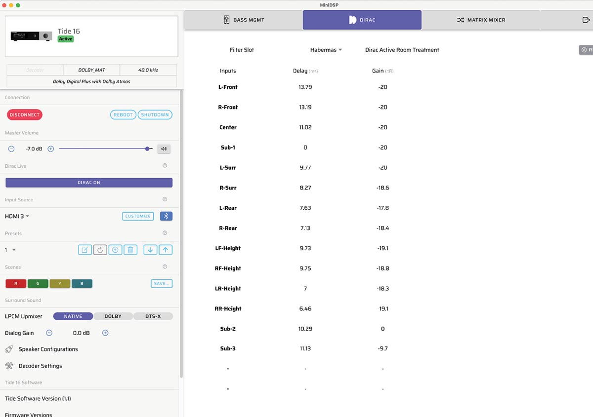
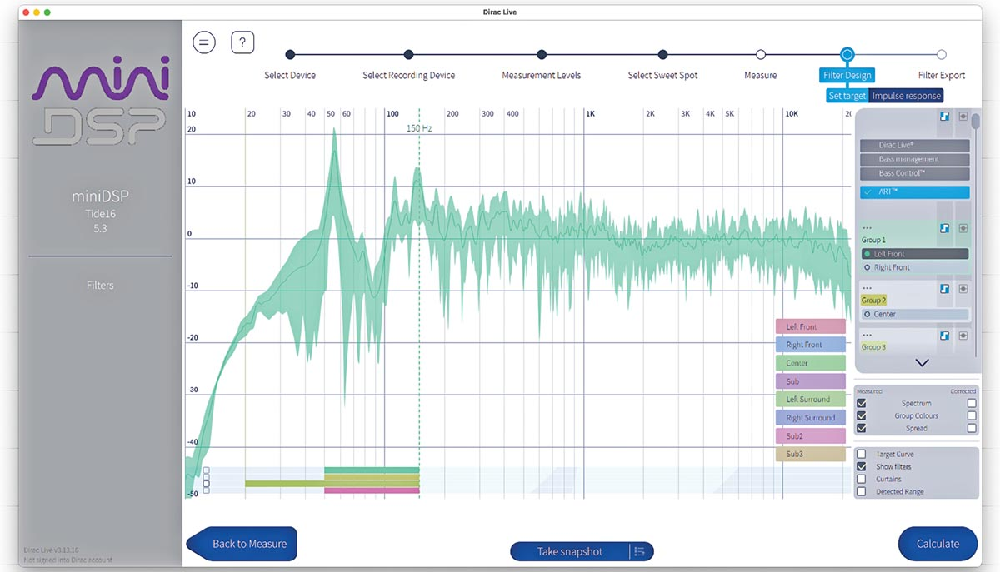
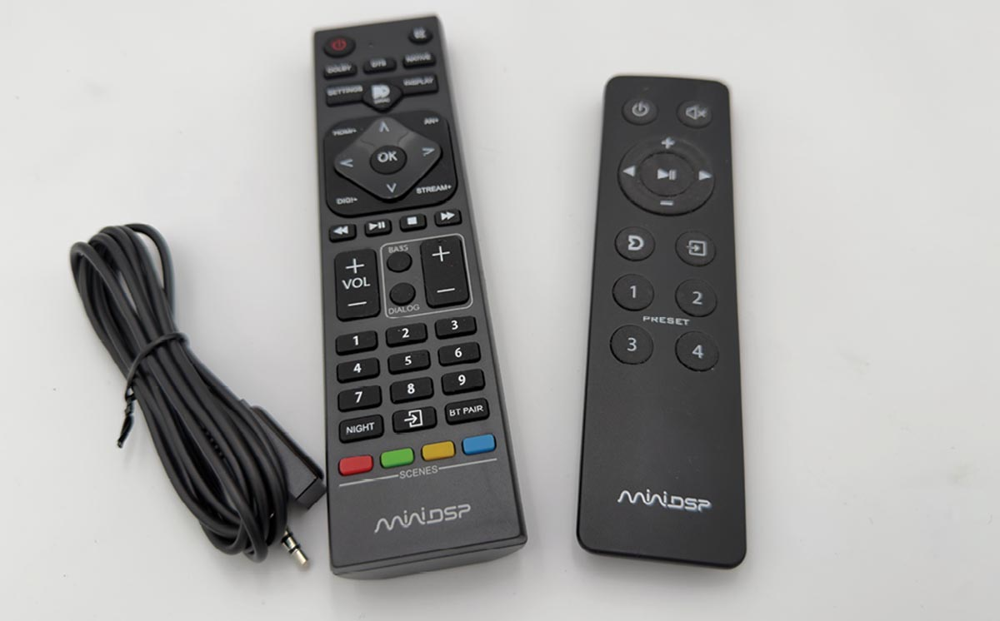
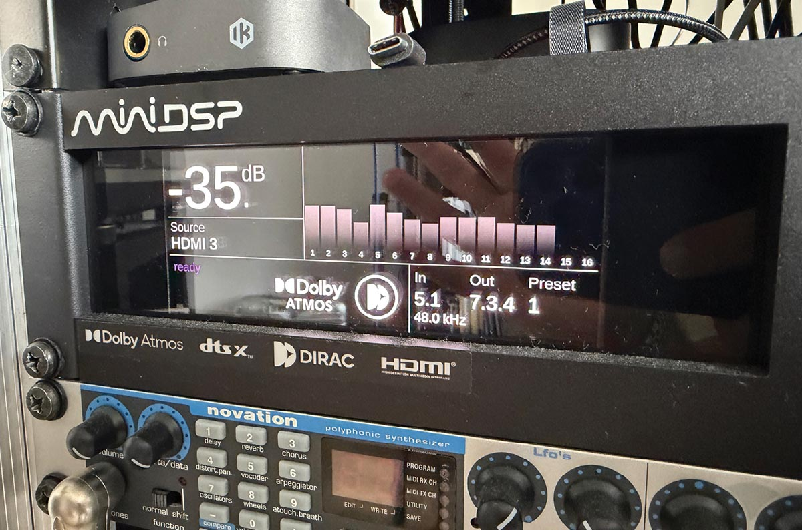

miniDSP se ha ganado un público fiel en el mundillo del audio con productos que
resuelven problemas concretos sin inflar el precio: sus procesadores, streamers y
micrófonos de medición están en estudios y laboratorios de todo el mundo. Con el
**Tide16** la compañía de Hong Kong da el salto al terreno de los procesadores de
audio inmersivo, un segmento dominado por los receptores AV tradicionales, y lo hace
con 16 salidas balanceadas en XLR y un precio de 3500 dólares (más envío e impuestos).

## Qué propone el Tide16

El Tide16 decodifica Dolby Atmos y DTS:X y ofrece hasta 16 canales de salida, todos en
XLR balanceado, además de conservar la competencia estéreo cuando se usa como DAC o
preamplificador. Es un enfoque distinto al de las barras de sonido que también buscan
el audio inmersivo por una vía más compacta, como la [Teufel CINEBAR PRO 2](/noticias/audio/teufel-barra-sonido-dolby-atmos-dts-x/).
En la parte trasera conviven HDMI/eARC, USB, Bluetooth, cuatro
entradas SPDIF y entradas analógicas, con disparadores de 12 V para encadenar etapas.
Mide 2U de alto y 40 cm de fondo, y se alimenta con una fuente conmutada interna a
través de un conector IEC C13/14.

El cambio de fondo respecto a la gama Flex es la arquitectura: en lugar de recurrir a
los DSP de Analog Devices habituales en la casa, miniDSP monta un **SoC ARM de cuatro
núcleos de NXP (familia i.MX)**. La compañía sostiene que esa integración reduce
consumo y calor, y abre la puerta a futuras funciones de decodificación por
actualización de software.

La configuración se hace desde el **Device Console**, una aplicación de escritorio para
macOS y Windows, o desde la web del propio dispositivo. Un asistente guía el montaje de
los altavoces e impide crear configuraciones ilegales, y los parámetros de DSP pueden
introducirse a mano, dejarse al API de REW o entregarse por completo a **Dirac**. Aquí
hay un detalle relevante frente a muchos receptores AV: la licencia de Dirac viene
integrada de fábrica, sin coste adicional, e incluye la tecnología **Active Room
Treatment (ART)**, que actúa de forma activa sobre el comportamiento acústico de la
sala en lugar de limitarse a aplicar ecualización para domar resonancias.

## Qué se mide

miniDSP declara un **SINAD de 118 dB**, una cifra que equivaldría a unos 20 bits de
resolución. En la prueba de audioXpress, el analizador QuantAsylum no llega a
confirmarla —no porque el dato sea falso, sino porque se queda corto de rango para
verificarlo—, pero sí acredita una relación señal-ruido superior a 106 dB. La salida
del Tide16 resulta lo bastante limpia como para llevar al límite al propio equipo de
medición.

Los convertidores **ESS Sabre ES9017S** hacen el trabajo de conversión a analógico con
un perfil transparente, sin coloración audible. En el uso diario, el redactor de la
prueba describe un equipo silencioso: sin clics ni artefactos incluso empleando las 20
bandas de filtro disponibles, y con una puesta en marcha que redujo de forma notable el
tiempo de configuración de un sistema inmersivo en comparación con un receptor AV
convencional.

## Lo que aún falta y para quién es

No todo está cerrado en la versión 1.12. **AirPlay, Roon y la entrada USB multicanal
no están disponibles** en el momento de la prueba: la USB se queda en dos canales, así
que para disfrutar de material inmersivo hay que tirar de fuentes como un Apple TV.
miniDSP ha prometido activarlos mediante actualizaciones de software, que se instalan
solas si el equipo está conectado a la red. El botón de encendido, además, está en la
parte trasera, una decisión de diseño que la prueba califica de incómoda.

En el capítulo de acabados, los paneles frontales que rodean el control de volumen son
intercambiables y se fijan con imanes, aunque de momento solo existe la variante en
aluminio gris plata. La pantalla es Full HD y los dos mandos giratorios —uno de ellos
también pulsable— permiten cambiar de fuente y acceder a un menú mínimo con la
dirección IP o el brillo. El mando a distancia nuevo integra los nuevos **scenes**, que
guardan fuente y volumen además de los parámetros de DSP que gestionan los **presets**.

¿Merece la pena? Para quien esté montando una sala inmersiva o un home cinema, el
Tide16 promete bajar mucho la barrera de entrada frente a un receptor AV: menos horas
de configuración y la corrección de sala más avanzada incluida. Los 3500 dólares lo
sitúan en una franja de precio alta, pero competitiva para lo que ofrece. Quien
necesite AirPlay o Roon hoy tendrá que esperar a esas actualizaciones; quien priorice
la transparencia de la conversión y una puesta en marcha sin fricción encontrará aquí
una de las propuestas más interesantes del segmento.
