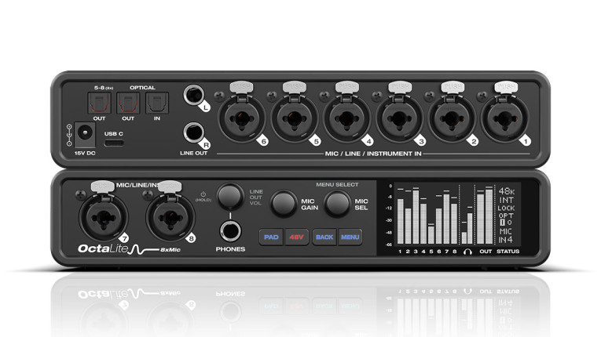

MOTU ya distribuye la OctaLite, una interfaz de audio USB-C que mete ocho previos de micrófono, línea e instrumento en un chasis de medio rack. La compañía estadounidense la vende a un precio recomendado de 849,95 dólares y la orienta a grabación móvil, estudio casero y directo. El aparato pesa 1,36 kg, va en chasis de acero y se alimenta con una fuente externa de 15 V DC incluida.

## La OctaLite, entrada por entrada

La disposición de conectores busca encajar en sesiones de batería, formaciones pequeñas o rodajes fuera del estudio. Dos entradas combinadas XLR/TRS quedan en el frontal y las seis restantes pasan al panel trasero; todas aceptan señal de micrófono, línea o instrumento de alta impedancia sin necesidad de DI externa.

Cada canal suma alimentación phantom de 48 V individual, un pad de 20 dB, inversión de polaridad y hasta 74 dB de ganancia de previo. Las entradas de jack de 6,35 mm declaran 1 MΩ de impedancia, un valor que la propia MOTU destaca como útil cuando se conectan varias guitarras directamente.

## Del dato medido al uso real

El apartado analógico combina amplificadores operacionales Burr-Brown de Texas Instruments con conversión ESS Sabre32. MOTU identifica el DAC de salida como ES9026PRO y da 125 dB de rango dinámico ponderado A, −114 dB de THD+N sin ponderar y un máximo de +21 dBu en las salidas de línea balanceadas. Las entradas de micrófono se quedan en 115 dB de rango dinámico ponderado A y −129 dBu de ruido equivalente de entrada, cifras pensadas para micros de baja salida. La salida de auriculares del frontal baja de 1 Ω de impedancia, y una pantalla OLED blanca muestra la monitorización de entrada y salida analógica y el estado del equipo.

La conexión al ordenador es USB 2.0 a través de conector USB-C, con soporte para equipos USB-A mediante cable o [adaptador de USB-A a USB-C](/noticias/usb-to-usb-c-adapter-guide/). En macOS no hacen falta controladores, y el modo class-compliant permite conectar Mac e iPhone/iPad compatibles sin instalar nada. Con drivers propios, MOTU anuncia 2 ms de latencia de ida y vuelta a 96 kHz con un búfer de 32 muestras, un dato relevante si se toca con instrumentos virtuales o simulaciones de amplificador. La lista de compatibilidad cubre Mac con Apple silicon e Intel y PC Windows con procesadores Intel, AMD o Snapdragon.

Para monitorizar sin pasar por el ordenador, la OctaLite incluye un mezclador DSP con reverb, ecualizador paramétrico de cuatro bandas, compresión y gating. La app CueMix 5 controla estos ajustes desde macOS, Windows e iOS, con mezclas independientes para las salidas de monitor balanceadas, los auriculares y los canales de loopback. Las señales de entrada pueden enviarse al DAW en seco o con el procesado aplicado, de modo que el intérprete escuche los efectos mientras se guarda la toma limpia. Tres buses de mezcla virtuales amplían el enrutado para streaming y podcast, y los dispositivos móviles pueden manejar CueMix por Wi-Fi a través de un ordenador conectado por USB en la misma red.

## Expansión ADAT y rivales directos

La parte óptica añade una segunda función al producto. Al elegir las ocho entradas analógicas como origen de la salida óptica, la OctaLite trabaja como previo y conversor de ocho canales para otra interfaz o mesa con ADAT. Una segunda salida óptica transporta los canales cinco a ocho mediante S/MUX a 88,2 o 96 kHz, y la única entrada óptica admite también S/PDIF estéreo por TOSLink. La configuración anunciada de 16 entradas y 12 salidas aplica a 44,1/48 kHz; baja a 12 entradas y 12 salidas a 88,2/96 kHz, y a ocho entradas y cuatro salidas a 176,4/192 kHz.

Dentro de la gama de MOTU, la OctaLite queda como compañera natural de la UltraLite-mk5, con la que comparte los circuitos de entrada de micrófono y que al combinarse ofrece diez canales de micro. La firma señala además los modelos 828 y 16A como posibles socios de expansión. Con los soportes opcionales, una OctaLite y una UltraLite-mk5 —o dos OctaLite— caben en un solo espacio de rack, y la segunda opción deja dieciséis entradas de micro en 1U.

El segmento de ocho previos con expansión óptica ya tiene referentes como la Focusrite Scarlett 18i20 y la Audient EVO 16. Frente a ellas, el argumento de la OctaLite no es el número de conexiones, sino meter ocho entradas de micro, línea e instrumento en medio rack, sumar efectos a bordo y poder alternar entre interfaz, mezclador y expansor ADAT. La contrapartida está en las salidas: solo ofrece dos de línea balanceadas, suficientes para una monitorización estéreo sencilla, pero escasas si se trabaja con varios pares de monitores o se enruta mucho hardware analógico. Que esas salidas estén acopladas en DC permite, eso sí, generar voltajes de control para sintetizadores modulares desde software compatible. El paquete incluye Performer Lite, Ableton Live Lite, más de 100 instrumentos y 6 GB de bucles y sonidos.
