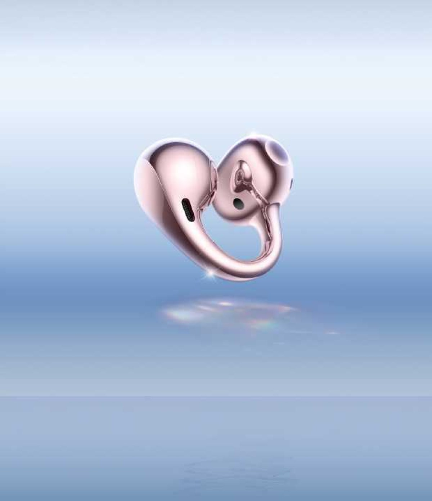
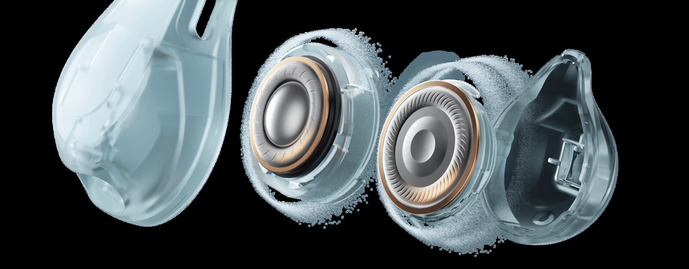

Los OnePlus Buds Clip ya tienen ficha en la web global de la marca. Son sus primeros auriculares de pinza, y el formato es el de la categoría que consolidaron los [Bose Ultra Open Earbuds](/noticias/audio/bose-ultra-open-earbuds-2/): una cápsula que se engancha al pabellón de la oreja con un arco, sin introducir nada en el canal auditivo. La ficha oficial confirma dos drivers por unidad, 5,2 gramos de peso y hasta 40 horas de uso con el estuche. Lo que no aparece en ningún punto de la página es el precio ni la lista de países.

El anuncio llegó sin presentación pública: la firma colgó la ficha del producto y los medios la detectaron después. Conviene aclarar desde el principio que el producto ya se había cubierto en medios en español durante el 23 y el 24 de octubre, así que lo que aporta esta pieza no es una exclusiva, sino el contraste de la ficha oficial con lo publicado.

## Un arco que sujeta sin taponar el oído

El sistema de sujeción es un arco en C de aleación de níquel-titanio que OnePlus describe como más fino y ligero que un alambre de titanio, y que recupera su forma tras doblarse. La marca asegura que la pieza se ha probado con más de 30.000 flexiones y recomienda no forzar la brida durante el uso. El peso declarado es de 5,2 gramos por auricular, una cifra que la marca vincula directamente al confort de uso prolongado.

La ficha añade dos detalles poco habituales. El primero es la simetría: los canales estéreo se asignan solos según el oído en el que esté colocado cada unidad, de modo que no hay que distinguir izquierdo y derecho, y un solo auricular sigue reproduciendo estéreo. El segundo es el monitor de caída, que avisa al móvil cuando una de las dos piezas se suelta. La compañía también declara una certificación «Comfortable Fit» de TÜV Rheinland, que evalúa el confort de uso, no la calidad de sonido.

Los acabados son tres: Pearl White (blanco perla), Pebble Gray (gris guijarro) y Twilight Rose (rosa crepúsculo).

## Qué ofrecen los OnePlus Buds Clip en la parte acústica

Cada auricular lleva un woofer de 11 mm y un tweeter de 9 mm, cada uno con su propio convertidor digital-analógico. El ajuste tonal se ha hecho junto a Dynaudio, firma danesa de altavoces de alta fidelidad, y la marca lo presenta como un perfil fiel a la grabación. Es una afirmación de intención, no una medición: no hay todavía curvas de respuesta publicadas ni análisis independientes.

En conectividad, los Buds Clip usan Bluetooth 6.1, admiten LHDC 5.0, AAC y SBC, y mantienen dos dispositivos enlazados a la vez. El audio de alta resolución solo está disponible con LHDC 5.0 en Android y, según la propia ficha, no funciona en iOS. Para llamadas hay seis micrófonos con captación por conducción ósea y un chip de audio dedicado de 6 nm que ejecuta el algoritmo de reducción de ruido de voz.

La fuga de sonido es el punto débil estructural de cualquier diseño abierto, y aquí OnePlus la ataca con un sistema que llama Dipole Sound-Field: las rejillas traseras emiten ondas inversas para cancelar parte de la energía que escaparía hacia fuera. La tecnología reduce la fuga, no la elimina, y la marca recomienda bajar el volumen en entornos silenciosos por salud auditiva.

La traducción simultánea merece una cautela aparte: la función solo está disponible en determinados móviles OnePlus con OxygenOS 15.0.1 o superior, y los idiomas compatibles dependen de la aplicación. No es una función universal del auricular.

## Autonomía y resistencia: las cifras, con matices

Las 40 horas del titular incluyen el estuche. Por carga, la autonomía declarada baja a 9,5 horas, y ambas cifras corresponden al códec AAC con el volumen al 50 %. Con LHDC, el consumo sube y el total queda en 36 horas con estuche y 8 horas por carga.

| Códec | Con estuche | Solo auriculares |
| --- | --- | --- |
| AAC | 40 h | 9,5 h |
| LHDC | 36 h | 8 h |

La resistencia al agua y al polvo es IP55, pero solo para los auriculares: el estuche no la tiene. La propia documentación advierte de que conviene evitar el ejercicio intenso por el sudor, secar las piezas antes de guardarlas y que la garantía no cubre daños por líquido ni por polvo. Son condiciones habituales en este segmento, pero encajan mal con el uso deportivo que sugiere un diseño abierto.

## Para quién tiene sentido y dónde se queda corto

El formato de pinza renuncia a algo a cambio de comodidad. Al no sellar el canal auditivo, el aislamiento pasivo es bajo por construcción: en metro, avión o una oficina ruidosa el entorno competirá con la música, y la ficha no menciona cancelación activa de ruido para reproducción, solo para llamadas. A cambio, no hay presión en el conducto, se puede llevar durante horas y se mantiene la conciencia del entorno, que es justo lo que se busca al caminar o al circular en bici.

El segundo límite es la fuga. El sistema de ondas inversas ayuda, pero un diseño abierto emite hacia fuera por definición, y en una biblioteca o un vagón silencioso se notará antes que con unos in-ear cerrados.

Sobre el precio no hay veredicto posible: OnePlus no lo ha publicado. Los rivales del formato ya tienen referencia —los Bose Ultra Open de segunda generación se quedan en 299 dólares y los [Ugreen ClipBuds Pro 2](/noticias/audio/ugreen-clipbuds-pro-2/) en 99,99—, pero sin la cifra de OnePlus cualquier comparación sería especulativa. La marca tampoco detalla los países, y su salida del mercado de móviles en Europa y Estados Unidos obliga a esperar confirmación antes de dar por hecha la llegada a España. Sin esas dos piezas —precio y disponibilidad— la relación calidad-precio queda abierta. Lo que sí puede decidirse ya es el encaje: quien priorice aislamiento debería seguir mirando un in-ear cerrado; quien quiera oír el entorno sin sacarse nada del oído tiene aquí una opción con dos drivers por unidad y un estuche que dobla la autonomía.
