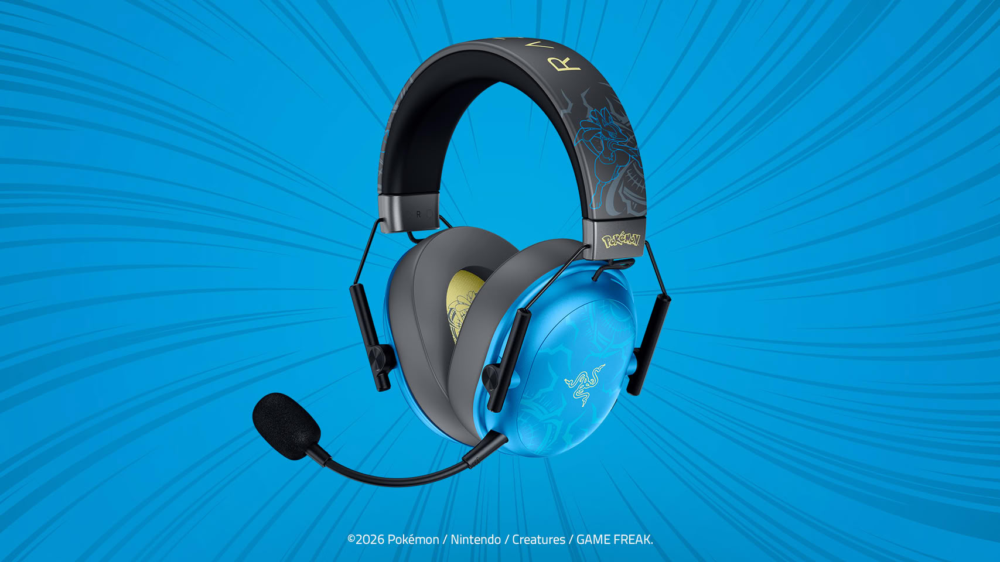
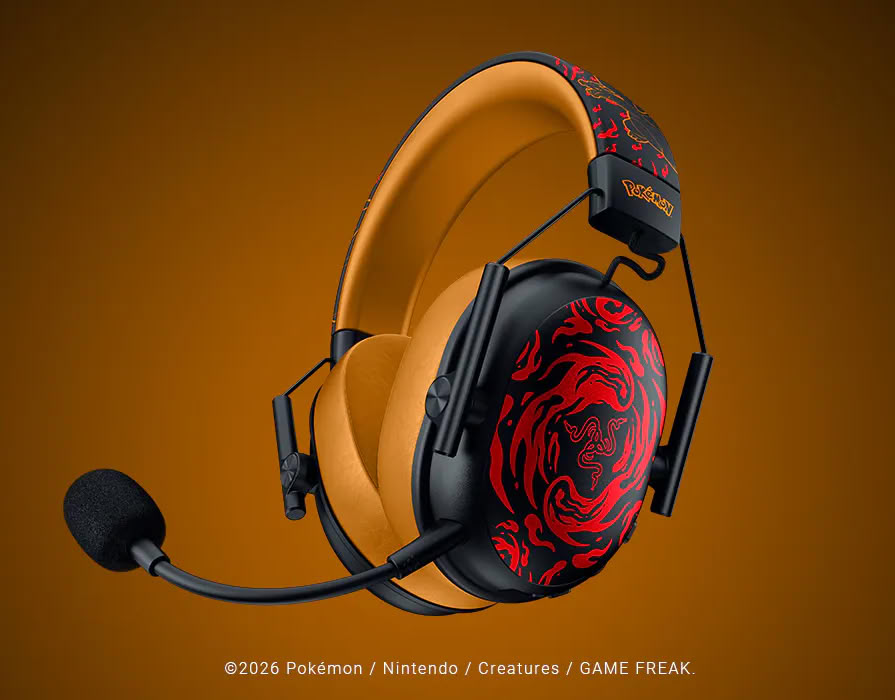
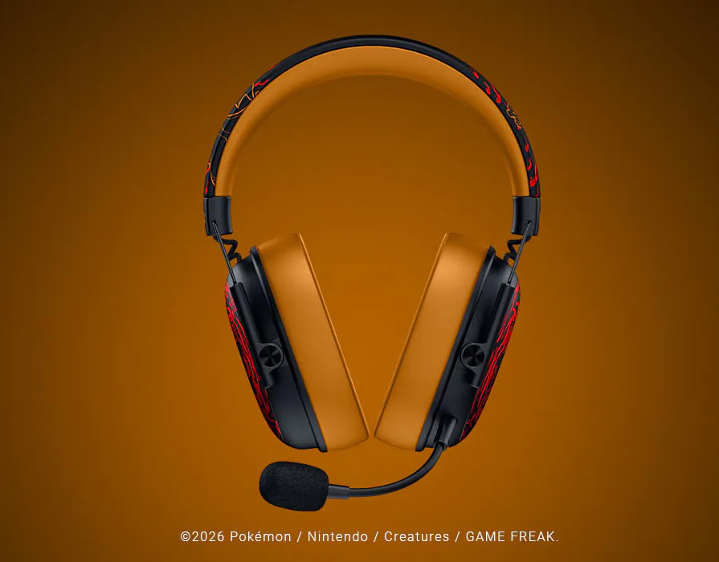
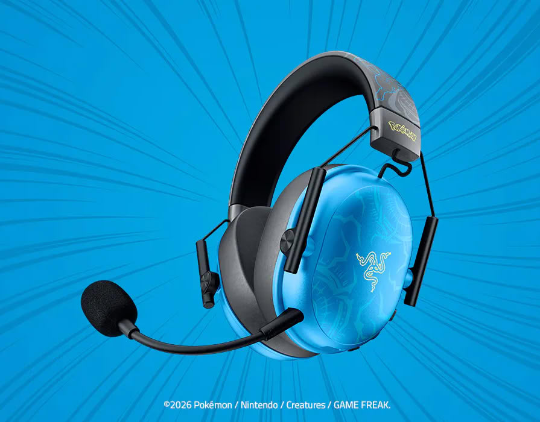
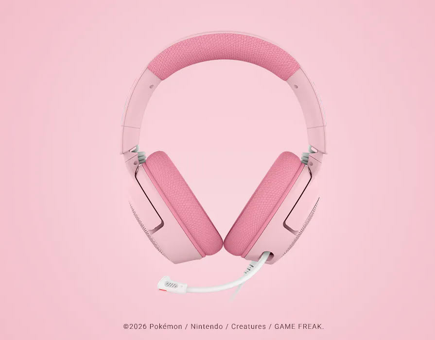

Razer ha ampliado su colección de periféricos de Pokémon con tres auriculares gaming licenciados, desarrollados junto a The Pokémon Company International. Los diseños se inspiran en Charizard, Lucario y Sylveon, y llegan en plena celebración del 30.º aniversario de la franquicia. El comunicado no detalla precios ni fecha de lanzamiento, así que de momento los datos que se conocen son los de la propia plataforma de cada modelo.

## Dos BlackShark V3 X inalámbricos y un Kraken V4 X con cable

Las tres piezas no comparten base. Las ediciones de Charizard y Lucario parten del **BlackShark V3 X HyperSpeed**, un auricular inalámbrico de corte esports que combina los drivers **TriForce de 50 mm Gen-2** con la conexión HyperSpeed Wireless de la marca. Razer presenta las dos como soluciones de baja latencia, pensadas para el juego competitivo, y la única diferencia entre ambas es el diseño del personaje.

El tercer modelo rompe ese patrón: **Kraken V4 X** en edición Sylveon es un auricular **con cable**, de acabado rosa y azul, que baja a los **TriForce de 40 mm** y añade un micrófono HyperClear Cardioid retráctil y la iluminación Razer Chroma RGB.

## Qué cambia realmente respecto al modelo base

Conviene separar lo que se ve de lo que se oye. En los dos BlackShark V3 X HyperSpeed, la edición de personaje afecta al acabado y al empaque, no a la plataforma acústica: los drivers de 50 mm Gen-2 y el módulo HyperSpeed Wireless son los mismos que en la versión estándar, así que la respuesta en frecuencia y el aislamiento deberían mantenerse idénticos sobre el papel.

El Kraken V4 X es otro punto de partida. Su driver de 40 mm es más pequeño y, al ser de conexión por cable, no depende de un enlace inalámbrico ni de su latencia. Eso no lo hace mejor ni peor por sí solo: marca un perfil distinto, más cercano al uso doméstico que al competitivo.

## Los tres auriculares Pokémon, uno por uno

- **Charizard Edition** sobre BlackShark V3 X HyperSpeed: inalámbrico, driver TriForce de 50 mm Gen-2 y conexión HyperSpeed Wireless.
- **Lucario Edition** sobre BlackShark V3 X HyperSpeed: misma base que el anterior, con acabado inspirado en Lucario.
- **Sylveon Edition** sobre Kraken V4 X: con cable, driver TriForce de 40 mm, micrófono HyperClear Cardioid retráctil y RGB Chroma.

## ¿Merece la pena?

Para quien ya busque uno de estos modelos, la edición de personaje no altera el rendimiento: pagas el diseño, no una mejora acústica. La decisión real sigue estando en el formato —inalámbrico de 50 mm para partidas competitivas, cableado de 40 mm para el escritorio— y en cuánto pesa el personaje frente al precio, que Razer todavía no ha publicado. Es una jugada coherente con el resto de la colección: la marca ya había llevado Pokémon a otros productos, como el [altavoz Beats Pill con diseño de Pikachu](/noticias/audio/beats-pokemon-altavoz-pill-pikachu/) que la marca dejó entrever estos días.
