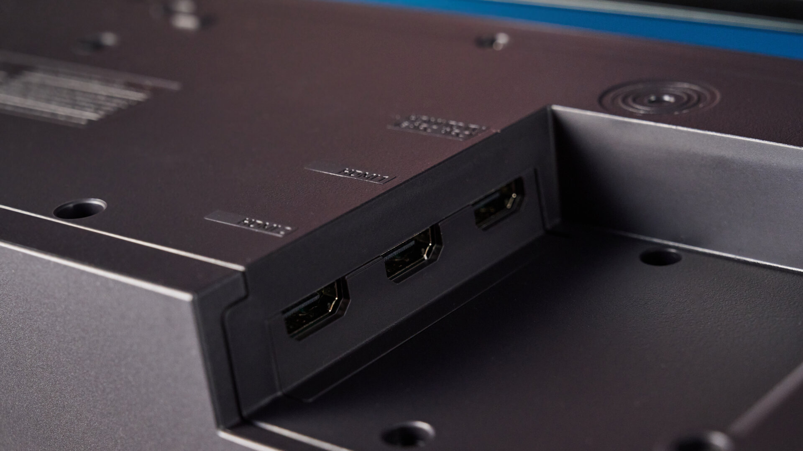
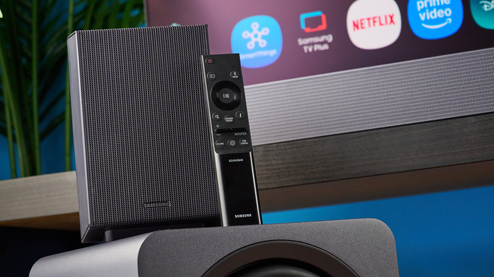
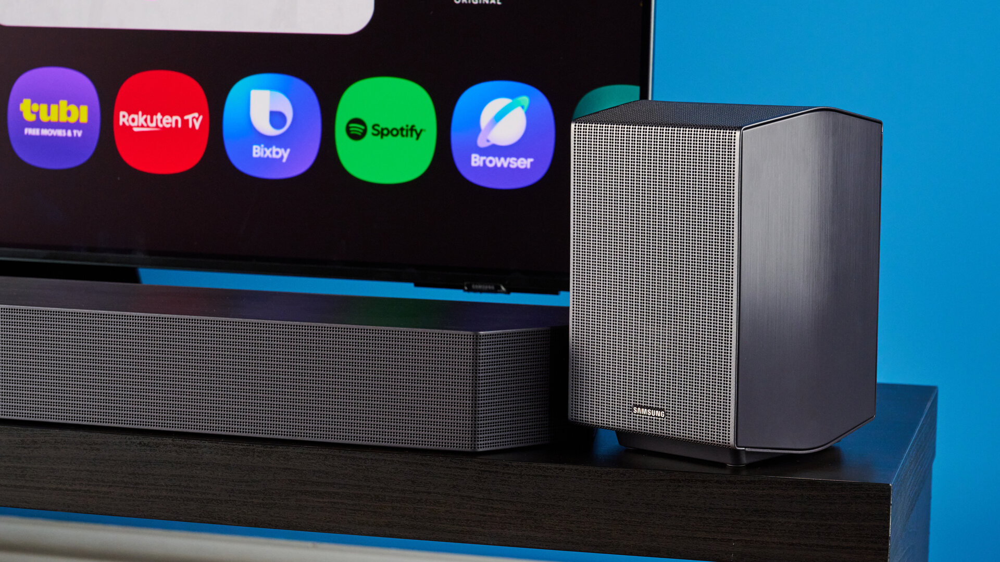
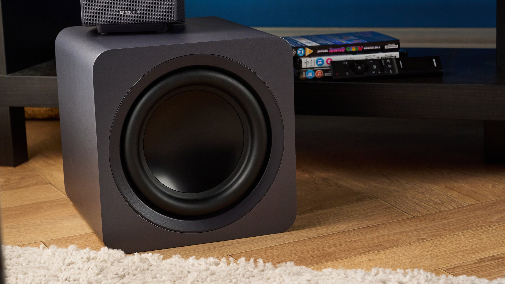
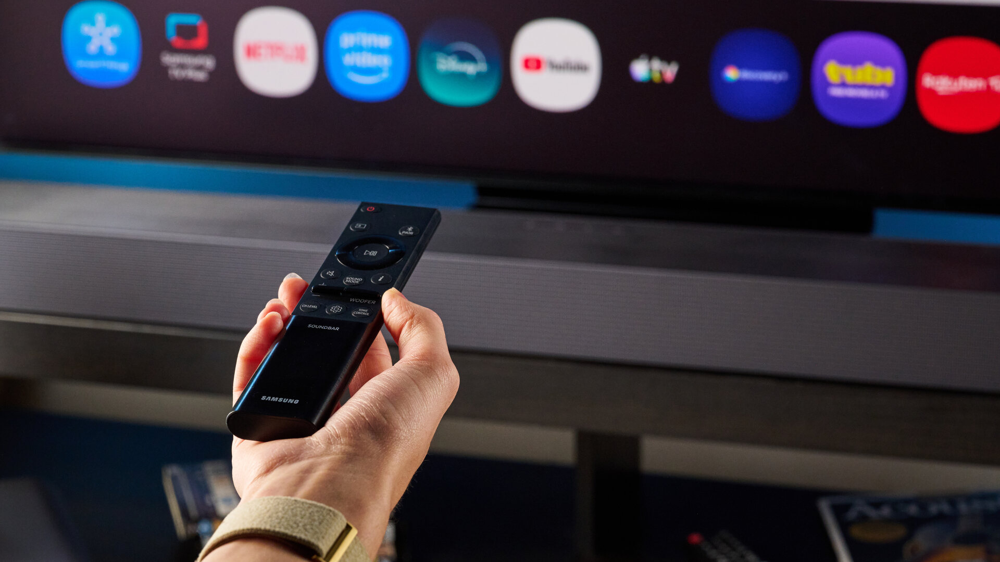
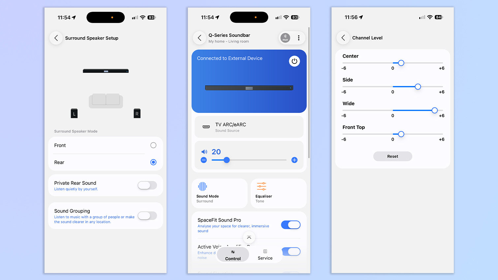
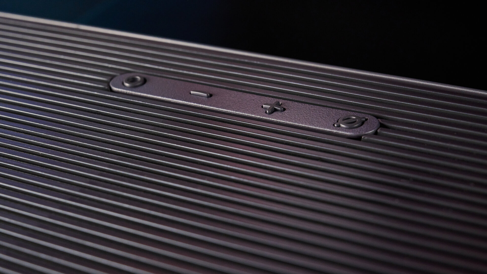
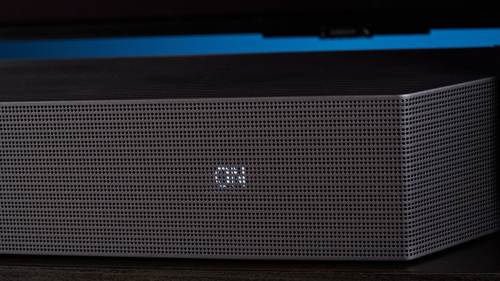
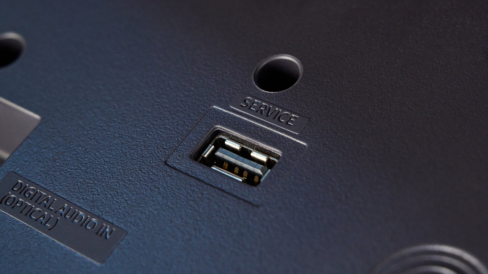
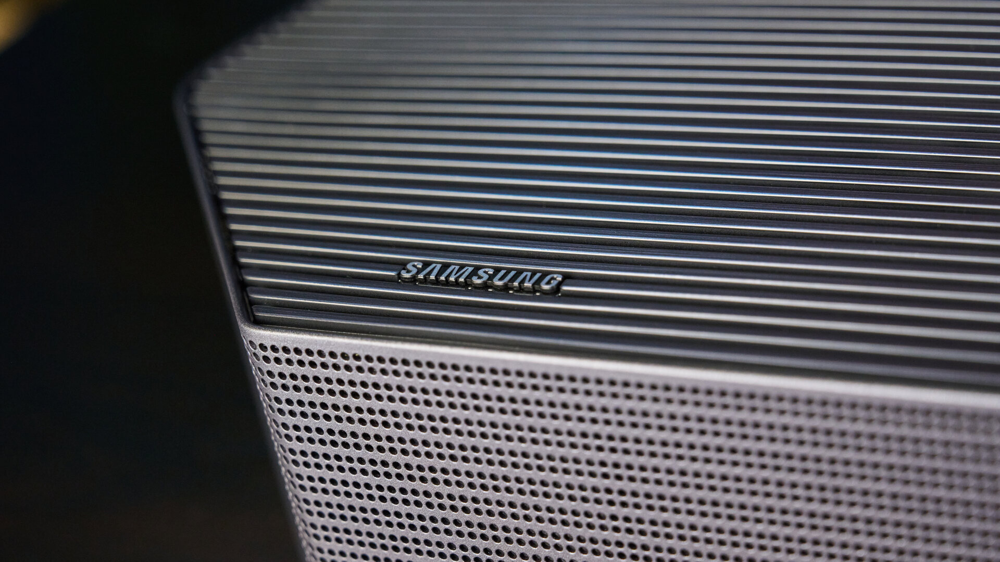

La Samsung Q990H combina **11.1.4 canales, subwoofer y altavoces traseros**, pero su cifra de canales no cuenta toda la historia. El análisis de Erin Bashford publicado en Tom’s Guide el 23 de octubre destaca la claridad de los diálogos y la contundencia de los graves, aunque encuentra margen de mejora en la sensación de altura de Dolby Atmos. Son conclusiones de las pruebas de ese medio, no de una evaluación propia de TechSpain24.

## Qué ofrece la Samsung Q990H más allá de Dolby Atmos

La [ficha oficial de Samsung para el modelo HW-Q990H/XU](https://www.samsung.com/uk/business/audio-devices/soundbar/q990h-black-hw-q990h-xu/) confirma la configuración 11.1.4, SpaceFit Sound Pro y el paso de vídeo 4K a 120 Hz. Esta última función permite intercalar la barra entre una fuente compatible y el televisor sin limitar la señal a 60 Hz. La compatibilidad del resto de la cadena sigue siendo necesaria.

El sistema no se reduce a una pieza delante de la pantalla: incluye un subwoofer y dos altavoces para la zona posterior. Bashford explica que estos elementos se enlazaron automáticamente al encenderlos. **Inalámbricos no significa sin enchufes**: tanto el subwoofer como cada trasero necesitan alimentación eléctrica, aunque no un cable de audio hasta la barra.

Es una distinción importante al planificar el salón. Antes de elegir un conjunto de este tipo conviene pensar dónde quedarán los altavoces y sus tomas de corriente, no solo cuánto espacio hay bajo el televisor.

## Voces y graves: los puntos fuertes de la prueba

En las sesiones de Tom’s Guide, las conversaciones de *Top Gun: Maverick* se entendían sin activar los refuerzos de voz, incluso con motores y música de fondo. La autora también destaca la inteligibilidad en *The Batman*, una película con voces contenidas y escenas exigentes para separar diálogo y efectos.

El resultado descrito interesa especialmente a quien sube el volumen para entender una frase y después tiene que bajarlo durante la acción. No equivale a una medición de respuesta en frecuencia o distorsión: es una observación de escucha atribuida a la analista.

Los graves también reciben una valoración favorable. Bashford relata una presencia física marcada en la persecución de *The Batman* y una reproducción musical que mantenía las voces por encima de las líneas de bajo. Esas impresiones describen su sala y sus sesiones; no garantizan la misma intensidad ni equilibrio en cualquier vivienda.

## Calibración útil, pero una altura que no convence del todo

SpaceFit Sound Pro ajusta el sonido a la habitación. Según Tom’s Guide, la función pudo utilizarse con televisores LG y TCL: la calibración no quedó restringida a una pantalla Samsung. La autora percibió una mejora en la claridad del canal central al activarla. Eso no debe confundirse con la conexión inalámbrica de audio al televisor, cuya compatibilidad requiere una comprobación separada.

La aplicación SmartThings permite modificar niveles de canales, subwoofer, graves y agudos. Sin embargo, Bashford indica que subir los canales traseros y laterales no produjo una diferencia tan grande como esperaba. Su principal reserva es precisamente esa: una escena amplia y graves convincentes, pero una sensación de altura y envolvimiento que no siempre alcanza sus expectativas.

La analista considera más envolvente la JBL Bar 1300X MK2. Esa preferencia es una comparación subjetiva del medio, no una clasificación universal ni una comparación de precios españoles. La mezcla de cine, sala y colocación sigue importando más que una lectura aislada del número de canales.

## Qué revisar antes de decidir la compra

El balance del análisis favorece a quien prioriza voces comprensibles, graves presentes y un conjunto con traseros incluidos. Para quien busca ante todo efectos claramente elevados, la reserva sobre Dolby Atmos merece atención antes de comprar sin escucharlo.

También conviene distinguirla de otras propuestas, como la [Teufel CINEBAR PRO 2 y su configuración ampliable con traseros](/noticias/audio/teufel-barra-sonido-dolby-atmos-dts-x/): compartir Dolby Atmos no significa incluir los mismos elementos ni distribuir igual los canales.

Tom’s Guide recomienda valorar la Q990H con descuento, pero su página combina referencias de tarifa y ofertas comerciales distintas. Por eso aquí no se trasladan esas cifras a euros ni se presenta un precio para España. Antes de comparar, hay que comprobar la referencia regional exacta, el contenido del paquete y el precio final del vendedor.

Imágenes: Tom’s Guide; capturas de SmartThings: Samsung / Tom’s Guide.
