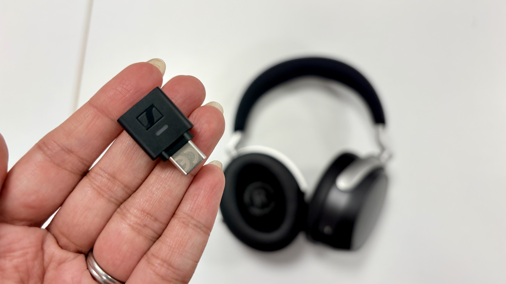

Los auriculares inalámbricos de diadema Sennheiser HDB 630 llegaron al mercado a finales de 2025 y acaban de sumar un nuevo aval: un premio en los What Hi-Fi? Awards 2026. Lo particular de este modelo no es solo cómo suena, sino la solución que trae para un problema que arrastra toda la escucha inalámbrica: el desajuste entre los códecs que admite el auricular y los que admite la fuente que le envía el audio.

## Cómo se diseñó el Sennheiser HDB 630

Antes de poner el HDB 630 en el mercado, Sennheiser partió de un estudio propio. Según sus datos, los aficionados al audio escuchaban música en promedio entre una hora y hora y media al día. La compañía se preguntó por qué personas que aprecian el sonido dedicaban tan poco tiempo a hacerlo, y la respuesta apuntaba a un obstáculo conocido: obtener la máxima calidad obliga tradicionalmente a atarse a un sistema doméstico con amplificador.

La investigación destapó un segundo problema, este medible. Menos del 16 % de los teléfonos son compatibles con aptX Adaptive y menos del 1 % lo es con aptX Lossless. De poco sirve tener unos auriculares excelentes si el dispositivo que les manda la música no está a la altura del códec, algo que se complica porque móviles del mismo modelo pueden variar según el mercado donde se vendan.

## El dongle BTD 700

La respuesta de Sennheiser es el BTD 700, un pequeño adaptador USB-C que se vendió por separado y que ahora acompaña al HDB 630. Se conecta a la fuente (móvil, tableta u ordenador) y enlaza con los auriculares por Bluetooth; admite hasta 24 bits/96 kHz con los mejores códecs inalámbricos, entre ellos aptX Lossless y Auracast. La clave es que funciona con cualquier auricular Bluetooth, no solo con los de la casa.

Según las estimaciones del fabricante, el dongle eleva por encima del 80 % el porcentaje de teléfonos capaces de soportar aptX Adaptive. El margen restante corresponde en su mayoría a los iPhone con conector Lightning, que no encajan con el puerto USB-C del accesorio. En el diseño se cuidaron detalles prácticos: una ranura junto al conector permite encajarlo en un teléfono con funda y su perfil fino evita tapar rejillas de ventilación u otros puertos. El propio fabricante recomienda dejarlo enchufado en el USB-C del HDB 630 cuando no se use, para no perderlo. No era la primera vez que Sennheiser incluía un dongle: el Accentum Special Edition ya lo hacía, aunque con conexión USB-A y pensado para videollamadas en PC.

## Qué se traduce en el uso diario

El HDB 630 se defiende también sin el dongle. En las pruebas destaca por su calidad de sonido y por sus ajustes personalizables, como un ecualizador paramétrico que permite introducir la frecuencia exacta en hercios en lugar de mover un deslizador, y compartir la afinación mediante un código QR para que otra persona la escanee y la pruebe.

El límite de fondo sigue siendo el ancho de banda de Bluetooth, que obliga a elegir entre alta resolución con compresión o menor resolución sin pérdidas. Es un compromiso que el sector tendrá que resolver con un Bluetooth de mayor capacidad.

Para quien compra, la ventaja es concreta: deja de depender de que su móvil y sus auriculares compartan códec. Frente a otros inalámbricos de diadema de gama alta, como los [Technics EAH-A1000](/noticias/technics-eah-a1000/), la propuesta de Sennheiser no se apoya solo en el transductor, sino en cerrar el eslabón que suele fallar. ¿Merece la pena? Si el objetivo es escuchar a alta calidad durante horas y desde cualquier fuente, el dongle resuelve un problema real que la ficha técnica de ningún auricular resuelve por sí sola.
