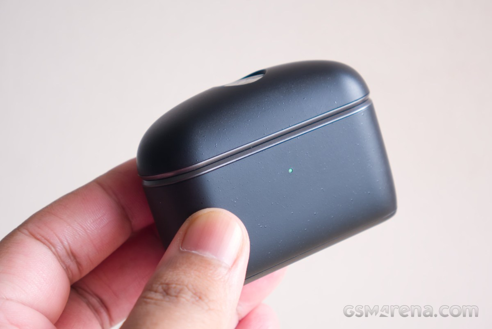
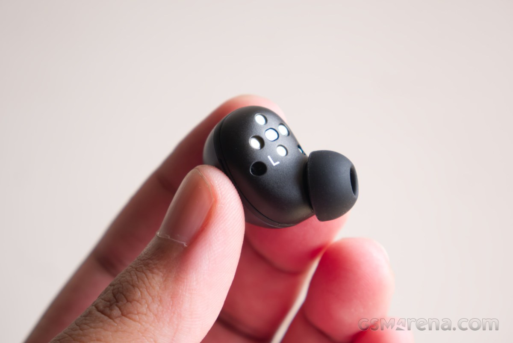
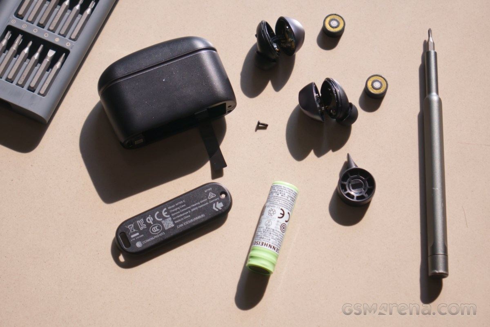
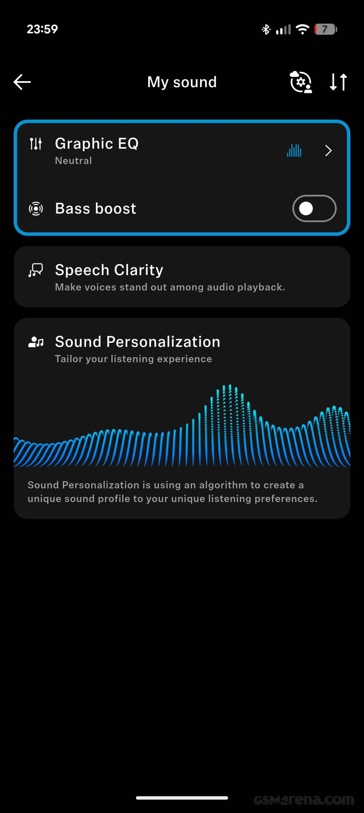
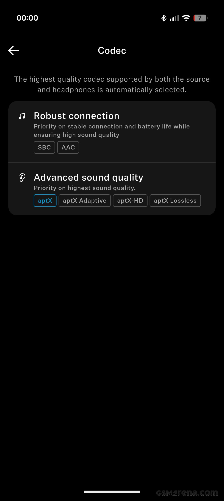

Los Sennheiser Momentum True Wireless 5 cuestan 300 dólares y llegan al mismo terreno que los Apple AirPods Pro 3 y los Sony WF-1000XM6. Su argumento menos habitual no está en la ficha de sonido: son los primeros auriculares inalámbricos de la marca con baterías reemplazables, tanto en los auriculares como en el estuche. GSMArena ha publicado su análisis y la conclusión es que estamos ante una mejora amplia respecto a la generación anterior, con dos reservas claras: el software y el micrófono en entornos ruidosos.

## Qué cambia en los Momentum True Wireless 5 respecto al modelo anterior

El rediseño es completo. El estuche es más alto y más delgado, mucho más fácil de llevar en el bolsillo que el volumen que gastaba el modelo anterior, y abandona el recubrimiento textil por un plástico mate con acabado moteado. Según el análisis, ese material se mancha menos que la tela, pero atrae más huellas y transmite una sensación menos premium. El estuche tampoco hereda la resistencia al polvo y al agua de los auriculares —IP54— y presenta algunos crujidos, sobre todo en la bisagra.

Los auriculares, en cambio, son notablemente más pequeños: desaparece el diseño cuadrado con aletas y llega una forma compacta y redondeada, sin mango. El ajuste es más superficial que en el Momentum True Wireless 4, y eso se traduce en comodidad para sesiones largas, aunque GSMArena advierte de que agarrarlos sin mango resulta más torpe. Se ofrecen en cinco colores: Graphite, Cream, Copper, Denim y Lavender.

En el apartado acústico, la base es un driver dinámico TrueResponse de 7 mm, el mismo tipo que Sennheiser utiliza en buena parte de su catálogo, incluidos varios modelos con cable.

## Aislamiento, transparencia y micrófono

La cancelación de ruido activa funciona bien, pero no es la referencia de la categoría. GSMArena la sitúa por debajo de los AirPods Pro 3: tarda más en ajustarse, probablemente por un procesador más justo, y en una prueba con un auricular de cada modelo en cada oído se colaba más ruido de fondo por los Sennheiser. La distancia, eso sí, es corta, y el ajuste más superficial juega a favor de la comodidad.

El modo transparencia es el punto más débil del sistema. Se puede regular su nivel y se activa solo durante las llamadas, pero el análisis señala que prioriza sonidos ambientales por encima de las voces: cuesta más entender a quien habla alrededor y a uno mismo que con los rivales. El micrófono también se parte en dos escenarios. En una sala silenciosa la calidad de voz es muy buena, solo por detrás de los últimos AirPods; con ruido, el algoritmo sacrifica la voz para dejar el fondo prácticamente mudo, y el resultado suena apagado, con cortes puntuales.

## Autonomía y baterías reemplazables

Sennheiser anuncia 12 horas de autonomía, pero esa cifra corresponde a la cancelación de ruido desactivada. Con ANC o transparencia activados, la promesa baja a 6 horas. GSMArena midió 6 horas y 23 minutos con ANC encendido, en línea con lo declarado. La carga es por cable e inalámbrica.

La novedad real es que esas baterías se cambian. En cada auricular hay que aflojar dos tornillos con un destornillador PH000 y abrir la carcasa con la espátula incluida; el estuche solo lleva un tornillo en la base. El análisis enumera los matices del procedimiento: los tornillos de los auriculares son cautivos, pero el del estuche no; hay un cable plano entre las dos mitades, así que conviene abrir lo justo; las celdas pueden colocarse al revés si no se anota su orientación; y el plástico de las ranuras es blando, por lo que puede quedar alguna marca cosmética.

El límite está en el suministro. Las baterías son propietarias —modelo BA 501 para los auriculares y BA 502 para el estuche— y la información concreta de disponibilidad se reduce a una declaración vaga sobre la Unión Europea y "otros países seleccionados". La duración a largo plazo depende, por tanto, de cuánto tiempo mantenga Sennheiser esas celdas en catálogo. Aun así, es una ventaja que ningún rival directo ofrece hoy, y cambia el cálculo de precio frente a alternativas más baratas como los [Cambridge Audio Melomania A100 SE](/noticias/audio/cambridge-audio-melomania-a100-se/), que parten de un precio bastante menor.

## Perfil tonal, códecs y software

La afinación tira a neutro, con un refuerzo de graves de banda ancha que se derrama algo en los medios-bajos, medios-medios neutros, una caída en los medios-altos que se prolonga por los agudos bajos y medios, y una zona alta de agudos reforzada. El resultado es un sonido cálido sin ser excesivamente grave y brillante en la zona donde aparecen las eses, aunque esa caída deja a algunas voces e instrumentos algo apagados y empuja a subir el volumen. Según GSMArena, es lo primero que conviene corregir con el ecualizador. Detalle, imagen y escena están a un nivel razonable, y el modo Dolby Atmos con seguimiento de cabeza espacializa bien las fuentes estéreo, siempre que se use SBC, AAC o aptX estándar: el interruptor deja de funcionar si están activados los ajustes de Hi-Res.

La aplicación Smart Control Plus (iOS y Android) es completa: ecualizador de 8 bandas con presets, la función Sound Personalization, control del nivel de transparencia, modo anti-viento desactivable y un modo de protección de batería que evita la carga al 100 %. También permite fijar el códec y muestra cuál se está usando. En conectividad hay SBC, AAC, aptX hasta 16 bits y 48 kHz, aptX Adaptive hasta 24 bits y 96 kHz, y aptX Lossless en 16 bits y 44,1 kHz, además de multipunto.

Hay dos matices que conviene conocer antes de comprar. El primero es que no hay aptX HD real, por mucho que la pantalla de la aplicación lo mencione: GSMArena lo atribuye al cambio de los chips de Qualcomm, que sustituyeron HD por Adaptive. En móviles sin chip Qualcomm, como la serie Pixel, el techo práctico es aptX. El segundo es que el propio análisis resta importancia a esta carrera de códecs, porque en escucha real la diferencia es prácticamente nula.

El software, en cambio, sí es un problema. La cancelación se activa y desactiva de forma desigual en cada oído, la transparencia arranca con un volumen muy alto antes de asentarse, el nivel automático de ANC no deja de corregirse, no se activa la transparencia al quitarte un auricular —ni permite hacerlo a mano, porque exige los dos puestos— y aparecen chasquidos al caminar con ANC. En alguna ocasión el audio se ralentizó hasta reiniciar los auriculares. Tampoco hay botón de emparejamiento en el estuche: hay que sacar los auriculares y mantener pulsada su superficie táctil.

Con todo, el veredicto de GSMArena es positivo: son unos auriculares muy completos y una mejora amplia sobre el modelo anterior, con buen sonido, buen aislamiento y un ajuste cómodo. Los 300 dólares pesan, pero la posibilidad de seguir usando los auriculares cambiando la batería compensa parte del desembolso. Quien busque la mejor cancelación o el mejor micrófono en la calle encontrará opciones superiores; quien valore conservar el producto durante años tiene aquí un argumento poco habitual. Para comparar con el resto del catálogo de la marca, el [Momentum 4 de diadema](/noticias/audio/sennheiser-momentum-4-oferta/) sigue siendo la opción con mucha más autonomía.
