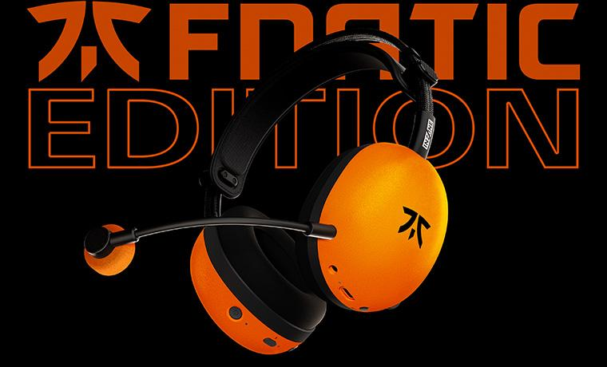

Sony ha puesto a la venta en el mercado continental chino dos nuevas variantes de sus auriculares para gaming. Por un lado, el **INZONE E9** en acabado «glass purple» (morado cristal), un modelo in-ear; por otro, el **INZONE H9 II** en edición conjunta con la organización de esports Fnatic, de formato diadema. Los precios finales son de **799 yuanes** para el primero y **1.699 yuanes** para el segundo, según recoge el medio chino ITHome.

## Un in-ear con caja de sonido USB-C

El INZONE E9 es la opción in-ear de la familia. Sony detalla que monta drivers de 5 mm y una estructura acústica sellada, el diseño cerrado que busca aislar del ruido exterior. El auricular se acompaña de una caja de sonido con conexión USB-C que habilita el sonido espacial de juego y permite ajustar el ecualizador.

En la práctica, es un modelo que apoya parte de su procesamiento en ese módulo externo. Este tipo de solución suele mejorar la gestión del sonido envolvente frente a conectar los auriculares directamente al equipo, aunque el resultado depende más de cómo se implemente el procesado en cada juego que de la especificación en sí.

## El H9 II de Fnatic, con los drivers del WH-1000XM6

El INZONE H9 II comparte unidad de driver con los WH-1000XM6, los auriculares de diadema de referencia de Sony fuera del ámbito gaming. El modelo añade un micrófono cardioide ajustable —un patrón que prioriza la voz frontal y descarta buena parte del ruido que llega por los lados—, cancelación activa de ruido y un preset de ecualización firmado por Fnatic.

La diadema es regulable y el conjunto declara 273 g, un peso que baja a 260 g si se prescinde del micrófono. La autonomía anunciada llega a las 30 horas.

## Qué implica para el comprador

Conviene separar lo que se mide de lo que se percibe. Los datos duros —5 mm de driver, 273 g de peso, 30 horas de batería— son verificables y sitúan a cada modelo en su tramo: el E9 en el escalón más contenido de precio y el H9 II en la gama alta de diadema. El sonido espacial y el preset de Fnatic, en cambio, son decisiones de afinado y responden a un gusto, no a una cifra.

El detalle más relevante es la herencia del H9 II: compartir driver con los WH-1000XM6 acerca la tecnología de los auriculares premium de Sony al catálogo orientado a juegos. Para quien busque una sola diadema que sirva tanto para jugar como para escuchar música con cancelación de ruido, ese es el argumento de peso.

Los precios citados son los del mercado continental chino y están expresados en yuanes. Queda por ver si Sony traslada estas dos variantes —el color del E9 y la edición de Fnatic del H9 II— a otros mercados.
