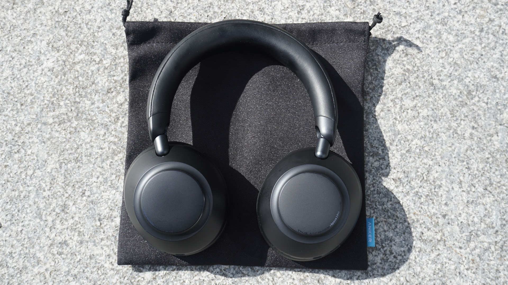

Los **Anker Soundcore Space 2 Pro** cuestan 199,99 € en la tienda oficial española de la marca, el mismo precio de tarifa que Trusted Reviews maneja en Reino Unido y Estados Unidos (199,99 libras y 199,99 dólares). Son unos circumaurales con cancelación de ruido adaptativa, chip Thus AI para las llamadas y hasta 60 horas de autonomía sin ANC. El análisis del medio británico, firmado por Kob Monney y publicado este 26 de octubre, les da cuatro estrellas sobre cinco.

Conviene aclarar que no es un lanzamiento de hoy. El Space 2 Pro llegó al mercado en septiembre y lo que se publica ahora es la revisión completa, después de cuatro semanas de uso real. La conclusión se puede resumir en una frase: son unos auriculares excelentes para trabajar y para llamar, y bastante menos recomendables si lo que se busca es fidelidad tonal.

## Cancelación de ruido y llamadas: donde el Space 2 Pro se justifica

La cancelación depende del sellado más que en otros modelos. Con la más mínima rendija en la almohadilla, el ruido entra como por una ventana entreabierta. Cuando el ajuste es correcto, el sistema adaptativo funciona con fiabilidad y sin el zumbido que a veces acompaña a esta tecnología: corta el tráfico y el bullicio de estaciones y espacios interiores sin que el oído note el procesado. El análisis lo comprobó en trayectos por Canary Wharf y en avión, con algo de ruido de viento en exteriores y una vibración leve en la copa derecha como única incidencia.

El modo transparencia cumple sin brillar. No es el más nítido del mercado, pero permite oír lo que ocurre alrededor sin quitarse los cascos. Frente al competidor directo que el medio usa como referencia, los JBL Live 780NC, la cancelación queda en un nivel parecido: los JBL aíslan algo más, los Soundcore lo hacen de forma más natural.

Donde no hay discusión es en las llamadas. El chip Thus AI, el mismo que la marca usa en los Liberty 5 Pro y 5 Pro Max, gobierna un conjunto de seis micrófonos con separación de voz en tiempo real. En una llamada de prueba que pasó por el tren ligero de Londres, un supermercado y un restaurante lleno, la persona al otro lado solo escuchó la voz del periodista, sin ruido de fondo. Trusted Reviews lo califica como el estándar de referencia en este rango de precio, y esa es la afirmación que hay que atribuirle: es su medición, no una prueba propia.

## El problema está en los graves

El perfil tonal es la parte discutible. Frente al Space 2, el Pro supone una mejora clara: graves más grandes y con más peso, agudos más detallados. Frente a los JBL Live 780NC, que ya tienen un sonido con graves adelantados, los Soundcore van bastante más lejos. El refuerzo se nota en la zona media-baja, engorda la transición entre graves y medios y sobreenfatiza las voces masculinas, menos las femeninas. En temas con mucho subgrave la pegada impresiona; en grabaciones más delicadas, el resultado se vuelve retumbón y pierde matiz. El medio cita dos ejemplos concretos: «Garden Song», de Phoebe Bridgers, coquetea con la saturación, mientras que «Regulate», de Warren G, aprovecha esa energía.

No todo es exceso. La escena sonora es amplia, los agudos son brillantes sin resultar hirientes y las voces tienen una claridad suave que aguanta bien sesiones largas. Lo que falta es equilibrio: los golpes de bombo se convierten en impactos sordos y la sutileza en las frecuencias bajas se pierde. Para quien venga de auriculares de consumo con realce de graves, el salto es coherente; para quien espere neutralidad por el apellido Pro, la firma sonora se queda corta.

Anker publicó una actualización de firmware que retoca la curva y atempera algo los graves, pero llegó demasiado tarde para entrar en la nota. El análisis solo pudo hacer una escucha breve con esa versión, suficiente para apreciar la corrección, no para rehacer las mediciones. Es un dato relevante de cara a la compra: el sonido que se describe aquí puede no ser exactamente el que reciba quien actualice el producto.

## Autonomía, controles y fichas que no cuadran

La batería cumple lo que promete el fabricante, algo que no siempre ocurre con los Soundcore recientes. Son 60 horas sin cancelación y 30 con ella activada, y el medio verificó la segunda cifra con una descarga de tres horas al 50 % de volumen usando AAC por Bluetooth. Con LDAC, más exigente, la autonomía debería caer. La carga rápida añade ocho horas con cinco minutos enchufados. La ficha oficial española añade 20 horas de conversación, un dato útil para quien use los cascos sobre todo para reuniones.

En construcción, el Space 2 Pro repite el lenguaje de la casa: botones físicos en lugar de controles táctiles, con el encendido y el ANC en la copa izquierda y la reproducción y el volumen en la derecha. Son fáciles de localizar al tacto y cada pulsación se confirma con un clic. La diadema se ajusta por pasos, no de forma continua, y el mecanismo hace algo de ruido al moverlo. El peso declarado es de 262 gramos y la comodidad es uno de los puntos fuertes: las copas dejan espacio, la presión sobre la cabeza y las orejas es baja y se pueden llevar varias horas sin fatiga. Se pliegan para viajar, aunque el paquete incluye una bolsa de tela y no un estuche rígido.

Hay más funciones de las que se usan a diario: LDAC, multipunto para dos dispositivos (no simultaneable con LDAC), detección de uso, audición segura y un ecualizador de ocho bandas. HearID 5.0 exige crear una cuenta, y el modo de audio espacial, según el análisis, conviene dejarlo desactivado porque expande la escena a costa de adelgazar el sonido. La aplicación también dio problemas: en un momento dejó de reconocer los auriculares pese a estar conectados y hubo que desemparejar y volver a emparejar.

Las fichas técnicas, además, no coinciden entre sí. El texto del análisis habla de Bluetooth 6.1, mientras que su propia tabla de especificaciones recoge 5.1. La página española del fabricante incluye en un bloque de características adicionales «control táctil intuitivo» y «resistencia IP57», dos líneas que no encajan ni con los botones físicos que describe la review ni con su tabla, que no otorga certificación IP al modelo. Tampoco coinciden los colores: el análisis menciona negro y gris medianoche, y la tienda española añade blanco lino. Son detalles de ficha que conviene contrastar antes de comprar, no defectos del producto en sí.

## Veredicto: para quién sí y para quién no

| Perfil | Veredicto |
| --- | --- |
| Oficina y trabajo | Sí. La cancelación tapa voces y teclados de un espacio abierto, y la comodidad aguanta la jornada. Requiere un buen sellado. |
| Llamadas y reuniones | Sí, con matices. Es su mejor argumento y los micrófonos aíslan la voz incluso en entornos ruidosos. |
| Viaje | Sí, si se viaja ligero. 30 horas con ANC y plegado, pero sin estuche rígido y con la autonomía cayendo si se usa LDAC. |
| Escucha crítica y fidelidad | No. El realce de graves y la falta de equilibrio pesan más que la escena amplia. |

Frente a alternativas, el Space 2 Pro se coloca en una zona intermedia. Cuesta menos de la mitad que unos [Sonos Ace Ultra](/noticias/audio/sonos-ace-ultra-analisis/) de 449 dólares y ofrece mejor micrófono y más autonomía; a cambio, los Sonos son más neutros y su ecosistema es más cerrado. Y quien priorice batería por encima de todo tiene el [Sennheiser Momentum 4](/noticias/audio/sennheiser-momentum-4-oferta/), con 60 horas con ANC y ofertas por debajo de los 250 dólares en Estados Unidos.

La valoración final es sobria: por 199,99 €, el Space 2 Pro resuelve muy bien el trabajo y las llamadas, que es justo lo que promete su ficha. Quien busque unos auriculares para escuchar música con la máxima fidelidad debería probarlos antes o mirar hacia otro lado, porque el exceso de graves no es un detalle menor en una firma que aspira a la gama media-alta.
