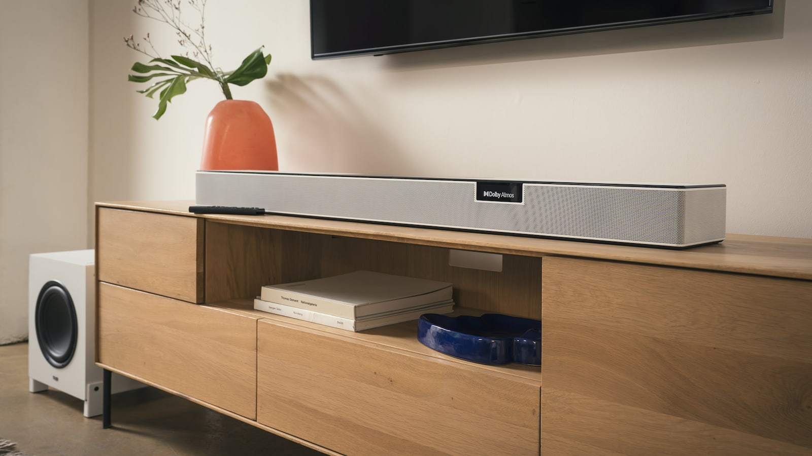
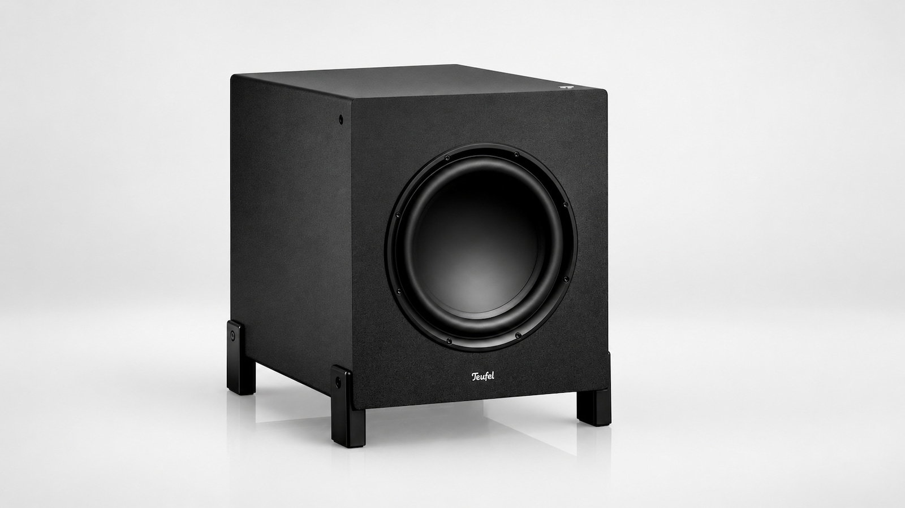

La nueva CINEBAR PRO 2 de Teufel es su barra de sonido más ambiciosa hasta la fecha y ya está disponible en España desde 1.199,99 euros en su configuración Select. La base de la propuesta es una configuración 5.1.2 con diez transductores, 232,5 W RMS de amplificación en clase D y un subwoofer inalámbrico; añadiendo dos altavoces traseros, el conjunto pasa a 7.1.2 canales.

## La barra de sonido monta diez altavoces, dos apuntando al techo

Lo que diferencia a esta barra de un sistema que simula el sonido envolvente por procesado es la distribución física de sus altavoces. En el frontal monta tres coaxiales, cada uno con su tweeter y su altavoz de medios-graves alineados sobre el mismo eje, pensados para fijar mejor la posición de las voces aunque no estemos sentados justo frente al televisor. A ellos se suman dos altavoces laterales y dos de 3,5 pulgadas orientados hacia el techo, que rebotan el sonido para reproducir los efectos de altura de Dolby Atmos y DTS:X.

Teufel recurre además a Dynamore, su tecnología de procesado, para ensanchar la escena sonora. La barra admite Dolby TrueHD, Dolby Digital Plus, DTS-HD y DTS Digital Surround, de modo que no se limita a los formatos comprimidos habituales del streaming.

## HDMI 2.1, eARC y música por red

En conectividad, la CINEBAR PRO 2 incluye dos entradas HDMI 2.1 y una HDMI eARC con CEC, además de entrada óptica, auxiliar y Ethernet. Eso permite conectar reproductores o consolas directamente a la barra y recibir el audio del televisor a través de eARC. La marca no especifica si esos puertos HDMI 2.1 mantienen 4K a 120 Hz o VRR, un dato relevante para quien quiera pasar por aquí la señal de una consola de nueva generación.

Para música, integra AirPlay 2, Google Cast, Spotify Connect, TIDAL Connect y TuneIn mediante Teufel Home, y suma Bluetooth 5.3 con AAC. El manejo se reparte entre el mando, la aplicación, los controles táctiles de la propia barra y una pequeña pantalla OLED, con cinco modos de sonido: Movie, Music, Game, Voice+ y Night.

## Subwoofer de 10 pulgadas y hasta 7.1.2 canales

El subwoofer T 10 Mk2 incorpora un transductor de 250 mm (10 pulgadas) con 150 W de amplificación y desciende hasta los 31 Hz a -3 dB. Se conecta de forma inalámbrica y su altavoz puede orientarse hacia delante o hacia el suelo según cómo se coloque. Quien quiera canales traseros físicos puede añadir los EFFEKT 2, también inalámbricos, con los que la configuración pasa de 5.1.2 a 7.1.2 y los efectos surround posteriores dejan de depender solo de la barra.

Los precios de los distintos conjuntos son los siguientes:

| Configuración | Subwoofer | Precio |
| --- | --- | --- |
| CINEBAR PRO 2 (5.1.2) | T 10 Mk2 | 1.299,99 euros |
| CINEBAR PRO 2 Select (5.1.2) | T 8 | 1.199,99 euros |
| Conjunto 7.1.2 con EFFEKT 2 | T 10 Mk2 | 1.649,99 euros |
| Conjunto 7.1.2 Select con EFFEKT 2 | T 8 | 1.549,99 euros |

Todos los packs están disponibles en España en acabado negro o blanco.

## ¿Merece la pena?

El salto respecto a una barra convencional se apoya en dos datos concretos: altavoces de altura reales en lugar de una simulación por procesado, y un subwoofer que baja hasta los 31 Hz. La incógnita, como en casi todo sistema que hace rebotar el sonido en el techo, es la acústica de la sala: la altura y el material del techo condicionan bastante el resultado. Para un salón pequeño, una propuesta compacta como la [Sonos Beam Ultra](/noticias/audio/sonos-beam-ultra-analisis/) cubre las necesidades sin ocupar espacio, mientras que quien busque canales traseros físicos y graves de verdad encontrará en esta CINEBAR PRO 2 y en la [JBL Cinema SB Mk2](/noticias/jbl-cinema-sb-mk2/) dos caminos distintos dentro de la misma franja de precio.
