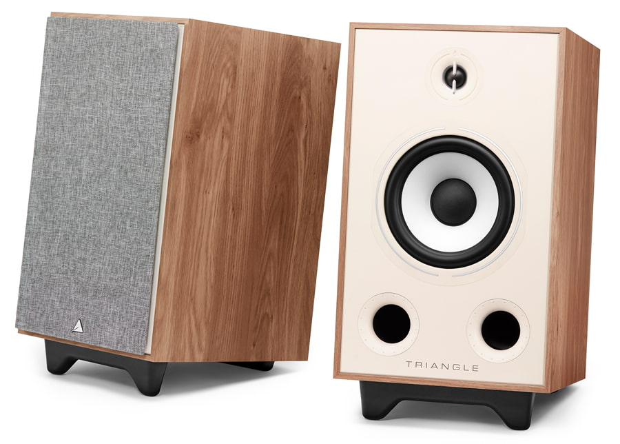
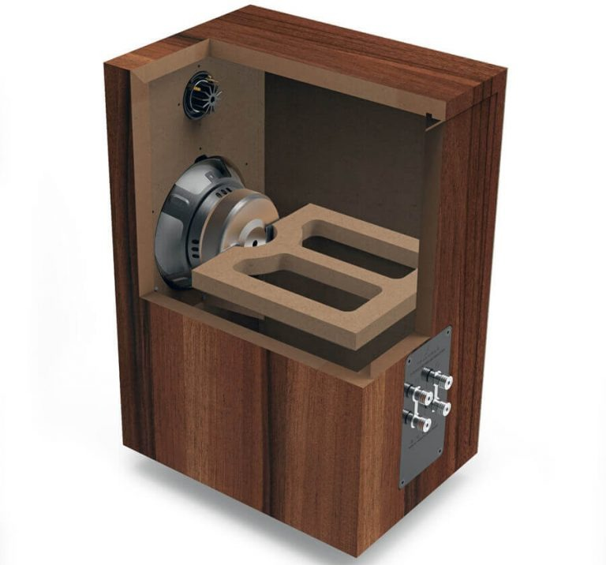
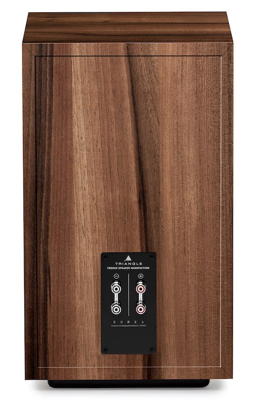
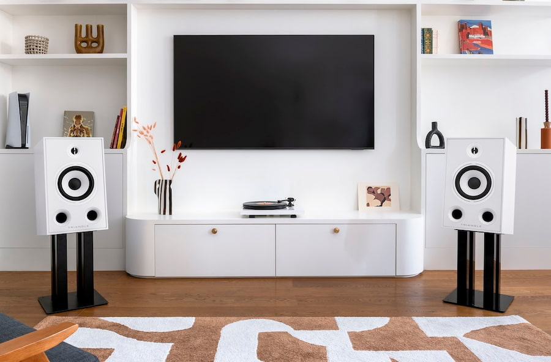

Un transductor de medios y graves de **21 cm** es la principal novedad de los **Triangle Borea BR05**, unos altavoces pasivos de dos vías que amplían la familia Borea con un formato de mayor tamaño y estética retro. La ficha oficial confirma el tweeter EFS de 25 mm y dos puertos bass-reflex frontales. La incorporación, recogida por [eCoustics el 19 de octubre](https://www.ecoustics.com/products/triangle-borea-br05-bookshelf-speakers/), mantiene una distinción importante para quien prepara un equipo: necesitan amplificación externa.

## Borea BR05: un transductor mayor, no una caja más pequeña

Triangle ha desarrollado para este modelo un transductor con cono de pulpa de celulosa natural, encargado tanto de los graves como de los medios. Lo acompaña un tweeter EFS de cúpula de seda con corrector de fase, mientras el filtro divide el trabajo entre ambos a **1.700 Hz**.

La comparación con los [Borea BR04 de la propia marca](https://www.trianglehifi.com/products/borea-br04) ayuda a situar el cambio: aquellos utilizan un transductor de 16 cm y declaran una respuesta desde 44 Hz; los BR05 anuncian **42 Hz–22 kHz, con una tolerancia de ±3 dB**. Es una diferencia de ficha técnica, no una demostración de que los nuevos altavoces suenen mejor en cualquier habitación.

También crece el recinto. Cada BR05 mide **300 × 490 × 345 mm**, sin la base, y pesa **14,6 kg**. El BR04 se queda en 220 × 425 × 314 mm y 8,6 kg por unidad. Por tanto, la denominación de altavoz de estantería no debe confundirse con un producto pequeño para cualquier mueble: conviene medir el espacio y comprobar la carga que admite el soporte.

## Dos puertos frontales y refuerzos contra las vibraciones

Los BR05 emplean paneles de MDF de hasta 21 mm, dos refuerzos internos adicionales y la arquitectura DVAS de Triangle. Según el fabricante, esta estructura busca disipar la energía mecánica y limitar las vibraciones que llegan al recinto.

Los dos puertos bass-reflex están en la parte delantera. Triangle explica que repartir el flujo de aire entre ambos permite reducir turbulencias y ruido a niveles elevados. Es el objetivo del diseño, no un resultado medido en esta noticia: no hemos realizado una prueba de escucha ni comprobado su distorsión. Tampoco basta la orientación de los puertos para garantizar unos graves equilibrados en cualquier ubicación.

## Amplificador externo y cinco acabados

La ficha declara una sensibilidad de **90 dB**, impedancia nominal de **8 ohmios** y mínima de **4,7 ohmios**. Triangle recomienda amplificadores de entre **25 y 130 W RMS por canal a 8 ohmios** y cifra en 120 W la potencia admisible de la caja. Ese último dato no es potencia integrada: los BR05 no incorporan un amplificador.

Es una propuesta distinta de los [PSB iQ2 activos con BluOS](/noticias/psb-iq2-altavoces/), que reúnen amplificación y funciones de reproducción en las propias cajas. Aquí, la elección del amplificador y de la fuente forma parte del presupuesto. El doble juego de bornes permite bicableado o biamplificación en configuraciones compatibles.

Los acabados disponibles son roble claro, fresno negro, castaño, verde y blanco escarchado. Se incluyen rejillas magnéticas y bases; como alternativa, Triangle ofrece los soportes S03, opcionales, con una inclinación de 8 grados hacia el oyente.

## Precio por pareja y disponibilidad por mercado

La [tienda francesa del fabricante](https://www.trianglehifi.fr/products/borea-br05) muestra **749 euros por pareja** al consultar el producto el 20 de octubre. Por su parte, eCoustics recoge precios recomendados de **999 dólares para Estados Unidos y 729 libras para Reino Unido**, también por pareja, no por altavoz. El medio sitúa los soportes S03 en 299 dólares, 225 libras o 249 euros por pareja, como compra separada.

Estas referencias no confirman existencias, precio final ni fecha de entrega en España. Para valorar el conjunto hay que sumar la electrónica y, si se eligen, los soportes. El interés del BR05 está en ofrecer un transductor mayor dentro de la serie sin pasar a una columna; decidir si compensa el espacio y el coste adicionales requiere algo que las especificaciones no resuelven: escuchar el sistema en condiciones comparables.
