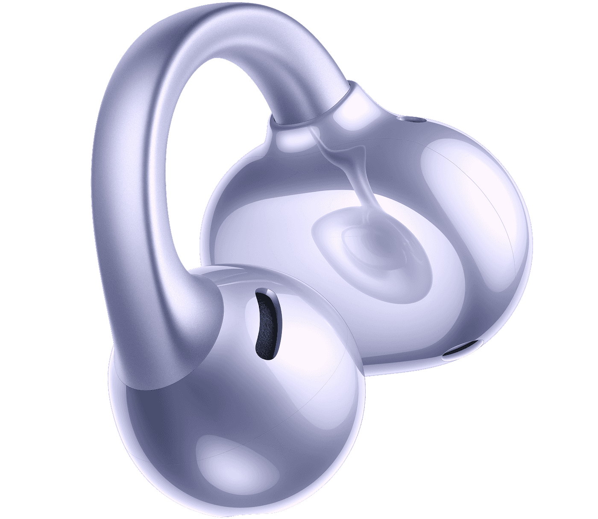

Los **Vivo Buds Clip** amplían su recorrido internacional con una referencia europea de **179 euros**, según [la información publicada por GizmoChina el 2 de noviembre](https://www.gizmochina.com/2026/11/02/vivo-buds-clip-global-launch-europe-price/). Son auriculares abiertos de pinza: se sujetan a la parte exterior de la oreja sin sellar el conducto auditivo. La web española de vivo ya recoge sus características, pero la ficha consultada no permite confirmar un precio oficial ni existencias para España.

Conviene separar la fecha de la noticia de la presentación. GizmoChina sitúa el evento internacional en Tenerife el **27 de octubre**, no hoy, y señala que las ventas europeas comenzaron después. El mismo medio recoge 179,90 euros para Italia. Son referencias comerciales del medio, no una tarifa española que pueda darse por cerrada.

## Vivo Buds Clip: una pinza de 5,2 gramos, no un auricular aislante

La [ficha oficial de vivo en España](https://www.vivo.com/es/products/buds-clip) declara **5,2 gramos por auricular** y un puente flexible Cloud-Fit de aleación de titanio con memoria de forma. La cápsula acústica queda delante y la pieza de equilibrio detrás de la oreja; el puente las mantiene unidas. El diseño simétrico permite utilizar cualquiera de las dos unidades en ambos oídos, con detección automática del lado.

Es la misma elección de formato que encontramos en los [OnePlus Buds Clip de pinza](/noticias/audio/oneplus-buds-clip/), aunque se trata de productos distintos. Frente a un modelo que introduce una almohadilla en el canal, aquí la prioridad es conservar la escucha del entorno. Esa apertura no debe confundirse con aislamiento: la propia vivo describe una mezcla del audio reproducido con el sonido ambiental.

El peso es una especificación; que la pinza resulte cómoda durante horas depende del ajuste en cada oreja. Sin una prueba de uso propia, no podemos convertir la promesa de comodidad del fabricante en una conclusión de análisis.

## Sonido y llamadas: dos funciones que conviene distinguir

Cada unidad incorpora un controlador de **12 mm**. La marca ofrece ecualización de diez bandas, audio espacial y modos equilibrado, de mejora de voz y de prevención de fugas. Este último busca reducir el sonido que oyen quienes están alrededor; no equivale a garantizar una escucha completamente privada.

La cancelación de ruido anunciada se refiere a **las llamadas**. Combina dos micrófonos con un sensor VPU de conducción ósea para captar la voz y reducir interferencias. No debe leerse como una promesa de cancelación activa del ruido exterior mientras se escucha música.

También hay diferencias según el teléfono. Los modos de sonido requieren vEarphones 9.2.40.0 o posterior; para la ecualización, los móviles de otras marcas necesitan la aplicación. El audio espacial tiene requisitos adicionales y, según vivo, los teléfonos que no son de la marca solo admiten el modo estándar mediante vEarphones. Antes de comprar por una función concreta, importa comprobar esa compatibilidad, no solo que el móvil disponga de Bluetooth.

## Hasta 42 horas, contando las recargas del estuche

Vivo anuncia **hasta diez horas por carga** y **42 horas en total con el estuche**. No son 42 horas seguidas con los auriculares puestos. La carga rápida promete hasta tres horas de reproducción tras diez minutos conectados.

Las condiciones oficiales dan contexto a esas cifras: pruebas de laboratorio con música MP3, códec AAC, volumen al 50 % y efectos de sonido desactivados. Son máximos declarados por el fabricante, no resultados medidos por TechSpain24, y el uso real puede variar con el volumen, el software y las funciones activadas.

La conexión admite hasta tres dispositivos de los ecosistemas Android y Apple. La gestión mediante vEarphones requiere Android 13 o iOS 14.0 o posteriores, mientras que determinados móviles vivo compatibles pueden utilizarla directamente. Es una función relevante para alternar ordenador, teléfono y tableta, siempre dentro de esas condiciones.

Por último, la protección **IP55 solo corresponde a los auriculares**, no al estuche, y no es permanente frente al desgaste. La ficha también limita la carga inalámbrica a la versión que incorpora esa capacidad: no conviene presuponer que cualquier variante la ofrece.

El interés de los Buds Clip está en escuchar sin cerrar el oído y gestionar varios equipos. Para quien busque aislamiento, el planteamiento es otro. Y para valorar su relación calidad-precio en España todavía falta contrastar la referencia europea publicada con una oferta local que detalle coste, variante y disponibilidad.
