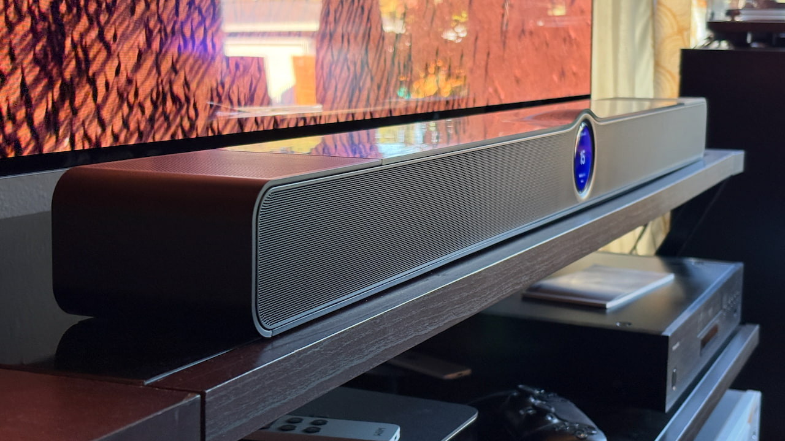
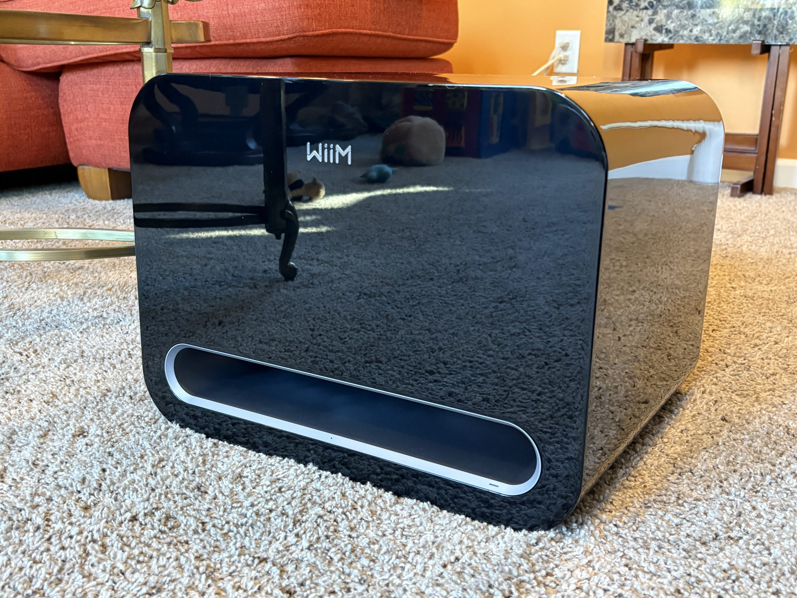
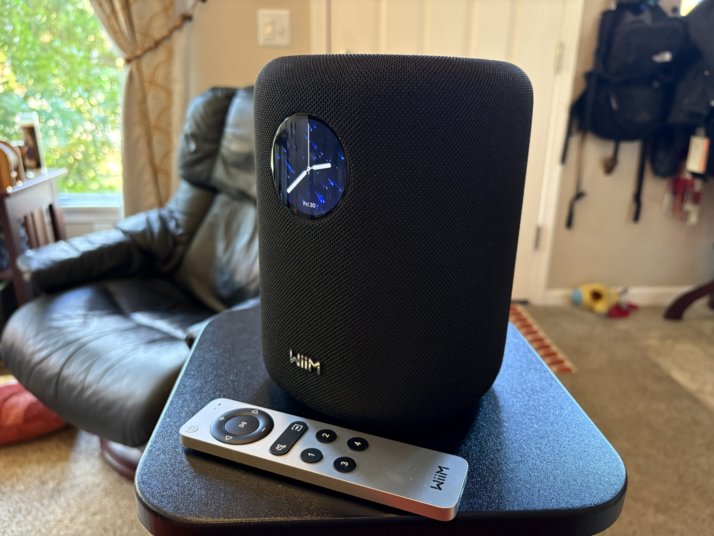

La WiiM Bar cuesta 479 dólares y traslada al salón la fórmula que WiiM ya aplicaba en sus amplificadores de red y altavoces: software propio, conectividad de sobra y un precio por debajo del rival de turno. En este caso, el rival es evidente, porque la comparación con Sonos aparece en la primera línea del análisis que eCoustics ha publicado del modelo. La diferencia de precio frente a la [Sonos Beam Ultra](/noticias/audio/sonos-beam-ultra-analisis/), que Sonos vende por 699 dólares, es de 220 dólares.

El problema es que una barra de sonido con Dolby Atmos se juzga por lo que hace con el cine, y ahí el análisis es claro: la WiiM Bar entrega una escena amplia y un sonido limpio, pero comprime en exceso los momentos más densos. eCoustics lo describe como un sistema con mucho a favor que queda en una posición incómoda por decisiones de diseño y, sobre todo, por un limitador demasiado agresivo.

## Qué ofrece la WiiM Bar: 3.0.2, pantalla y app

El hardware es el de una barra de gama media-alta, no el de un juguete: tres tweeters de 2,05 pulgadas al frente, tres woofers de 4,33 × 2,05 pulgadas, dos altavoces de altura de 2,05 pulgadas en la cara superior y 135 W de amplificación. La configuración resultante es 3.0.2, con cuatro radiadores pasivos que ayudan a sostener los graves sin subwoofer. Las medidas son 106 cm de ancho, 10,4 cm de fondo y 7,9 cm de alto, un formato que pide un mueble profundo y un televisor grande por delante.

El acabado superior en negro brillante y la pantalla táctil de 2,1 pulgadas son las señas de identidad del producto, y también sus dos puntos más discutidos en el análisis: ambos reflejan luz y la pantalla tiende a invadir visualmente la zona inferior del televisor. A cambio, esa pantalla se combina con la app de WiiM y con un mando de aluminio incluido, así que hay varias formas de controlar la barra sin depender del móvil.

La app concentra la puesta en marcha y la calibración RoomFit, y es también donde se nota el carácter de la marca: muchas opciones y una curva de aprendizaje que se alarga a medida que se añaden altavoces. La barra se puede ampliar hasta un sistema 5.1.2 con los modelos WiiM Sound y Sound Lite como canales traseros y el subwoofer Sub Pro.

## Dolby Atmos: altura sí, dinámica no

Los dos altavoces que apuntan al techo cumplen: el análisis les reconoce una extensión vertical razonable para el tamaño de la barra. El problema aparece cuando la banda sonora se complica. Con escenas de mucha carga en el canal de altura, el sistema recorta picos y comprime la dinámica, y ese efecto termina alcanzando también al canal central, donde viven los diálogos. eCoustics lo comprobó con *Our Planet* y con *Mad Max: Fury Road*, dos referencias habituales para medir atmósfera y contundencia.

Es un comportamiento medible, no una impresión: la barra aplana la diferencia entre un susurro y una explosión justo cuando esa diferencia es el efecto. WiiM reconoció el problema a eCoustics y aseguró que trabaja en él; según su explicación, aparece sobre todo a volumen alto, aunque también puede darse en escenas con mucho procesado. Que la marca lo admita es una buena señal de soporte, pero no convierte en virtud lo que hoy es una limitación del producto.

En el resto de formatos el panorama es más amable. La barra admite DTS y DTS:X, además de Dolby Atmos sobre TrueHD, y deja fuera Dolby Atmos Music de forma nativa. En graves se queda en un aprobado justo: el corte en la zona media-baja llega pronto y no iguala la pegada de la Beam Ultra. El perfil tonal, en cambio, es más frío que el de la Sonos y nunca llega a resultar estridente, algo que en escuchas largas se agradece.

## Conectividad y streaming, el argumento más sólido

Aquí la WiiM Bar no tiene mucho que envidiar a nadie. La sección de entradas incluye HDMI eARC, óptica, USB, Ethernet y hasta RCA analógica para equipos antiguos, una combinación poco habitual en esta franja de precio. En inalámbrico hay Bluetooth 5.3 y Wi-Fi, con Spotify, Tidal Connect, Amazon Music, YouTube Music, Deezer y TuneIn entre los servicios compatibles, además de Google Cast, Amazon Music Cast y UPnP.

La ausencia que más se nota es AirPlay, y con ella la de Apple Music: quien tenga el ecosistema de Apple montado en casa tendrá que recurrir al Bluetooth o a otra entrada. Es la única laguna relevante de una sección que eCoustics puntúa con un 4,5 sobre 5, la nota más alta del análisis.

## ¿Merece la pena frente a Sonos?

Las notas de eCoustics dibujan bien el perfil del producto: rendimiento 3 sobre 5, construcción 3,5, funciones 4,5 y relación calidad-precio 3. La conclusión del análisis es matizada. Para series, deportes, informativos y música, la WiiM Bar suena muy bien y su ecosistema de altavoces y subwoofer añade valor por lo que cuesta. Para cine con Dolby Atmos o DTS:X como prioridad, no llega al nivel que se espera de una barra que presume de audio espacial.

La alternativa que propone el análisis es doble. Quien se quede en el universo Sonos tiene la Beam Ultra; quien haya decidido salir de él y no necesite funciones de red puede mirar los Klipsch Flexus Core 200 y 300. En el mercado español hay además otras opciones con Atmos y DTS:X, como la [Teufel CINEBAR PRO 2](/noticias/audio/teufel-barra-sonido-dolby-atmos-dts-x/), aunque en otra liga de precio.

Sobre el desembolso, eCoustics solo publica el precio en Estados Unidos: 479 dólares en Amazon, Best Buy y Crutchfield. El análisis no indica precio en euros ni disponibilidad en España, así que cualquier cifra en euros que circule conviene comprobarla antes de darla por buena.

La lectura final es sencilla: si el televisor se usa sobre todo para contenido diario y la música pesa en la decisión, la WiiM Bar es una compra razonable y muy completa en conectividad. Si el objetivo es exprimir Dolby Atmos, hoy conviene esperar a que WiiM resuelva la compresión o mirar hacia otra barra.
