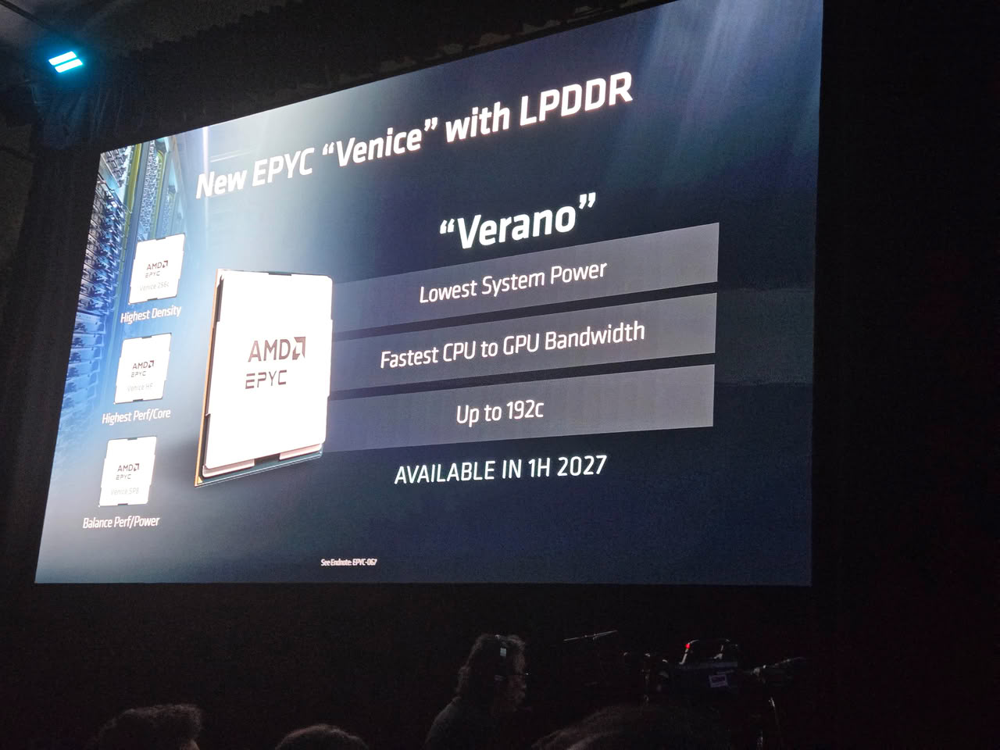

AMD enseñó sus próximos procesadores EPYC «Verano» para servidores durante la keynote de apertura de su consejera delegada, Lisa Su, en el OCP Global Summit 2026. La cifra que decide todo es doble: es el primer EPYC que da soporte a memoria LPDDR5X mediante módulos SOCAMM2, y su recuento de núcleos pasa de los 72 que se manejaban al principio a un máximo de 192. Para quien monta, la noticia no es solo cuántos núcleos entran, sino que cambia de plataforma: Verano se apoya en el nuevo zócalo SP8, no en el SP7 de los EPYC «Venice».

## Los EPYC Verano: 192 núcleos y LPDDR5X por SOCAMM2

«Verano» vive dentro de la familia EPYC 9006 «LP» y se fabrica en el mismo proceso de 2 nm de TSMC que los EPYC «Venice» ya lanzados. La diferencia de enfoque es lo importante: si «Venice» es el primer EPYC sobre arquitectura Zen 6, «Verano» está afinado para cargas de IA en racks de IA agéntica, con una idea de potencia de sistema baja y el ancho de banda entre CPU y GPU como argumento principal. AMD lo empareja con sus propias GPU Instinct MI500 mediante enlaces xGMI de hasta 112 Gbps.

La memoria es el otro salto. Al adoptar LPDDR5X sobre módulos SOCAMM2 reemplazables, AMD sigue el camino que ya abrió la CPU Vera de su rival NVIDIA. En la diapositiva proyectada, la compañía resume el chip con tres promesas —menor consumo de sistema, el mayor ancho de banda CPU-GPU de su catálogo y hasta 192 núcleos— y una fecha: disponibilidad prevista para 2027, con el primer semestre de ese año marcado en la propia presentación.

## Ocho CCD y cuatro controladores de memoria

Los 192 núcleos dejan abierta una pregunta de taller: ¿un solo chip grande o dos de 96? El análisis difundido por System360Cheese en X apunta a que la pieza mostrada llevaba ocho CCD de Zen 6 junto a dos grandes dies de E/S y cuatro controladores de memoria LPDDR5X. El detalle interesante es que esos CCD parecen más pequeños que los Zen 6C de «Venice», lo que sugiere dies estándar de Zen 6 de 12 núcleos en lugar de las variantes compactas de 32. Encajar más núcleos en el mismo zócalo sin engordar el encapsulado es, precisamente, el reto térmico de esta clase de chips.

El anuncio llega después de que AMD desvelara su rack Helion, un sistema diseñado sobre especificación de Open Compute Project donde se espera integrar a Verano.

## Qué implica al montar

Para el que arma, la lección vuelve a ser la de siempre en servidor: manda el zócalo. Un salto al SP8 arrastra placa base, anclaje y disipador, y ninguna de esas piezas hereda compatibilidad del SP7 o el SP8 de «Venice», igual que el posible SB1 que se había apuntado para Verano no se puede dar por confirmado. La memoria SOCAMM2 es una buena noticia de mantenimiento, porque se reemplaza sin soldadura, pero condiciona la placa y el flujo de aire del chasis: en un rack no basta con que el procesador encaje, hay que validar el conjunto.

El destino declarado son los racks de IA, no la torre de escritorio, así que hoy toca leerlo como una hoja de ruta y no como una pieza de compra. Si estás mirando plataforma EPYC para un servidor, quédate con las que ya se venden —como la [ASRock Rack para EPYC 8005 Sorano](/noticias/asrock-rack-sorano-epyc-8005/)— y sigue de cerca [el rastro del socket de Verano](/noticias/componentes/amd-epyc-verano-sb1/) antes de reservar presupuesto para 2027.
