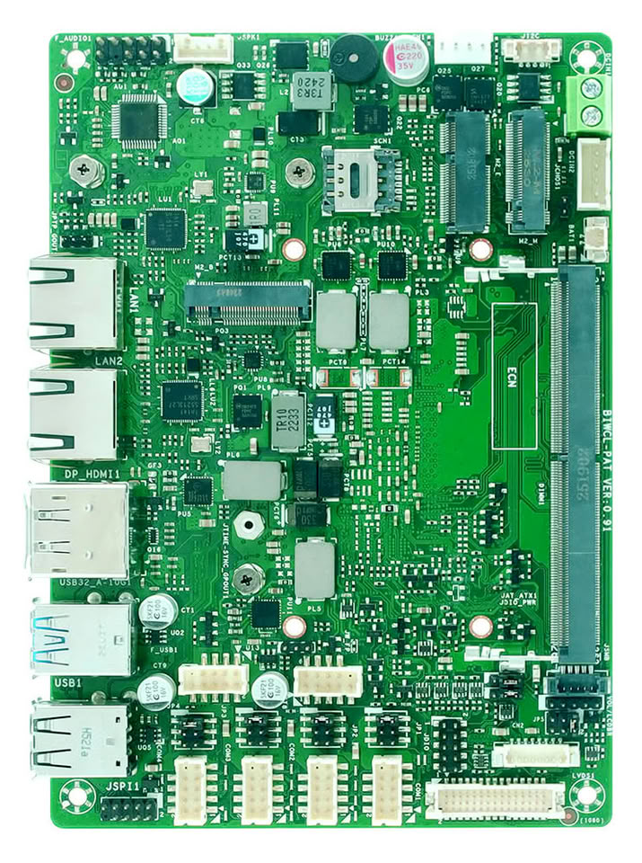
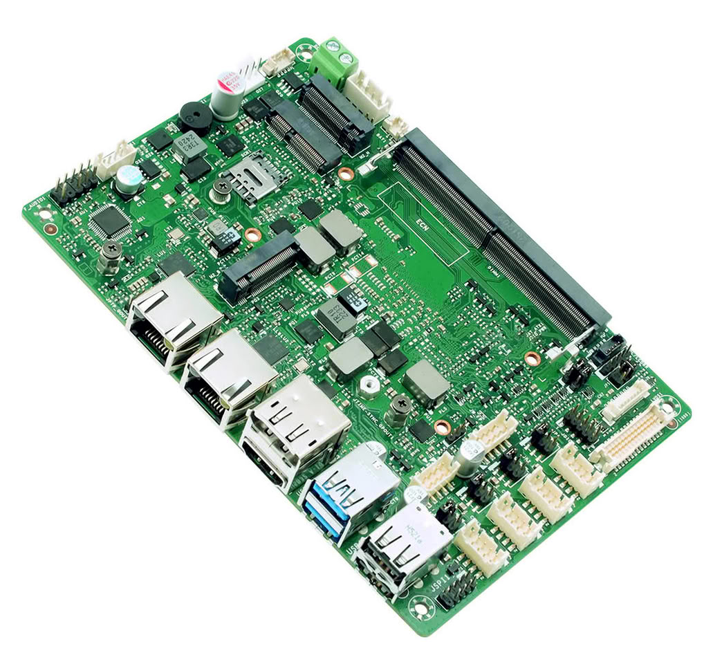
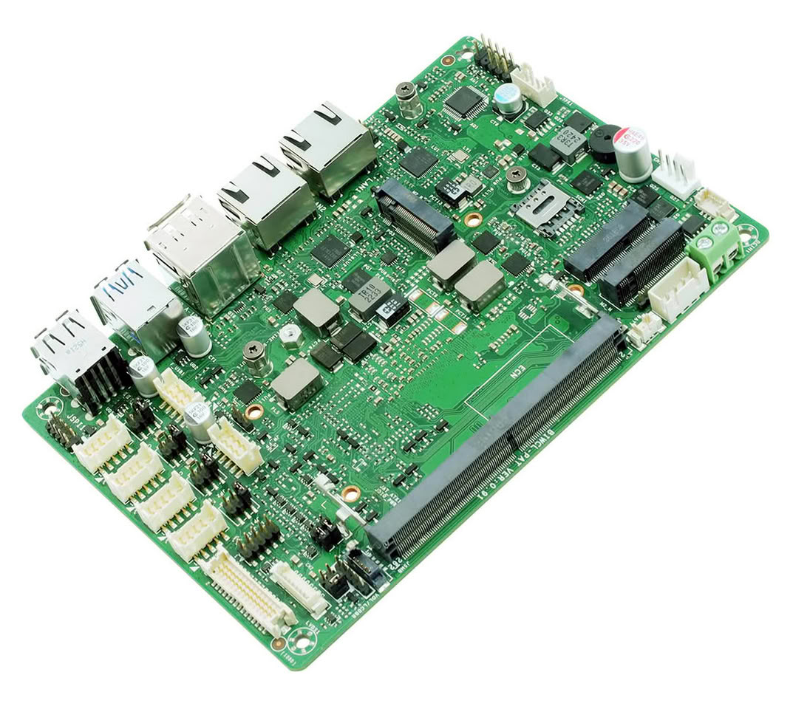

Biostar ha presentado la BIWCL-PAT, una placa industrial de formato reducido (148 × 102 mm) pensada para integrarse en equipos con poco espacio. La noticia la recoge TechPowerUp a partir de un comunicado de la propia Biostar, y conviene leerla con la mentalidad de quien va a montar el sistema y no la de quien solo compara fichas: en este segmento lo que decide no es la estética, sino el tamaño, la disposición de los conectores y el margen térmico.

## La BIWCL-PAT, una placa industrial para integrar

La BIWCL-PAT parte de los procesadores Intel Core Series 3, nombre en clave Wildcat Lake, con opciones que van del Core 3 al Core 7. La memoria se resuelve con una única ranura DDR5-6400 SO-DIMM de hasta 64 GB, el mismo estándar que ya emplean módulos diseñados para el mercado embebido, [como los CUDIMM y CSODIMM de 64 GB que presentó Transcend](/noticias/transcend-ddr5-6400-industrial/). Esa ranura única es una limitación real que conviene tener presente: no hay dual-channel, así que el rendimiento dependerá de cuánto ancho de banda exija la carga.

La alimentación admite un rango de 9 a 24 V DC, lo que permite reutilizar fuentes industriales sin añadir etapas de conversión, y la temperatura de operación declarada va de 0 °C a 60 °C. Son dos datos que pesan más de lo que parece cuando la placa acaba dentro de un armario eléctrico o de una caja sin ventilación forzada.

## Triple pantalla y tres ranuras M.2

La plataforma puede gobernar tres pantallas independientes a través de LVDS, HDMI y DisplayPort. El HDMI 2.1 y el DisplayPort 1.4 alcanzan 4K a 60 Hz cada uno, mientras que el LVDS está pensado para paneles embebidos de hasta 1920 × 1200. Es una combinación habitual en terminales de control, donde interesa separar la interfaz del operador de los datos de estado.

Para el almacenamiento y la conectividad hay tres ranuras M.2 dedicadas: una Key-M para SSD NVMe 2242/2280 sobre PCIe 4.0 x2, una Key-B para módulos 4G/5G 3042/3052 sobre PCIe 4.0 x1 y USB 3.2 —con hueco para una SIM integrada— y una Key-E 2230 para módulos Wi-Fi y Bluetooth.

En red, incorpora dos puertos Intel 2.5GbE con controladores I226-LM e I226-V. Tener dos interfaces separadas permite aislar la red local del equipo de la red ascendente, un detalle que en instalaciones aisladas suele decidir si hace falta añadir un switch.

## Puertos industriales y sistema operativo

Junto a los conectores más modernos, la BIWCL-PAT mantiene los que de verdad se usan en planta: dos USB 3.2 Gen 2, cuatro USB 2.0, dos RS232/422/485, dos RS232 y un cabezal de E/S digital de 8 bits. Con eso se enganchan periféricos como lectores de códigos de barras o controladores industriales sin recurrir a adaptadores.

La placa integra además TPM 2.0 por hardware y declara compatibilidad con Windows 11 IoT Enterprise 24H2 o posterior y con Ubuntu 24.04.

## Qué mirar antes de montarla

Antes de decidirse conviene comprobar tres cosas: que el panel o los monitores elegidos encajen con la salida que se vaya a usar (LVDS y HDMI/DisplayPort no son intercambiables), que la caja deje sitio físico a las tres ranuras M.2 y que la fuente entregue dentro del rango de 9 a 24 V.

Y una advertencia de taller: con una sola ranura SO-DIMM no hay dual-channel, así que en cargas sensibles al ancho de banda —varios contenedores o procesado local de datos para AIoT— dimensionar bien los 64 GB de memoria importa más que en una placa de escritorio.

