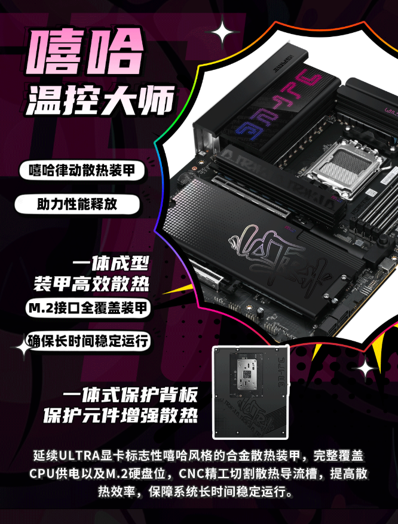

La **Colorful iGame X870E Ultra-S V14 DDR5** reúne cinco conectores M.2 y una alimentación de **16+2+1 fases** para montar un equipo sobre la plataforma AMD AM5. La novedad ahora es comercial: [IT Home informó el 19 de octubre](https://www.ithome.com/1/015/020.htm) de su aparición en JD en China por **1.899 yuanes**. Es una referencia de venta en ese mercado, no un precio anunciado para España.

## Qué ofrece la iGame X870E Ultra-S V14 al montar el equipo

Según la información recogida por IT Home, el VRM utiliza etapas **DrMOS de 80 A**, inductores de ferrita y condensadores sólidos. La placa incorpora cuatro ranuras DDR5 reforzadas y admite perfiles de memoria **XMP y EXPO**, además de overclocking asíncrono. Son características de la configuración anunciada: el número de fases y la intensidad nominal de sus etapas no sustituyen una prueba de temperatura o estabilidad bajo carga.

El material de producto reproducido por el medio muestra disipadores sobre la alimentación y el almacenamiento, junto con una cubierta posterior. Para quien monta el PC, lo relevante no es la iluminación del conjunto, sino poder acceder a los componentes y mantener un flujo de aire adecuado alrededor del socket y los SSD.

## Cinco M.2, desmontaje rápido y diagnóstico

Los **cinco conectores M.2** son uno de sus principales reclamos para equipos con varias unidades de almacenamiento. Esa cantidad no significa que todos tengan la misma interfaz ni que los cinco sean PCIe 5.0. Antes de planificar una configuración completa conviene consultar el manual y el reparto de líneas entre almacenamiento y expansión, en lugar de deducirlo únicamente del chipset X870E.

IT Home también describe un mecanismo de liberación rápida de la tarjeta gráfica, una pantalla numérica de diagnóstico y luces **EZ Debug**. El material ilustrativo muestra asimismo botones traseros para actualizar la BIOS y borrar la configuración CMOS. Son recursos útiles para localizar problemas de arranque o intervenir en un montaje sin depender exclusivamente de lo que aparezca en pantalla.

La propuesta se suma a otras placas AM5 que priorizan alimentación y almacenamiento, como la [Gigabyte B850 AORUS ELITE X3D con cuatro ranuras M.2](/noticias/gigabyte-b850-aorus-elite-x3d/). Al comparar opciones, importa tanto el número de conectores como sus condiciones de uso.

La documentación reproducida incluye además un modo **X3D AI** que, según IT Home, ajusta automáticamente parámetros de PBO. No se aportan aquí mediciones independientes que permitan convertir ese reclamo en una mejora garantizada de fotogramas por segundo.

## Precio chino y límites de la información disponible

[TechPowerUp también recogió el lanzamiento el 19 de octubre](https://www.techpowerup.com/353899/colorful-igame-x870e-ultra-s-v14-gaming-and-oc-motherboard-launches-for-usd-284), citando a IT Home y el mismo enlace de JD. Sirve como contraste de la cobertura, pero no constituye una confirmación independiente del precio: ambos textos remiten a la misma referencia comercial.

En esta comprobación no se ha podido consultar una ficha oficial completa de Colorful para este modelo, y el enlace de JD no ha expuesto una ficha de compra legible. Por tanto, los **1.899 yuanes** y las especificaciones descritas se atribuyen al reporte de IT Home y a las imágenes de producto que reproduce, no a una verificación directa del catálogo del fabricante. Todas las imágenes de esta pieza proceden de ese artículo.

Las fuentes consultadas no permiten confirmar disponibilidad en España ni una fecha de distribución internacional. Para una compra local, falta conocer el canal de venta, la garantía y el precio final; para preparar el montaje, también conviene esperar al manual y comprobar dimensiones, compatibilidad de memoria y reparto de conexiones antes de elegir el resto de piezas.
