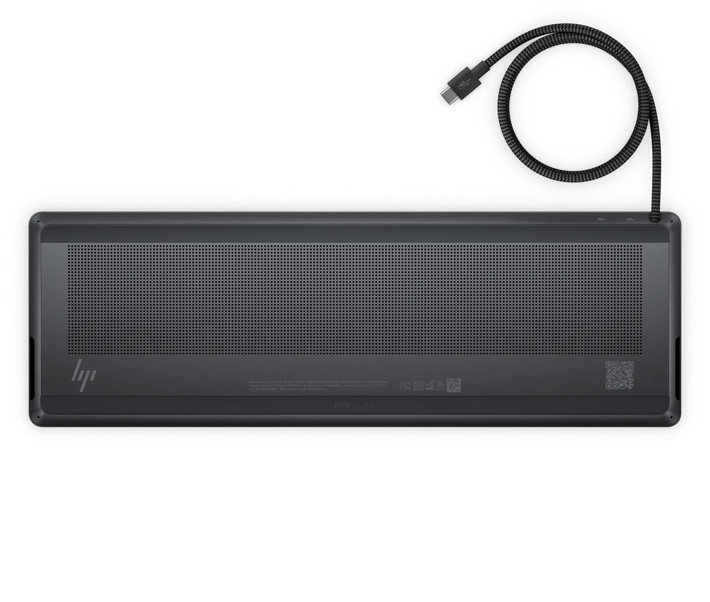
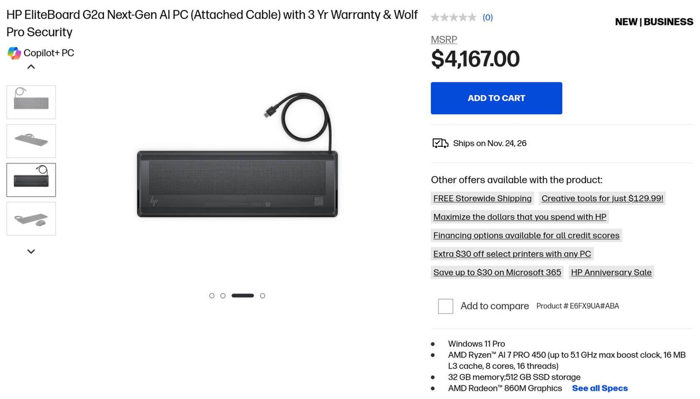

HP enseñó el EliteBoard G2a en el CES 2026 con la promesa de «potencia de IA local de nueva generación en un formato del tamaño de un teclado». Diez meses después, la compañía ha puesto a la venta el equipo y, de paso, ha desvelado el precio y buena parte de las especificaciones que hasta ahora se mantenían bajo llave.

## Un PC completo bajo las teclas del EliteBoard G2a

El EliteBoard G2a no es un teclado con extras: es un mini PC entero montado dentro del chasis del teclado. La parte que decide el conjunto es la APU de AMD, y aquí hay dos versiones. La tope lleva el Ryzen AI 7 Pro 450 y la de entrada el Ryzen AI 5 Pro 435. Ambos integran una NPU que, según HP, entrega 50 TOPS. La diferencia real entre las dos está en la CPU y, sobre todo, en la gráfica: el Ryzen AI 7 Pro 450 sube a ocho núcleos y monta una Radeon 860M con ocho unidades de cómputo, mientras que el Ryzen AI 5 Pro 435 se queda en la Radeon 840M con cuatro.

En precios, el modelo de entrada —Ryzen AI 5 Pro, 16 GB de DDR5-5600 y un SSD PCIe Gen 5 de 512 GB— arranca en 3.028 dólares. La versión con Ryzen AI 7 Pro 450, 32 GB de memoria y el mismo SSD de 512 GB sube a 4.167 dólares.

## Pocos puertos y una sorpresa al abrirlo

En lo físico, el equipo se alimenta por USB Power Delivery y consume hasta 65 W por ese puerto. La conectividad es mínima para un PC de escritorio: un único USB4 y un USB Type-C de 10 Gbps. Trae dos altavoces integrados y se vende con el ratón inalámbrico HP 675M en la caja.

El teclado en sí es de membrana, no mecánico, con una distribución que parece seguir el formato 1800 y retroiluminación blanca. Para quien vaya a abrirlo, hay una buena noticia: la memoria es SODIMM, así que se puede ampliar sin pasar por caja de HP.

## El «PC dentro del teclado», un nicho caro

Meter la placa dentro del teclado no es ninguna novedad: los equipos domésticos de los ochenta ya seguían ese esquema y el Raspberry Pi 400 lo recuperó hace unos años. El atractivo es el de siempre: menos cachivaches sobre la mesa y un solo cable. Pero sigue siendo un formato de nicho.

El problema es el precio. Con 3.028 y 4.167 dólares, el EliteBoard G2a se coloca por encima de muchos portátiles y mini PC de prestaciones comparables, y eso que renuncia a la pantalla. El fabricante lo enmarca como equipo «Copilot+ PC» de gama empresarial, no como un producto de consumo masivo. No es el único formato compacto con precio de gama alta: el [Framework Desktop con Ryzen AI Max+ Pro 495](/noticias/componentes/framework-desktop-ryzen-ai-max-pro-495/) también agotó su primer lote a partir de 6.799 dólares.

## Qué mirar antes de comprar

Visto el precio, este no es un equipo para quien monta buscando el coste por vatio más bajo. Si aun así interesa el formato, el punto a favor está en la memoria SODIMM: comprar la configuración básica y ampliar la RAM por tu cuenta suele salir más barato que pagar el salto a los 32 GB de HP. El punto en contra es la conectividad: un único USB4 y un USB-C de 10 Gbps obligan a tirar de un hub para conectar pantalla, periféricos y almacenamiento externo, así que conviene presupuestar ese accesorio antes de dar el paso.

