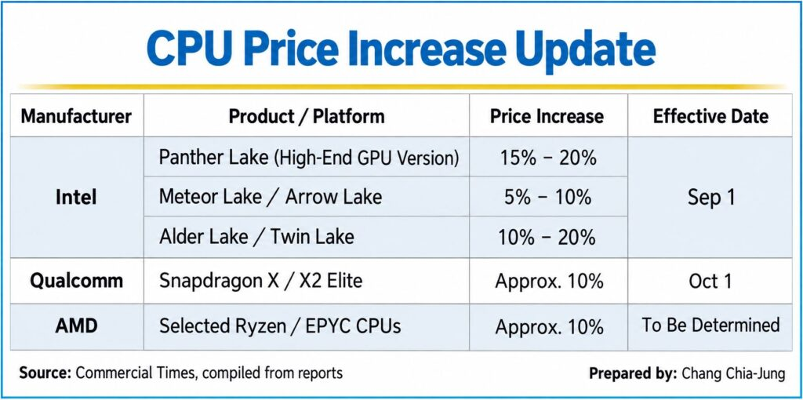

La subida de precios de los procesadores ha dejado de ser un aviso y ya es un hecho, al menos en dos de las tres grandes. Intel y Qualcomm han aplicado incrementos en varias de sus familias de CPU, y AMD sería la siguiente en la lista con un movimiento del **10 %**. El detalle que más importa a quien está planificando un montaje es la fecha: el aumento de Intel que se esperaba para **octubre ya se ejecutó en septiembre**, según la información recogida por el medio taiwanés **Commercial Times** a partir de fuentes de la cadena de suministro.

Conviene separar lo confirmado de lo que sigue en el aire. Los incrementos de Intel y Qualcomm están sobre la mesa con cifras concretas; el de AMD, en cambio, todavía es un plan sin fecha.

## Una subida que ya se aplicó en septiembre

El encarecimiento de Intel no llegó en el trimestre en que se le esperaba. La filtración previa apuntaba a un alza de hasta el **10 %** para octubre, pero el informe de la cadena de suministro sostiene que **ya se ha producido en septiembre** y que afecta a varias gamas de procesadores.

La familia más castigada es **Panther Lake**, la propuesta de alto rendimiento de la compañía, que se habría encarecido entre un **15 % y un 20 %**. Eso sí, no todos sus modelos entran en el ajuste: según el mismo informe, el precio sube sobre todo en las variantes con la **gráfica integrada más potente**, mientras que el resto quedaría fuera del grueso del incremento.

Las gamas más veteranas también se ven tocadas. Para **Alder Lake** y **Twin Lake**, el informe maneja rangos que van del **10 % al 20 %** en unas variantes y del **5 % al 10 %** en los chips de bajo consumo de entrada. Es decir, la horquilla no es uniforme: depende del modelo y de su encuadre en el catálogo.

## Qualcomm sube sus plataformas para PC desde el 1 de octubre

Qualcomm no se ha quedado atrás. La compañía habría aplicado un incremento de aproximadamente el **10 %** en sus plataformas de procesador para PC, lo que incluye las familias **Snapdragon X** y **X2 Elite**. Aquí la fecha sí es precisa: el ajuste entró en vigor el **1 de octubre**.

El movimiento encaja con el empuje que está viviendo el segmento de los PC con arquitectura ARM, donde estas plataformas compiten directamente con las propuestas x86 de Intel y AMD.

## AMD, el posible tercer movimiento

El tercer fabricante aún no ha movido ficha, pero los informes lo sitúan en la rampa de salida. AMD estaría preparando un encarecimiento de alrededor del **10 %** que tocaría algunas familias de **Ryzen** y de **EPYC**, su línea para servidores.

Lo que falta es justo lo que más condiciona una decisión de compra: **la fecha**. No está claro cuándo entraría en vigor el nuevo precio de AMD. Dado que Intel y Qualcomm ya lo han aplicado y que la demanda sigue alta, la previsión que manejan los medios consultados es que el anuncio se produzca pronto, sin descartar que se retrase.

## TSMC está en la raíz del encarecimiento

Detrás de las tres subidas está el mismo proveedor: **TSMC**, la fundición taiwanesa que fabrica los chips de Intel, Qualcomm y AMD. Según la **Central News Agency** (CNA), la compañía aumentaría de nuevo sus precios de fabricación en **2027**, y los analistas del sector anticipan subidas del **5 % al 10 %** en los nodos avanzados, del **10 % al 15 %** en el empaquetado avanzado y del **3 % al 5 %** en los nodos maduros.

A ese encarecimiento de la fabricación se suma la escalada del coste de la **memoria de alto rendimiento** y del almacenamiento, que añade presión sobre el precio final. Es la misma dinámica que atraviesa el resto del hardware: no es que un fabricante decida subir por gusto, es que la cadena entera está más cara por debajo.

## Qué cambia si vas a montar o comprar

Para quien está armando un equipo, la lectura práctica es que **los precios de referencia ya se están moviendo** y no conviene seguir esperando a que bajen. Con incrementos de dos dígitos, el efecto se nota más en las piezas caras: un mismo porcentaje pesa mucho más sobre un procesador de gama alta que sobre uno de entrada.

Lo sensato, si tienes decidida una configuración, es **cerrar el precio cuanto antes** y vigilar las ofertas puntuales en lugar de aguardar bajadas que no llegan. Y si el montaje puede esperar, conviene revisar qué modelos concretos entran en el ajuste: como la subida no es uniforme, puede que la pieza que tienes en mente se libre o que el sobrecoste la saque del presupuesto. Antes de comprar, compara el precio de la CPU objetivo con el que tenía hace unas semanas: ahí se ve de un vistazo si le ha tocado la subida.
